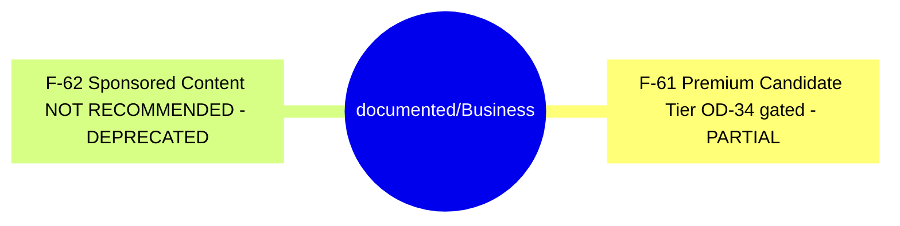

# documented/Business (MOD-248)

Generated by `project-mindmap/tools/catalog.py` from `master/MASTER_PROJECT_GRAPH.json` at commit `9b3032f`. Do not edit by hand. Back to the [feature catalog](../FEATURE_CATALOG.md).

**Application:** Documented scope (registry features) (APP-001). **Purpose:** Registry features in category 'Business'.

**Nodes by level:** MODULE 1, MAJOR 2. **Status:** DEPRECATED 1, PARTIALLY_IMPLEMENTED 1, UNKNOWN 1. **Verification:** UNKNOWN 1.

## Module map (to minor features)

## F-61 Premium Candidate Tier (OD-34 gated)

Premium Candidate Tier (OD-34 gated)

| ID   | Level | Parent  | Name                                 | Description | Status                | Verification | Evidence                               | Related |
| ---- | ----- | ------- | ------------------------------------ | ----------- | --------------------- | ------------ | -------------------------------------- | ------- |
| F-61 | MAJOR | MOD-248 | Premium Candidate Tier (OD-34 gated) |             | PARTIALLY_IMPLEMENTED |              | docs/registries/FEATURE_REGISTRY.md:77 |         |

## F-62 Sponsored Content (NOT RECOMMENDED)

Sponsored Content (NOT RECOMMENDED)

| ID   | Level | Parent  | Name                                | Description | Status     | Verification | Evidence                               | Related |
| ---- | ----- | ------- | ----------------------------------- | ----------- | ---------- | ------------ | -------------------------------------- | ------- |
| F-62 | MAJOR | MOD-248 | Sponsored Content (NOT RECOMMENDED) |             | DEPRECATED |              | docs/registries/FEATURE_REGISTRY.md:78 |         |
