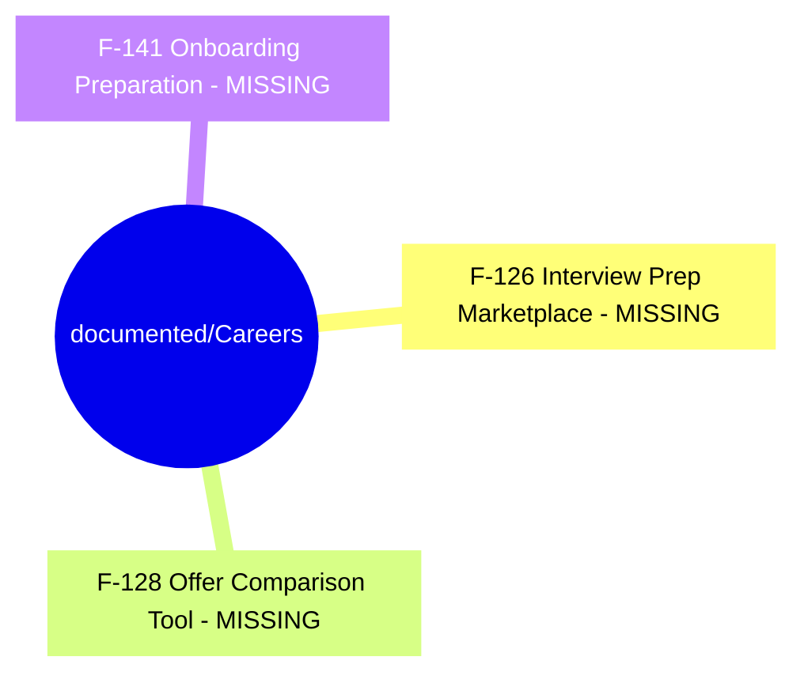

# documented/Careers (MOD-228)

Generated by `project-mindmap/tools/catalog.py` from `master/MASTER_PROJECT_GRAPH.json` at commit `9b3032f`. Do not edit by hand. Back to the [feature catalog](../FEATURE_CATALOG.md).

**Application:** Documented scope (registry features) (APP-001). **Purpose:** Registry features in category 'Careers'.

**Nodes by level:** MODULE 1, MAJOR 3. **Status:** NOT_IMPLEMENTED 3, UNKNOWN 1. **Verification:** UNKNOWN 1.

## Module map (to minor features)

## F-126 Interview Prep Marketplace

Interview Prep Marketplace

| ID    | Level | Parent  | Name                       | Description | Status          | Verification | Evidence                                | Related |
| ----- | ----- | ------- | -------------------------- | ----------- | --------------- | ------------ | --------------------------------------- | ------- |
| F-126 | MAJOR | MOD-228 | Interview Prep Marketplace |             | NOT_IMPLEMENTED |              | docs/registries/FEATURE_REGISTRY.md:147 |         |

## F-128 Offer Comparison Tool

Offer Comparison Tool

| ID    | Level | Parent  | Name                  | Description | Status          | Verification | Evidence                                | Related |
| ----- | ----- | ------- | --------------------- | ----------- | --------------- | ------------ | --------------------------------------- | ------- |
| F-128 | MAJOR | MOD-228 | Offer Comparison Tool |             | NOT_IMPLEMENTED |              | docs/registries/FEATURE_REGISTRY.md:149 |         |

## F-141 Onboarding Preparation

Onboarding Preparation

| ID    | Level | Parent  | Name                   | Description | Status          | Verification | Evidence                                | Related |
| ----- | ----- | ------- | ---------------------- | ----------- | --------------- | ------------ | --------------------------------------- | ------- |
| F-141 | MAJOR | MOD-228 | Onboarding Preparation |             | NOT_IMPLEMENTED |              | docs/registries/FEATURE_REGISTRY.md:162 |         |
