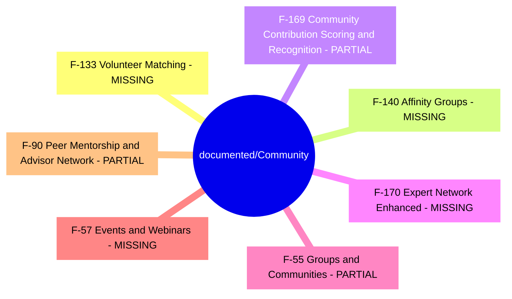

# documented/Community (MOD-230)

Generated by `project-mindmap/tools/catalog.py` from `master/MASTER_PROJECT_GRAPH.json` at commit `9b3032f`. Do not edit by hand. Back to the [feature catalog](../FEATURE_CATALOG.md).

**Application:** Documented scope (registry features) (APP-001). **Purpose:** Registry features in category 'Community'.

**Nodes by level:** MODULE 1, MAJOR 7. **Status:** NOT_IMPLEMENTED 4, PARTIALLY_IMPLEMENTED 3, UNKNOWN 1. **Verification:** UNKNOWN 1.

## Module map (to minor features)

## F-133 Volunteer Matching

Volunteer Matching

| ID    | Level | Parent  | Name               | Description | Status          | Verification | Evidence                                | Related |
| ----- | ----- | ------- | ------------------ | ----------- | --------------- | ------------ | --------------------------------------- | ------- |
| F-133 | MAJOR | MOD-230 | Volunteer Matching |             | NOT_IMPLEMENTED |              | docs/registries/FEATURE_REGISTRY.md:154 |         |

## F-140 Affinity Groups

Affinity Groups

| ID    | Level | Parent  | Name            | Description | Status          | Verification | Evidence                                | Related |
| ----- | ----- | ------- | --------------- | ----------- | --------------- | ------------ | --------------------------------------- | ------- |
| F-140 | MAJOR | MOD-230 | Affinity Groups |             | NOT_IMPLEMENTED |              | docs/registries/FEATURE_REGISTRY.md:161 |         |

## F-169 Community Contribution Scoring & Recognition

Community Contribution Scoring & Recognition

| ID    | Level | Parent  | Name                                         | Description | Status                | Verification | Evidence                                | Related |
| ----- | ----- | ------- | -------------------------------------------- | ----------- | --------------------- | ------------ | --------------------------------------- | ------- |
| F-169 | MAJOR | MOD-230 | Community Contribution Scoring & Recognition |             | PARTIALLY_IMPLEMENTED |              | docs/registries/FEATURE_REGISTRY.md:195 |         |

## F-170 Expert Network (Enhanced)

Expert Network (Enhanced)

| ID    | Level | Parent  | Name                      | Description | Status          | Verification | Evidence                                | Related |
| ----- | ----- | ------- | ------------------------- | ----------- | --------------- | ------------ | --------------------------------------- | ------- |
| F-170 | MAJOR | MOD-230 | Expert Network (Enhanced) |             | NOT_IMPLEMENTED |              | docs/registries/FEATURE_REGISTRY.md:196 |         |

## F-55 Groups & Communities

Groups & Communities

| ID   | Level | Parent  | Name                 | Description | Status                | Verification | Evidence                               | Related |
| ---- | ----- | ------- | -------------------- | ----------- | --------------------- | ------------ | -------------------------------------- | ------- |
| F-55 | MAJOR | MOD-230 | Groups & Communities |             | PARTIALLY_IMPLEMENTED |              | docs/registries/FEATURE_REGISTRY.md:71 |         |

## F-57 Events & Webinars

Events & Webinars

| ID   | Level | Parent  | Name              | Description | Status          | Verification | Evidence                               | Related |
| ---- | ----- | ------- | ----------------- | ----------- | --------------- | ------------ | -------------------------------------- | ------- |
| F-57 | MAJOR | MOD-230 | Events & Webinars |             | NOT_IMPLEMENTED |              | docs/registries/FEATURE_REGISTRY.md:73 |         |

## F-90 Peer Mentorship & Advisor Network

Peer Mentorship & Advisor Network

| ID   | Level | Parent  | Name                              | Description | Status                | Verification | Evidence                                | Related |
| ---- | ----- | ------- | --------------------------------- | ----------- | --------------------- | ------------ | --------------------------------------- | ------- |
| F-90 | MAJOR | MOD-230 | Peer Mentorship & Advisor Network |             | PARTIALLY_IMPLEMENTED |              | docs/registries/FEATURE_REGISTRY.md:106 |         |
