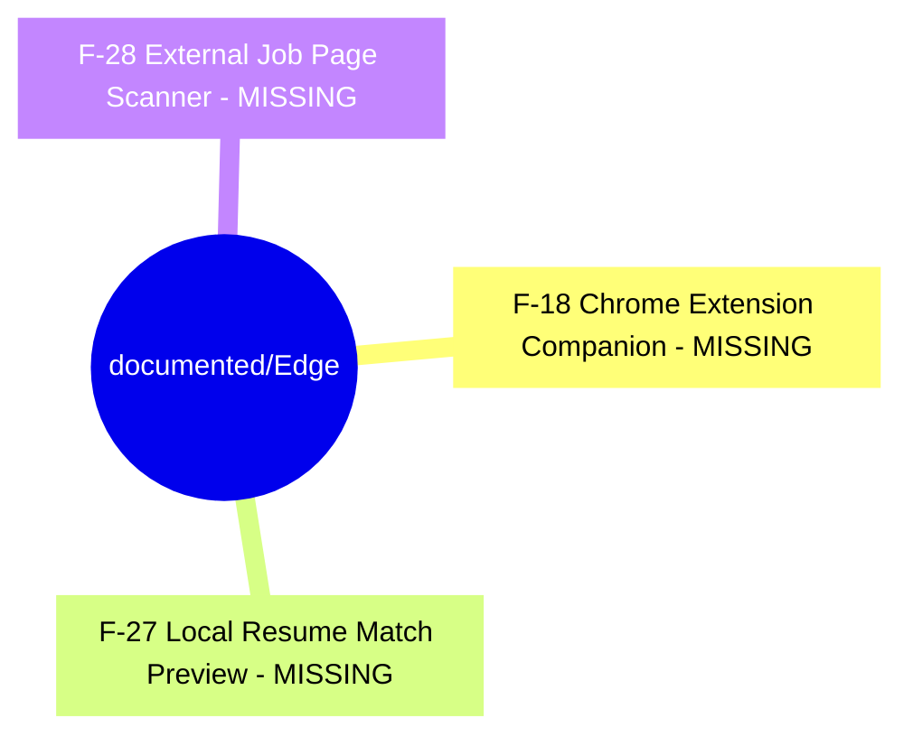

# documented/Edge (MOD-241)

Generated by `project-mindmap/tools/catalog.py` from `master/MASTER_PROJECT_GRAPH.json` at commit `9b3032f`. Do not edit by hand. Back to the [feature catalog](../FEATURE_CATALOG.md).

**Application:** Documented scope (registry features) (APP-001). **Purpose:** Registry features in category 'Edge'.

**Nodes by level:** MODULE 1, MAJOR 3. **Status:** NOT_IMPLEMENTED 3, UNKNOWN 1. **Verification:** UNKNOWN 1.

## Module map (to minor features)

## F-18 Chrome Extension Companion

Chrome Extension Companion

| ID   | Level | Parent  | Name                       | Description | Status          | Verification | Evidence                               | Related |
| ---- | ----- | ------- | -------------------------- | ----------- | --------------- | ------------ | -------------------------------------- | ------- |
| F-18 | MAJOR | MOD-241 | Chrome Extension Companion |             | NOT_IMPLEMENTED |              | docs/registries/FEATURE_REGISTRY.md:34 |         |

## F-27 Local Resume Match Preview

Local Resume Match Preview

| ID   | Level | Parent  | Name                       | Description | Status          | Verification | Evidence                               | Related |
| ---- | ----- | ------- | -------------------------- | ----------- | --------------- | ------------ | -------------------------------------- | ------- |
| F-27 | MAJOR | MOD-241 | Local Resume Match Preview |             | NOT_IMPLEMENTED |              | docs/registries/FEATURE_REGISTRY.md:43 |         |

## F-28 External Job Page Scanner

External Job Page Scanner

| ID   | Level | Parent  | Name                      | Description | Status          | Verification | Evidence                               | Related |
| ---- | ----- | ------- | ------------------------- | ----------- | --------------- | ------------ | -------------------------------------- | ------- |
| F-28 | MAJOR | MOD-241 | External Job Page Scanner |             | NOT_IMPLEMENTED |              | docs/registries/FEATURE_REGISTRY.md:44 |         |
