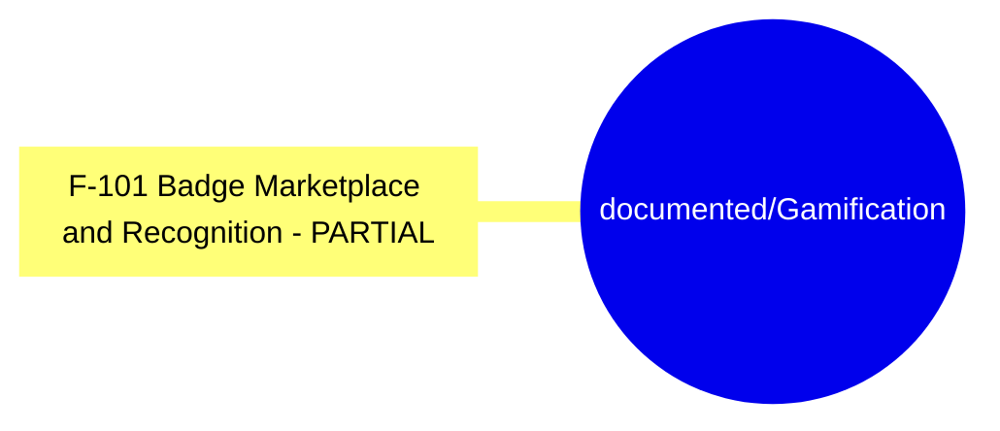

# documented/Gamification (MOD-217)

Generated by `project-mindmap/tools/catalog.py` from `master/MASTER_PROJECT_GRAPH.json` at commit `9b3032f`. Do not edit by hand. Back to the [feature catalog](../FEATURE_CATALOG.md).

**Application:** Documented scope (registry features) (APP-001). **Purpose:** Registry features in category 'Gamification'.

**Nodes by level:** MODULE 1, MAJOR 1. **Status:** PARTIALLY_IMPLEMENTED 1, UNKNOWN 1. **Verification:** UNKNOWN 1.

## Module map (to minor features)

## F-101 Badge Marketplace & Recognition

Badge Marketplace & Recognition

| ID    | Level | Parent  | Name                            | Description | Status                | Verification | Evidence                                | Related |
| ----- | ----- | ------- | ------------------------------- | ----------- | --------------------- | ------------ | --------------------------------------- | ------- |
| F-101 | MAJOR | MOD-217 | Badge Marketplace & Recognition |             | PARTIALLY_IMPLEMENTED |              | docs/registries/FEATURE_REGISTRY.md:117 |         |
