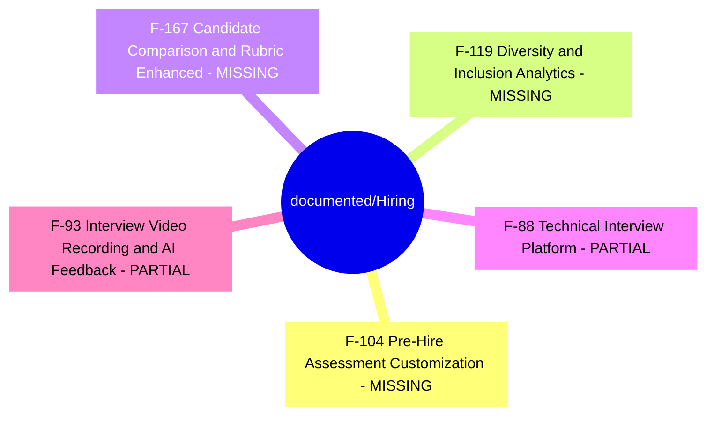

# documented/Hiring (MOD-218)

Generated by `project-mindmap/tools/catalog.py` from `master/MASTER_PROJECT_GRAPH.json` at commit `9b3032f`. Do not edit by hand. Back to the [feature catalog](../FEATURE_CATALOG.md).

**Application:** Documented scope (registry features) (APP-001). **Purpose:** Registry features in category 'Hiring'.

**Nodes by level:** MODULE 1, MAJOR 5. **Status:** NOT_IMPLEMENTED 3, PARTIALLY_IMPLEMENTED 2, UNKNOWN 1. **Verification:** UNKNOWN 1.

## Module map (to minor features)

## F-104 Pre-Hire Assessment Customization

Pre-Hire Assessment Customization

| ID    | Level | Parent  | Name                              | Description | Status          | Verification | Evidence                                | Related |
| ----- | ----- | ------- | --------------------------------- | ----------- | --------------- | ------------ | --------------------------------------- | ------- |
| F-104 | MAJOR | MOD-218 | Pre-Hire Assessment Customization |             | NOT_IMPLEMENTED |              | docs/registries/FEATURE_REGISTRY.md:120 |         |

## F-119 Diversity & Inclusion Analytics

Diversity & Inclusion Analytics

| ID    | Level | Parent  | Name                            | Description | Status          | Verification | Evidence                                | Related |
| ----- | ----- | ------- | ------------------------------- | ----------- | --------------- | ------------ | --------------------------------------- | ------- |
| F-119 | MAJOR | MOD-218 | Diversity & Inclusion Analytics |             | NOT_IMPLEMENTED |              | docs/registries/FEATURE_REGISTRY.md:135 |         |

## F-167 Candidate Comparison & Rubric (Enhanced)

Candidate Comparison & Rubric (Enhanced)

| ID    | Level | Parent  | Name                                     | Description | Status          | Verification | Evidence                                | Related |
| ----- | ----- | ------- | ---------------------------------------- | ----------- | --------------- | ------------ | --------------------------------------- | ------- |
| F-167 | MAJOR | MOD-218 | Candidate Comparison & Rubric (Enhanced) |             | NOT_IMPLEMENTED |              | docs/registries/FEATURE_REGISTRY.md:193 |         |

## F-88 Technical Interview Platform

Technical Interview Platform

| ID   | Level | Parent  | Name                         | Description | Status                | Verification | Evidence                                | Related |
| ---- | ----- | ------- | ---------------------------- | ----------- | --------------------- | ------------ | --------------------------------------- | ------- |
| F-88 | MAJOR | MOD-218 | Technical Interview Platform |             | PARTIALLY_IMPLEMENTED |              | docs/registries/FEATURE_REGISTRY.md:104 |         |

## F-93 Interview Video Recording & AI Feedback

Interview Video Recording & AI Feedback

| ID   | Level | Parent  | Name                                    | Description | Status                | Verification | Evidence                                | Related |
| ---- | ----- | ------- | --------------------------------------- | ----------- | --------------------- | ------------ | --------------------------------------- | ------- |
| F-93 | MAJOR | MOD-218 | Interview Video Recording & AI Feedback |             | PARTIALLY_IMPLEMENTED |              | docs/registries/FEATURE_REGISTRY.md:109 |         |
