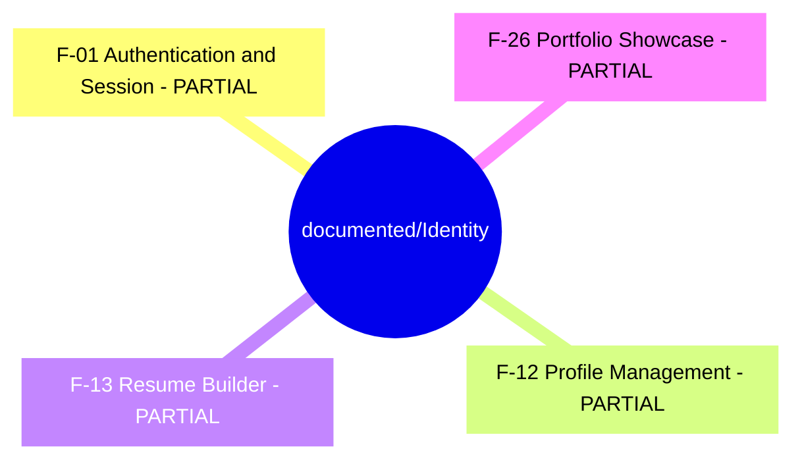

# documented/Identity (MOD-209)

Generated by `project-mindmap/tools/catalog.py` from `master/MASTER_PROJECT_GRAPH.json` at commit `9b3032f`. Do not edit by hand. Back to the [feature catalog](../FEATURE_CATALOG.md).

**Application:** Documented scope (registry features) (APP-001). **Purpose:** Registry features in category 'Identity'.

**Nodes by level:** MODULE 1, MAJOR 4. **Status:** PARTIALLY_IMPLEMENTED 4, UNKNOWN 1. **Verification:** UNKNOWN 1.

## Module map (to minor features)

## F-01 Authentication & Session

Authentication & Session

| ID   | Level | Parent  | Name                     | Description | Status                | Verification | Evidence                               | Related |
| ---- | ----- | ------- | ------------------------ | ----------- | --------------------- | ------------ | -------------------------------------- | ------- |
| F-01 | MAJOR | MOD-209 | Authentication & Session |             | PARTIALLY_IMPLEMENTED |              | docs/registries/FEATURE_REGISTRY.md:17 |         |

## F-12 Profile Management

Profile Management

| ID   | Level | Parent  | Name               | Description | Status                | Verification | Evidence                               | Related |
| ---- | ----- | ------- | ------------------ | ----------- | --------------------- | ------------ | -------------------------------------- | ------- |
| F-12 | MAJOR | MOD-209 | Profile Management |             | PARTIALLY_IMPLEMENTED |              | docs/registries/FEATURE_REGISTRY.md:28 |         |

## F-13 Resume Builder

Resume Builder

| ID   | Level | Parent  | Name           | Description | Status                | Verification | Evidence                               | Related |
| ---- | ----- | ------- | -------------- | ----------- | --------------------- | ------------ | -------------------------------------- | ------- |
| F-13 | MAJOR | MOD-209 | Resume Builder |             | PARTIALLY_IMPLEMENTED |              | docs/registries/FEATURE_REGISTRY.md:29 |         |

## F-26 Portfolio Showcase

Portfolio Showcase

| ID   | Level | Parent  | Name               | Description | Status                | Verification | Evidence                               | Related |
| ---- | ----- | ------- | ------------------ | ----------- | --------------------- | ------------ | -------------------------------------- | ------- |
| F-26 | MAJOR | MOD-209 | Portfolio Showcase |             | PARTIALLY_IMPLEMENTED |              | docs/registries/FEATURE_REGISTRY.md:42 |         |
