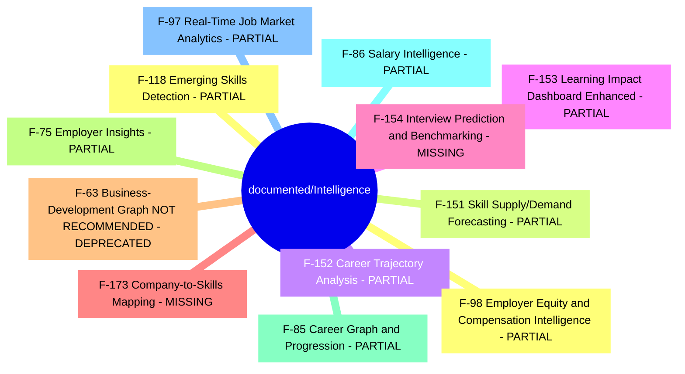

# documented/Intelligence (MOD-226)

Generated by `project-mindmap/tools/catalog.py` from `master/MASTER_PROJECT_GRAPH.json` at commit `9b3032f`. Do not edit by hand. Back to the [feature catalog](../FEATURE_CATALOG.md).

**Application:** Documented scope (registry features) (APP-001). **Purpose:** Registry features in category 'Intelligence'.

**Nodes by level:** MODULE 1, MAJOR 12. **Status:** DEPRECATED 1, NOT_IMPLEMENTED 2, PARTIALLY_IMPLEMENTED 9, UNKNOWN 1. **Verification:** UNKNOWN 1.

## Module map (to minor features)

## F-118 Emerging Skills Detection

Emerging Skills Detection

| ID    | Level | Parent  | Name                      | Description | Status                | Verification | Evidence                                | Related |
| ----- | ----- | ------- | ------------------------- | ----------- | --------------------- | ------------ | --------------------------------------- | ------- |
| F-118 | MAJOR | MOD-226 | Emerging Skills Detection |             | PARTIALLY_IMPLEMENTED |              | docs/registries/FEATURE_REGISTRY.md:134 |         |

## F-151 Skill Supply/Demand Forecasting

Skill Supply/Demand Forecasting

| ID    | Level | Parent  | Name                            | Description | Status                | Verification | Evidence                                | Related |
| ----- | ----- | ------- | ------------------------------- | ----------- | --------------------- | ------------ | --------------------------------------- | ------- |
| F-151 | MAJOR | MOD-226 | Skill Supply/Demand Forecasting |             | PARTIALLY_IMPLEMENTED |              | docs/registries/FEATURE_REGISTRY.md:177 |         |

## F-152 Career Trajectory Analysis

Career Trajectory Analysis

| ID    | Level | Parent  | Name                       | Description | Status                | Verification | Evidence                                | Related |
| ----- | ----- | ------- | -------------------------- | ----------- | --------------------- | ------------ | --------------------------------------- | ------- |
| F-152 | MAJOR | MOD-226 | Career Trajectory Analysis |             | PARTIALLY_IMPLEMENTED |              | docs/registries/FEATURE_REGISTRY.md:178 |         |

## F-153 Learning Impact Dashboard (Enhanced)

Learning Impact Dashboard (Enhanced)

| ID    | Level | Parent  | Name                                 | Description | Status                | Verification | Evidence                                | Related |
| ----- | ----- | ------- | ------------------------------------ | ----------- | --------------------- | ------------ | --------------------------------------- | ------- |
| F-153 | MAJOR | MOD-226 | Learning Impact Dashboard (Enhanced) |             | PARTIALLY_IMPLEMENTED |              | docs/registries/FEATURE_REGISTRY.md:179 |         |

## F-154 Interview Prediction & Benchmarking

Interview Prediction & Benchmarking

| ID    | Level | Parent  | Name                                | Description | Status          | Verification | Evidence                                | Related |
| ----- | ----- | ------- | ----------------------------------- | ----------- | --------------- | ------------ | --------------------------------------- | ------- |
| F-154 | MAJOR | MOD-226 | Interview Prediction & Benchmarking |             | NOT_IMPLEMENTED |              | docs/registries/FEATURE_REGISTRY.md:180 |         |

## F-173 Company-to-Skills Mapping

Company-to-Skills Mapping

| ID    | Level | Parent  | Name                      | Description | Status          | Verification | Evidence                                | Related |
| ----- | ----- | ------- | ------------------------- | ----------- | --------------- | ------------ | --------------------------------------- | ------- |
| F-173 | MAJOR | MOD-226 | Company-to-Skills Mapping |             | NOT_IMPLEMENTED |              | docs/registries/FEATURE_REGISTRY.md:199 |         |

## F-63 Business-Development Graph (NOT RECOMMENDED)

Business-Development Graph (NOT RECOMMENDED)

| ID   | Level | Parent  | Name                                         | Description | Status     | Verification | Evidence                               | Related |
| ---- | ----- | ------- | -------------------------------------------- | ----------- | ---------- | ------------ | -------------------------------------- | ------- |
| F-63 | MAJOR | MOD-226 | Business-Development Graph (NOT RECOMMENDED) |             | DEPRECATED |              | docs/registries/FEATURE_REGISTRY.md:79 |         |

## F-75 Employer Insights

Employer Insights

| ID   | Level | Parent  | Name              | Description | Status                | Verification | Evidence                               | Related |
| ---- | ----- | ------- | ----------------- | ----------- | --------------------- | ------------ | -------------------------------------- | ------- |
| F-75 | MAJOR | MOD-226 | Employer Insights |             | PARTIALLY_IMPLEMENTED |              | docs/registries/FEATURE_REGISTRY.md:91 |         |

## F-85 Career Graph & Progression

Career Graph & Progression

| ID   | Level | Parent  | Name                       | Description | Status                | Verification | Evidence                                | Related |
| ---- | ----- | ------- | -------------------------- | ----------- | --------------------- | ------------ | --------------------------------------- | ------- |
| F-85 | MAJOR | MOD-226 | Career Graph & Progression |             | PARTIALLY_IMPLEMENTED |              | docs/registries/FEATURE_REGISTRY.md:101 |         |

## F-86 Salary Intelligence

Salary Intelligence

| ID   | Level | Parent  | Name                | Description | Status                | Verification | Evidence                                | Related |
| ---- | ----- | ------- | ------------------- | ----------- | --------------------- | ------------ | --------------------------------------- | ------- |
| F-86 | MAJOR | MOD-226 | Salary Intelligence |             | PARTIALLY_IMPLEMENTED |              | docs/registries/FEATURE_REGISTRY.md:102 |         |

## F-97 Real-Time Job Market Analytics

Real-Time Job Market Analytics

| ID   | Level | Parent  | Name                           | Description | Status                | Verification | Evidence                                | Related |
| ---- | ----- | ------- | ------------------------------ | ----------- | --------------------- | ------------ | --------------------------------------- | ------- |
| F-97 | MAJOR | MOD-226 | Real-Time Job Market Analytics |             | PARTIALLY_IMPLEMENTED |              | docs/registries/FEATURE_REGISTRY.md:113 |         |

## F-98 Employer Equity & Compensation Intelligence

Employer Equity & Compensation Intelligence

| ID   | Level | Parent  | Name                                        | Description | Status                | Verification | Evidence                                | Related |
| ---- | ----- | ------- | ------------------------------------------- | ----------- | --------------------- | ------------ | --------------------------------------- | ------- |
| F-98 | MAJOR | MOD-226 | Employer Equity & Compensation Intelligence |             | PARTIALLY_IMPLEMENTED |              | docs/registries/FEATURE_REGISTRY.md:114 |         |
