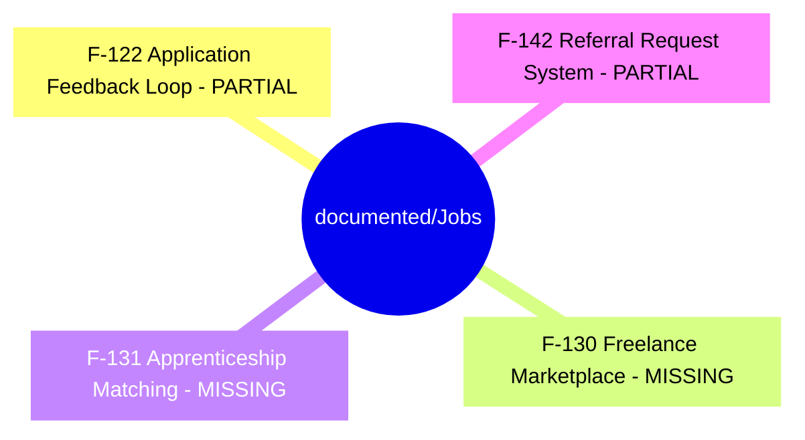

# documented/Jobs (MOD-227)

Generated by `project-mindmap/tools/catalog.py` from `master/MASTER_PROJECT_GRAPH.json` at commit `9b3032f`. Do not edit by hand. Back to the [feature catalog](../FEATURE_CATALOG.md).

**Application:** Documented scope (registry features) (APP-001). **Purpose:** Registry features in category 'Jobs'.

**Nodes by level:** MODULE 1, MAJOR 4. **Status:** NOT_IMPLEMENTED 2, PARTIALLY_IMPLEMENTED 2, UNKNOWN 1. **Verification:** UNKNOWN 1.

## Module map (to minor features)

## F-122 Application Feedback Loop

Application Feedback Loop

| ID    | Level | Parent  | Name                      | Description | Status                | Verification | Evidence                                | Related |
| ----- | ----- | ------- | ------------------------- | ----------- | --------------------- | ------------ | --------------------------------------- | ------- |
| F-122 | MAJOR | MOD-227 | Application Feedback Loop |             | PARTIALLY_IMPLEMENTED |              | docs/registries/FEATURE_REGISTRY.md:143 |         |

## F-130 Freelance Marketplace

Freelance Marketplace

| ID    | Level | Parent  | Name                  | Description | Status          | Verification | Evidence                                | Related |
| ----- | ----- | ------- | --------------------- | ----------- | --------------- | ------------ | --------------------------------------- | ------- |
| F-130 | MAJOR | MOD-227 | Freelance Marketplace |             | NOT_IMPLEMENTED |              | docs/registries/FEATURE_REGISTRY.md:151 |         |

## F-131 Apprenticeship Matching

Apprenticeship Matching

| ID    | Level | Parent  | Name                    | Description | Status          | Verification | Evidence                                | Related |
| ----- | ----- | ------- | ----------------------- | ----------- | --------------- | ------------ | --------------------------------------- | ------- |
| F-131 | MAJOR | MOD-227 | Apprenticeship Matching |             | NOT_IMPLEMENTED |              | docs/registries/FEATURE_REGISTRY.md:152 |         |

## F-142 Referral Request System

Referral Request System

| ID    | Level | Parent  | Name                    | Description | Status                | Verification | Evidence                                | Related |
| ----- | ----- | ------- | ----------------------- | ----------- | --------------------- | ------------ | --------------------------------------- | ------- |
| F-142 | MAJOR | MOD-227 | Referral Request System |             | PARTIALLY_IMPLEMENTED |              | docs/registries/FEATURE_REGISTRY.md:163 |         |
