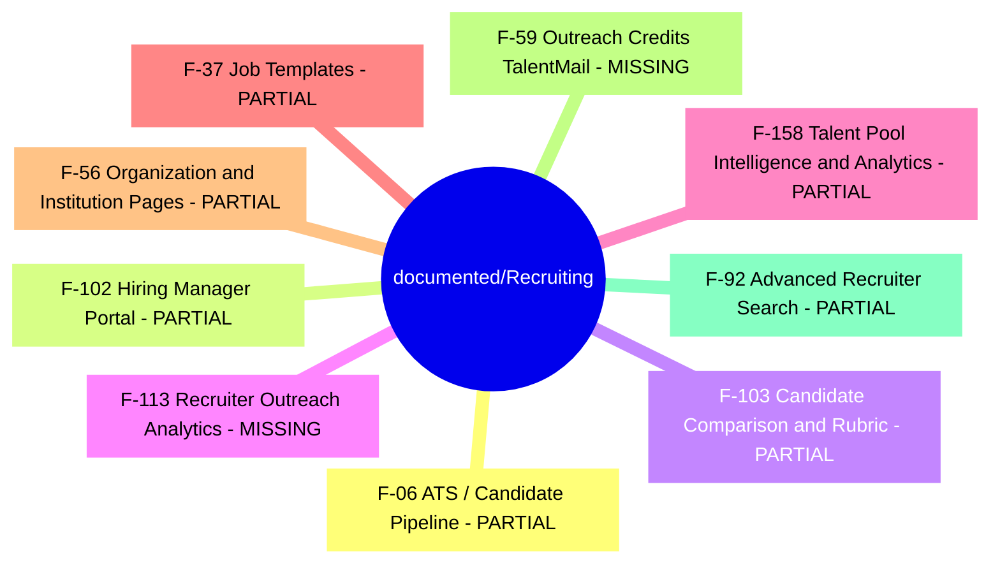

# documented/Recruiting (MOD-212)

Generated by `project-mindmap/tools/catalog.py` from `master/MASTER_PROJECT_GRAPH.json` at commit `9b3032f`. Do not edit by hand. Back to the [feature catalog](../FEATURE_CATALOG.md).

**Application:** Documented scope (registry features) (APP-001). **Purpose:** Registry features in category 'Recruiting'.

**Nodes by level:** MODULE 1, MAJOR 9. **Status:** NOT_IMPLEMENTED 2, PARTIALLY_IMPLEMENTED 7, UNKNOWN 1. **Verification:** UNKNOWN 1.

## Module map (to minor features)

## F-06 ATS / Candidate Pipeline

ATS / Candidate Pipeline

| ID   | Level | Parent  | Name                     | Description | Status                | Verification | Evidence                               | Related |
| ---- | ----- | ------- | ------------------------ | ----------- | --------------------- | ------------ | -------------------------------------- | ------- |
| F-06 | MAJOR | MOD-212 | ATS / Candidate Pipeline |             | PARTIALLY_IMPLEMENTED |              | docs/registries/FEATURE_REGISTRY.md:22 |         |

## F-102 Hiring Manager Portal

Hiring Manager Portal

| ID    | Level | Parent  | Name                  | Description | Status                | Verification | Evidence                                | Related |
| ----- | ----- | ------- | --------------------- | ----------- | --------------------- | ------------ | --------------------------------------- | ------- |
| F-102 | MAJOR | MOD-212 | Hiring Manager Portal |             | PARTIALLY_IMPLEMENTED |              | docs/registries/FEATURE_REGISTRY.md:118 |         |

## F-103 Candidate Comparison & Rubric

Candidate Comparison & Rubric

| ID    | Level | Parent  | Name                          | Description | Status                | Verification | Evidence                                | Related |
| ----- | ----- | ------- | ----------------------------- | ----------- | --------------------- | ------------ | --------------------------------------- | ------- |
| F-103 | MAJOR | MOD-212 | Candidate Comparison & Rubric |             | PARTIALLY_IMPLEMENTED |              | docs/registries/FEATURE_REGISTRY.md:119 |         |

## F-113 Recruiter Outreach Analytics

Recruiter Outreach Analytics

| ID    | Level | Parent  | Name                         | Description | Status          | Verification | Evidence                                | Related |
| ----- | ----- | ------- | ---------------------------- | ----------- | --------------- | ------------ | --------------------------------------- | ------- |
| F-113 | MAJOR | MOD-212 | Recruiter Outreach Analytics |             | NOT_IMPLEMENTED |              | docs/registries/FEATURE_REGISTRY.md:129 |         |

## F-158 Talent Pool Intelligence & Analytics

Talent Pool Intelligence & Analytics

| ID    | Level | Parent  | Name                                 | Description | Status                | Verification | Evidence                                | Related |
| ----- | ----- | ------- | ------------------------------------ | ----------- | --------------------- | ------------ | --------------------------------------- | ------- |
| F-158 | MAJOR | MOD-212 | Talent Pool Intelligence & Analytics |             | PARTIALLY_IMPLEMENTED |              | docs/registries/FEATURE_REGISTRY.md:184 |         |

## F-37 Job Templates

Job Templates

| ID   | Level | Parent  | Name          | Description | Status                | Verification | Evidence                               | Related |
| ---- | ----- | ------- | ------------- | ----------- | --------------------- | ------------ | -------------------------------------- | ------- |
| F-37 | MAJOR | MOD-212 | Job Templates |             | PARTIALLY_IMPLEMENTED |              | docs/registries/FEATURE_REGISTRY.md:53 |         |

## F-56 Organization & Institution Pages

Organization & Institution Pages

| ID   | Level | Parent  | Name                             | Description | Status                | Verification | Evidence                               | Related |
| ---- | ----- | ------- | -------------------------------- | ----------- | --------------------- | ------------ | -------------------------------------- | ------- |
| F-56 | MAJOR | MOD-212 | Organization & Institution Pages |             | PARTIALLY_IMPLEMENTED |              | docs/registries/FEATURE_REGISTRY.md:72 |         |

## F-59 Outreach Credits (TalentMail)

Outreach Credits (TalentMail)

| ID   | Level | Parent  | Name                          | Description | Status          | Verification | Evidence                               | Related |
| ---- | ----- | ------- | ----------------------------- | ----------- | --------------- | ------------ | -------------------------------------- | ------- |
| F-59 | MAJOR | MOD-212 | Outreach Credits (TalentMail) |             | NOT_IMPLEMENTED |              | docs/registries/FEATURE_REGISTRY.md:75 |         |

## F-92 Advanced Recruiter Search

Advanced Recruiter Search

| ID   | Level | Parent  | Name                      | Description | Status                | Verification | Evidence                                | Related |
| ---- | ----- | ------- | ------------------------- | ----------- | --------------------- | ------------ | --------------------------------------- | ------- |
| F-92 | MAJOR | MOD-212 | Advanced Recruiter Search |             | PARTIALLY_IMPLEMENTED |              | docs/registries/FEATURE_REGISTRY.md:108 |         |
