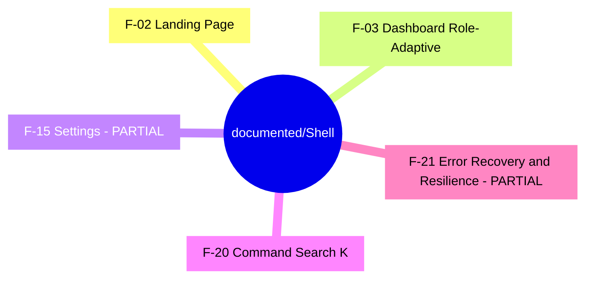

# documented/Shell (MOD-210)

Generated by `project-mindmap/tools/catalog.py` from `master/MASTER_PROJECT_GRAPH.json` at commit `9b3032f`. Do not edit by hand. Back to the [feature catalog](../FEATURE_CATALOG.md).

**Application:** Documented scope (registry features) (APP-001). **Purpose:** Registry features in category 'Shell'.

**Nodes by level:** MODULE 1, MAJOR 5. **Status:** IMPLEMENTED 3, PARTIALLY_IMPLEMENTED 2, UNKNOWN 1. **Verification:** UNKNOWN 1.

## Module map (to minor features)

## F-02 Landing Page

Landing Page

| ID   | Level | Parent  | Name         | Description | Status      | Verification | Evidence                               | Related |
| ---- | ----- | ------- | ------------ | ----------- | ----------- | ------------ | -------------------------------------- | ------- |
| F-02 | MAJOR | MOD-210 | Landing Page |             | IMPLEMENTED |              | docs/registries/FEATURE_REGISTRY.md:18 |         |

## F-03 Dashboard (Role-Adaptive)

Dashboard (Role-Adaptive)

| ID   | Level | Parent  | Name                      | Description | Status      | Verification | Evidence                               | Related |
| ---- | ----- | ------- | ------------------------- | ----------- | ----------- | ------------ | -------------------------------------- | ------- |
| F-03 | MAJOR | MOD-210 | Dashboard (Role-Adaptive) |             | IMPLEMENTED |              | docs/registries/FEATURE_REGISTRY.md:19 |         |

## F-15 Settings

Settings

| ID   | Level | Parent  | Name     | Description | Status                | Verification | Evidence                               | Related |
| ---- | ----- | ------- | -------- | ----------- | --------------------- | ------------ | -------------------------------------- | ------- |
| F-15 | MAJOR | MOD-210 | Settings |             | PARTIALLY_IMPLEMENTED |              | docs/registries/FEATURE_REGISTRY.md:31 |         |

## F-20 Command Search (⌘K)

Command Search (⌘K)

| ID   | Level | Parent  | Name                | Description | Status      | Verification | Evidence                               | Related |
| ---- | ----- | ------- | ------------------- | ----------- | ----------- | ------------ | -------------------------------------- | ------- |
| F-20 | MAJOR | MOD-210 | Command Search (⌘K) |             | IMPLEMENTED |              | docs/registries/FEATURE_REGISTRY.md:36 |         |

## F-21 Error Recovery & Resilience

Error Recovery & Resilience

| ID   | Level | Parent  | Name                        | Description | Status                | Verification | Evidence                               | Related |
| ---- | ----- | ------- | --------------------------- | ----------- | --------------------- | ------------ | -------------------------------------- | ------- |
| F-21 | MAJOR | MOD-210 | Error Recovery & Resilience |             | PARTIALLY_IMPLEMENTED |              | docs/registries/FEATURE_REGISTRY.md:37 |         |
