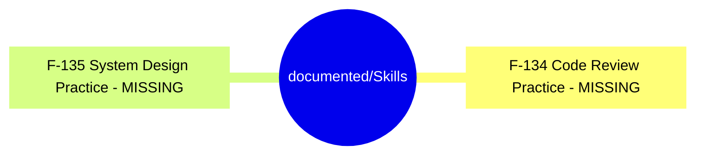

# documented/Skills (MOD-231)

Generated by `project-mindmap/tools/catalog.py` from `master/MASTER_PROJECT_GRAPH.json` at commit `9b3032f`. Do not edit by hand. Back to the [feature catalog](../FEATURE_CATALOG.md).

**Application:** Documented scope (registry features) (APP-001). **Purpose:** Registry features in category 'Skills'.

**Nodes by level:** MODULE 1, MAJOR 2. **Status:** NOT_IMPLEMENTED 2, UNKNOWN 1. **Verification:** UNKNOWN 1.

## Module map (to minor features)

## F-134 Code Review Practice

Code Review Practice

| ID    | Level | Parent  | Name                 | Description | Status          | Verification | Evidence                                | Related |
| ----- | ----- | ------- | -------------------- | ----------- | --------------- | ------------ | --------------------------------------- | ------- |
| F-134 | MAJOR | MOD-231 | Code Review Practice |             | NOT_IMPLEMENTED |              | docs/registries/FEATURE_REGISTRY.md:155 |         |

## F-135 System Design Practice

System Design Practice

| ID    | Level | Parent  | Name                   | Description | Status          | Verification | Evidence                                | Related |
| ----- | ----- | ------- | ---------------------- | ----------- | --------------- | ------------ | --------------------------------------- | ------- |
| F-135 | MAJOR | MOD-231 | System Design Practice |             | NOT_IMPLEMENTED |              | docs/registries/FEATURE_REGISTRY.md:156 |         |
