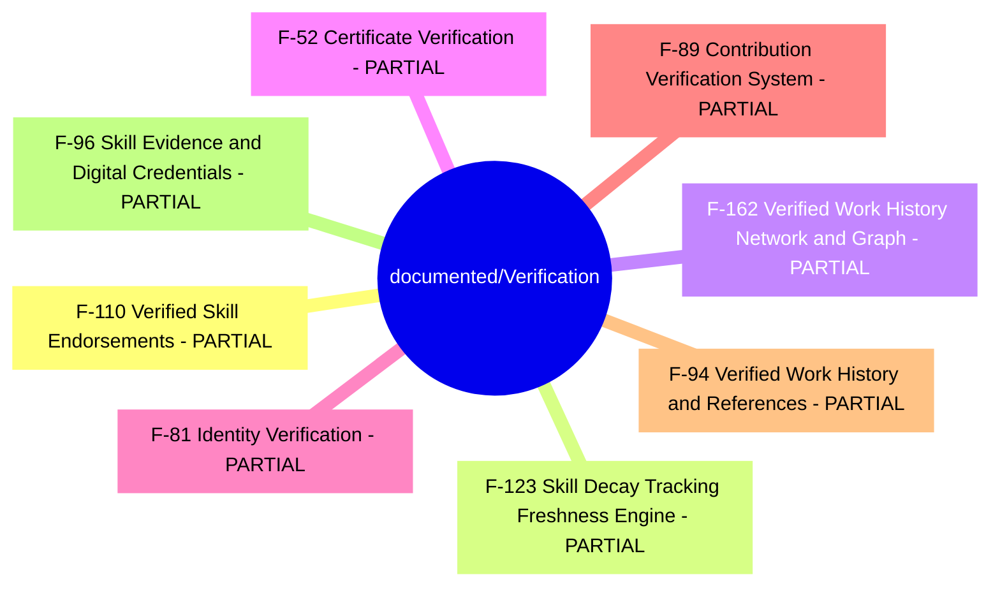

# documented/Verification (MOD-223)

Generated by `project-mindmap/tools/catalog.py` from `master/MASTER_PROJECT_GRAPH.json` at commit `9b3032f`. Do not edit by hand. Back to the [feature catalog](../FEATURE_CATALOG.md).

**Application:** Documented scope (registry features) (APP-001). **Purpose:** Registry features in category 'Verification'.

**Nodes by level:** MODULE 1, MAJOR 8. **Status:** PARTIALLY_IMPLEMENTED 8, UNKNOWN 1. **Verification:** UNKNOWN 1.

## Module map (to minor features)

## F-110 Verified Skill Endorsements

Verified Skill Endorsements

| ID    | Level | Parent  | Name                        | Description | Status                | Verification | Evidence                                | Related |
| ----- | ----- | ------- | --------------------------- | ----------- | --------------------- | ------------ | --------------------------------------- | ------- |
| F-110 | MAJOR | MOD-223 | Verified Skill Endorsements |             | PARTIALLY_IMPLEMENTED |              | docs/registries/FEATURE_REGISTRY.md:126 |         |

## F-123 Skill Decay Tracking (Freshness Engine)

Skill Decay Tracking (Freshness Engine)

| ID    | Level | Parent  | Name                                    | Description | Status                | Verification | Evidence                                | Related |
| ----- | ----- | ------- | --------------------------------------- | ----------- | --------------------- | ------------ | --------------------------------------- | ------- |
| F-123 | MAJOR | MOD-223 | Skill Decay Tracking (Freshness Engine) |             | PARTIALLY_IMPLEMENTED |              | docs/registries/FEATURE_REGISTRY.md:144 |         |

## F-162 Verified Work History Network & Graph

Verified Work History Network & Graph

| ID    | Level | Parent  | Name                                  | Description | Status                | Verification | Evidence                                | Related |
| ----- | ----- | ------- | ------------------------------------- | ----------- | --------------------- | ------------ | --------------------------------------- | ------- |
| F-162 | MAJOR | MOD-223 | Verified Work History Network & Graph |             | PARTIALLY_IMPLEMENTED |              | docs/registries/FEATURE_REGISTRY.md:188 |         |

## F-52 Certificate Verification

Certificate Verification

| ID   | Level | Parent  | Name                     | Description | Status                | Verification | Evidence                               | Related |
| ---- | ----- | ------- | ------------------------ | ----------- | --------------------- | ------------ | -------------------------------------- | ------- |
| F-52 | MAJOR | MOD-223 | Certificate Verification |             | PARTIALLY_IMPLEMENTED |              | docs/registries/FEATURE_REGISTRY.md:68 |         |

## F-81 Identity Verification

Identity Verification

| ID   | Level | Parent  | Name                  | Description | Status                | Verification | Evidence                               | Related |
| ---- | ----- | ------- | --------------------- | ----------- | --------------------- | ------------ | -------------------------------------- | ------- |
| F-81 | MAJOR | MOD-223 | Identity Verification |             | PARTIALLY_IMPLEMENTED |              | docs/registries/FEATURE_REGISTRY.md:97 |         |

## F-89 Contribution Verification System

Contribution Verification System

| ID   | Level | Parent  | Name                             | Description | Status                | Verification | Evidence                                | Related |
| ---- | ----- | ------- | -------------------------------- | ----------- | --------------------- | ------------ | --------------------------------------- | ------- |
| F-89 | MAJOR | MOD-223 | Contribution Verification System |             | PARTIALLY_IMPLEMENTED |              | docs/registries/FEATURE_REGISTRY.md:105 |         |

## F-94 Verified Work History & References

Verified Work History & References

| ID   | Level | Parent  | Name                               | Description | Status                | Verification | Evidence                                | Related |
| ---- | ----- | ------- | ---------------------------------- | ----------- | --------------------- | ------------ | --------------------------------------- | ------- |
| F-94 | MAJOR | MOD-223 | Verified Work History & References |             | PARTIALLY_IMPLEMENTED |              | docs/registries/FEATURE_REGISTRY.md:110 |         |

## F-96 Skill Evidence & Digital Credentials

Skill Evidence & Digital Credentials

| ID   | Level | Parent  | Name                                 | Description | Status                | Verification | Evidence                                | Related |
| ---- | ----- | ------- | ------------------------------------ | ----------- | --------------------- | ------------ | --------------------------------------- | ------- |
| F-96 | MAJOR | MOD-223 | Skill Evidence & Digital Credentials |             | PARTIALLY_IMPLEMENTED |              | docs/registries/FEATURE_REGISTRY.md:112 |         |
