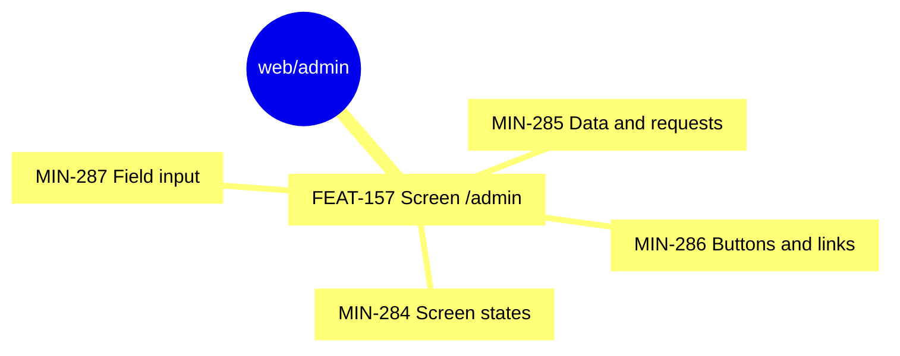
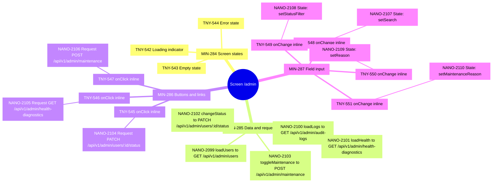

# web/admin (MOD-162)

Generated by `project-mindmap/tools/catalog.py` from `master/MASTER_PROJECT_GRAPH.json` at commit `9b3032f`. Do not edit by hand. Back to the [feature catalog](../FEATURE_CATALOG.md).

**Application:** apps/web (MOD-002). **Purpose:** Routed screens under /admin in apps/web/src/App.tsx.

**Nodes by level:** MODULE 1, MAJOR 1, MINOR 4, TINY 10, NANO 12. **Status:** IMPLEMENTED 28. **Verification:** PATH_LEVEL 14, UNKNOWN 13, VERIFIED 1.

## Module map (to minor features)

## FEAT-157 Screen /admin

AdminPage at route /admin (signed-in only); 3 buttons, 0 forms, 3 inputs; calls 5 endpoint(s).

| ID        | Level | Parent   | Name                                                 | Description                                                                                                                                            | Status      | Verification | Evidence                             | Related           |
| --------- | ----- | -------- | ---------------------------------------------------- | ------------------------------------------------------------------------------------------------------------------------------------------------------ | ----------- | ------------ | ------------------------------------ | ----------------- |
| FEAT-157  | MAJOR | MOD-162  | Screen /admin                                        | AdminPage at route /admin (signed-in only); 3 buttons, 0 forms, 3 inputs; calls 5 endpoint(s).                                                         | IMPLEMENTED | VERIFIED     | apps/web/src/App.tsx:84              | SCR-028, TEST-184 |
| MIN-284   | MINOR | FEAT-157 | Screen states                                        | Loading, empty and error presentation found in the screen source.                                                                                      | IMPLEMENTED | PATH_LEVEL   | apps/web/src/pages/AdminPage.tsx     |                   |
| TNY-542   | TINY  | MIN-284  | Loading indicator                                    | Loading indicator rendered by AdminPage (detected in source).                                                                                          | IMPLEMENTED | PATH_LEVEL   | apps/web/src/pages/AdminPage.tsx     |                   |
| TNY-543   | TINY  | MIN-284  | Empty state                                          | Empty state rendered by AdminPage (detected in source).                                                                                                | IMPLEMENTED | PATH_LEVEL   | apps/web/src/pages/AdminPage.tsx     |                   |
| TNY-544   | TINY  | MIN-284  | Error state                                          | Error state rendered by AdminPage (detected in source).                                                                                                | IMPLEMENTED | PATH_LEVEL   | apps/web/src/pages/AdminPage.tsx     |                   |
| MIN-285   | MINOR | FEAT-157 | Data and requests                                    | API endpoints this screen calls (5).                                                                                                                   | IMPLEMENTED | PATH_LEVEL   | apps/web/src/pages/AdminPage.tsx     |                   |
| NANO-2099 | NANO  | MIN-285  | loadUsers -> GET /api/v1/admin/users                 | loadUsers() at apps/web/src/pages/AdminPage.tsx:98 sends GET /api/v1/admin/users.                                                                      | IMPLEMENTED | UNKNOWN      | apps/web/src/pages/AdminPage.tsx:98  | API-229           |
| NANO-2100 | NANO  | MIN-285  | loadLogs -> GET /api/v1/admin/audit-logs             | loadLogs() at apps/web/src/pages/AdminPage.tsx:108 sends GET /api/v1/admin/audit-logs.                                                                 | IMPLEMENTED | UNKNOWN      | apps/web/src/pages/AdminPage.tsx:108 | API-234           |
| NANO-2101 | NANO  | MIN-285  | loadHealth -> GET /api/v1/admin/health-diagnostics   | loadHealth() at apps/web/src/pages/AdminPage.tsx:118 sends GET /api/v1/admin/health-diagnostics.                                                       | IMPLEMENTED | UNKNOWN      | apps/web/src/pages/AdminPage.tsx:118 | API-235           |
| NANO-2102 | NANO  | MIN-285  | changeStatus -> PATCH /api/v1/admin/users/:id/status | changeStatus() at apps/web/src/pages/AdminPage.tsx:144 sends PATCH /api/v1/admin/users/:id/status.                                                     | IMPLEMENTED | UNKNOWN      | apps/web/src/pages/AdminPage.tsx:144 | API-230           |
| NANO-2103 | NANO  | MIN-285  | toggleMaintenance -> POST /api/v1/admin/maintenance  | toggleMaintenance() at apps/web/src/pages/AdminPage.tsx:160 sends POST /api/v1/admin/maintenance.                                                      | IMPLEMENTED | UNKNOWN      | apps/web/src/pages/AdminPage.tsx:160 | API-236           |
| MIN-286   | MINOR | FEAT-157 | Buttons and links                                    | 3 'buttons and links' binding(s) in apps/web/src/pages/AdminPage.tsx.                                                                                  | IMPLEMENTED | PATH_LEVEL   | apps/web/src/pages/AdminPage.tsx:278 |                   |
| TNY-545   | TINY  | MIN-286  | onClick inline                                       | onClick at apps/web/src/pages/AdminPage.tsx:278 runs inline: () => void changeStatus(user, action.to); calls PATCH /api/v1/admin/users/:id/status.     | IMPLEMENTED | PATH_LEVEL   | apps/web/src/pages/AdminPage.tsx:278 | INT-045           |
| NANO-2104 | NANO  | TNY-545  | Request PATCH /api/v1/admin/users/:id/status         | Sends PATCH /api/v1/admin/users/:id/status through apiFetch/apiJson (apps/web/src/lib/api.ts).                                                         | IMPLEMENTED | UNKNOWN      | apps/web/src/pages/AdminPage.tsx:278 | API-230           |
| TNY-546   | TINY  | MIN-286  | onClick inline                                       | onClick at apps/web/src/pages/AdminPage.tsx:328 runs inline: () => void loadHealth(); calls GET /api/v1/admin/health-diagnostics.                      | IMPLEMENTED | PATH_LEVEL   | apps/web/src/pages/AdminPage.tsx:328 | INT-046           |
| NANO-2105 | NANO  | TNY-546  | Request GET /api/v1/admin/health-diagnostics         | Sends GET /api/v1/admin/health-diagnostics through apiFetch/apiJson (apps/web/src/lib/api.ts).                                                         | IMPLEMENTED | UNKNOWN      | apps/web/src/pages/AdminPage.tsx:328 | API-235           |
| TNY-547   | TINY  | MIN-286  | onClick inline                                       | onClick at apps/web/src/pages/AdminPage.tsx:333 runs inline: () => void toggleMaintenance(!(diag?.inMaintenance; calls POST /api/v1/admin/maintenance. | IMPLEMENTED | PATH_LEVEL   | apps/web/src/pages/AdminPage.tsx:333 | INT-047           |
| NANO-2106 | NANO  | TNY-547  | Request POST /api/v1/admin/maintenance               | Sends POST /api/v1/admin/maintenance through apiFetch/apiJson (apps/web/src/lib/api.ts).                                                               | IMPLEMENTED | UNKNOWN      | apps/web/src/pages/AdminPage.tsx:333 | API-236           |
| MIN-287   | MINOR | FEAT-157 | Field input                                          | 4 'field input' binding(s) in apps/web/src/pages/AdminPage.tsx.                                                                                        | IMPLEMENTED | PATH_LEVEL   | apps/web/src/pages/AdminPage.tsx:205 |                   |
| TNY-548   | TINY  | MIN-287  | onChange inline                                      | onChange at apps/web/src/pages/AdminPage.tsx:205 runs inline: (e) => setSearch(e.target.value); changes state setSearch.                               | IMPLEMENTED | PATH_LEVEL   | apps/web/src/pages/AdminPage.tsx:205 | INT-042           |
| NANO-2107 | NANO  | TNY-548  | State: setSearch                                     | Updates component state through setSearch.                                                                                                             | IMPLEMENTED | UNKNOWN      | apps/web/src/pages/AdminPage.tsx:205 |                   |
| TNY-549   | TINY  | MIN-287  | onChange inline                                      | onChange at apps/web/src/pages/AdminPage.tsx:213 runs inline: (e) => setStatusFilter(e.target.value); changes state setStatusFilter.                   | IMPLEMENTED | PATH_LEVEL   | apps/web/src/pages/AdminPage.tsx:213 | INT-043           |
| NANO-2108 | NANO  | TNY-549  | State: setStatusFilter                               | Updates component state through setStatusFilter.                                                                                                       | IMPLEMENTED | UNKNOWN      | apps/web/src/pages/AdminPage.tsx:213 |                   |
| TNY-550   | TINY  | MIN-287  | onChange inline                                      | onChange at apps/web/src/pages/AdminPage.tsx:218 runs inline: (e) => setReason(e.target.value); changes state setReason.                               | IMPLEMENTED | PATH_LEVEL   | apps/web/src/pages/AdminPage.tsx:218 | INT-044           |
| NANO-2109 | NANO  | TNY-550  | State: setReason                                     | Updates component state through setReason.                                                                                                             | IMPLEMENTED | UNKNOWN      | apps/web/src/pages/AdminPage.tsx:218 |                   |
| TNY-551   | TINY  | MIN-287  | onChange inline                                      | onChange at apps/web/src/pages/AdminPage.tsx:341 runs inline: (e) => setMaintenanceReason(e.target.value); changes state setMaintenanceReason.         | IMPLEMENTED | PATH_LEVEL   | apps/web/src/pages/AdminPage.tsx:341 | INT-048           |
| NANO-2110 | NANO  | TNY-551  | State: setMaintenanceReason                          | Updates component state through setMaintenanceReason.                                                                                                  | IMPLEMENTED | UNKNOWN      | apps/web/src/pages/AdminPage.tsx:341 |                   |
