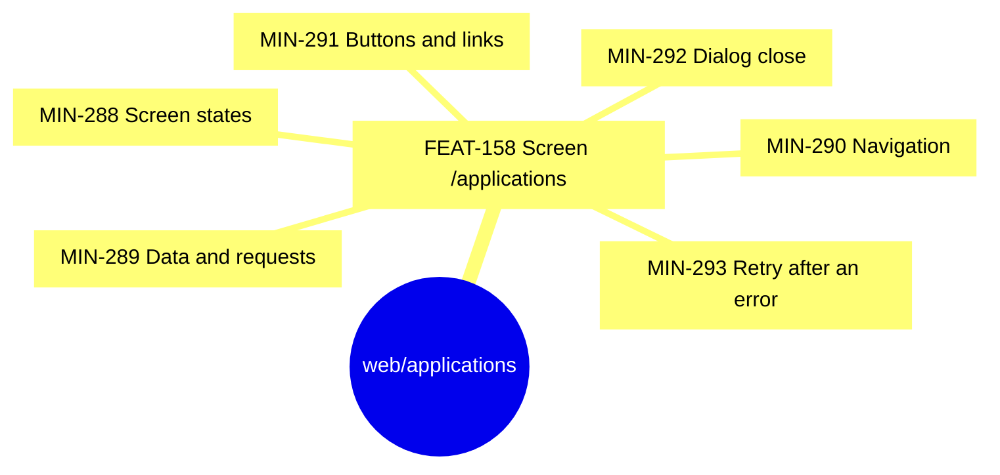
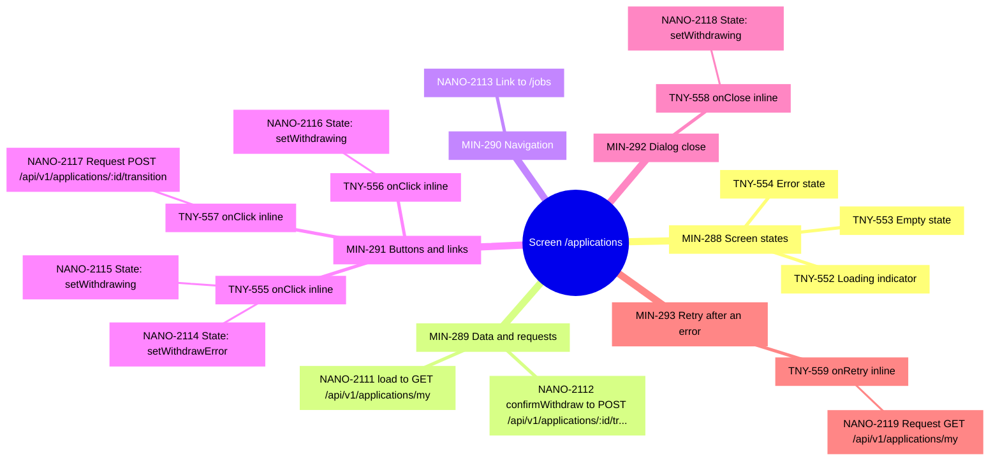

# web/applications (MOD-163)

Generated by `project-mindmap/tools/catalog.py` from `master/MASTER_PROJECT_GRAPH.json` at commit `9b3032f`. Do not edit by hand. Back to the [feature catalog](../FEATURE_CATALOG.md).

**Application:** apps/web (MOD-002). **Purpose:** Routed screens under /applications in apps/web/src/App.tsx.

**Nodes by level:** MODULE 1, MAJOR 1, MINOR 6, TINY 8, NANO 9. **Status:** IMPLEMENTED 25. **Verification:** PATH_LEVEL 14, UNKNOWN 10, VERIFIED 1.

## Module map (to minor features)

## FEAT-158 Screen /applications

ApplicationsPage at route /applications (signed-in only); 3 buttons, 0 forms, 0 inputs; calls 2 endpoint(s).

| ID        | Level | Parent   | Name                                                        | Description                                                                                                                                                             | Status      | Verification | Evidence                                    | Related                     |
| --------- | ----- | -------- | ----------------------------------------------------------- | ----------------------------------------------------------------------------------------------------------------------------------------------------------------------- | ----------- | ------------ | ------------------------------------------- | --------------------------- |
| FEAT-158  | MAJOR | MOD-163  | Screen /applications                                        | ApplicationsPage at route /applications (signed-in only); 3 buttons, 0 forms, 0 inputs; calls 2 endpoint(s).                                                            | IMPLEMENTED | VERIFIED     | apps/web/src/App.tsx:68                     | SCR-012, TEST-178, TEST-220 |
| MIN-288   | MINOR | FEAT-158 | Screen states                                               | Loading, empty and error presentation found in the screen source.                                                                                                       | IMPLEMENTED | PATH_LEVEL   | apps/web/src/pages/ApplicationsPage.tsx     |                             |
| TNY-552   | TINY  | MIN-288  | Loading indicator                                           | Loading indicator rendered by ApplicationsPage (detected in source).                                                                                                    | IMPLEMENTED | PATH_LEVEL   | apps/web/src/pages/ApplicationsPage.tsx     |                             |
| TNY-553   | TINY  | MIN-288  | Empty state                                                 | Empty state rendered by ApplicationsPage (detected in source).                                                                                                          | IMPLEMENTED | PATH_LEVEL   | apps/web/src/pages/ApplicationsPage.tsx     |                             |
| TNY-554   | TINY  | MIN-288  | Error state                                                 | Error state rendered by ApplicationsPage (detected in source).                                                                                                          | IMPLEMENTED | PATH_LEVEL   | apps/web/src/pages/ApplicationsPage.tsx     |                             |
| MIN-289   | MINOR | FEAT-158 | Data and requests                                           | API endpoints this screen calls (2).                                                                                                                                    | IMPLEMENTED | PATH_LEVEL   | apps/web/src/pages/ApplicationsPage.tsx     |                             |
| NANO-2111 | NANO  | MIN-289  | load -> GET /api/v1/applications/my                         | load() at apps/web/src/pages/ApplicationsPage.tsx:42 sends GET /api/v1/applications/my.                                                                                 | IMPLEMENTED | UNKNOWN      | apps/web/src/pages/ApplicationsPage.tsx:42  | API-048                     |
| NANO-2112 | NANO  | MIN-289  | confirmWithdraw -> POST /api/v1/applications/:id/transition | confirmWithdraw() at apps/web/src/pages/ApplicationsPage.tsx:59 sends POST /api/v1/applications/:id/transition.                                                         | IMPLEMENTED | UNKNOWN      | apps/web/src/pages/ApplicationsPage.tsx:59  | API-051                     |
| MIN-290   | MINOR | FEAT-158 | Navigation                                                  | Links from this screen to 1 other screen(s).                                                                                                                            | IMPLEMENTED | PATH_LEVEL   | apps/web/src/pages/ApplicationsPage.tsx     |                             |
| NANO-2113 | NANO  | MIN-290  | Link to /jobs                                               | Navigates to /jobs (JobsPage).                                                                                                                                          | IMPLEMENTED | UNKNOWN      | apps/web/src/pages/ApplicationsPage.tsx     | SCR-007                     |
| MIN-291   | MINOR | FEAT-158 | Buttons and links                                           | 3 'buttons and links' binding(s) in apps/web/src/pages/ApplicationsPage.tsx.                                                                                            | IMPLEMENTED | PATH_LEVEL   | apps/web/src/pages/ApplicationsPage.tsx:132 |                             |
| TNY-555   | TINY  | MIN-291  | onClick inline                                              | onClick at apps/web/src/pages/ApplicationsPage.tsx:132 runs inline: () => { setWithdrawError(null); setWithdrawing(app; changes state setWithdrawError, setWithdrawing. | IMPLEMENTED | PATH_LEVEL   | apps/web/src/pages/ApplicationsPage.tsx:132 | INT-049                     |
| NANO-2114 | NANO  | TNY-555  | State: setWithdrawError                                     | Updates component state through setWithdrawError.                                                                                                                       | IMPLEMENTED | UNKNOWN      | apps/web/src/pages/ApplicationsPage.tsx:132 |                             |
| NANO-2115 | NANO  | TNY-555  | State: setWithdrawing                                       | Updates component state through setWithdrawing.                                                                                                                         | IMPLEMENTED | UNKNOWN      | apps/web/src/pages/ApplicationsPage.tsx:132 |                             |
| TNY-556   | TINY  | MIN-291  | onClick inline                                              | onClick at apps/web/src/pages/ApplicationsPage.tsx:209 runs inline: () => setWithdrawing(null); changes state setWithdrawing.                                           | IMPLEMENTED | PATH_LEVEL   | apps/web/src/pages/ApplicationsPage.tsx:209 | INT-052                     |
| NANO-2116 | NANO  | TNY-556  | State: setWithdrawing                                       | Updates component state through setWithdrawing.                                                                                                                         | IMPLEMENTED | UNKNOWN      | apps/web/src/pages/ApplicationsPage.tsx:209 |                             |
| TNY-557   | TINY  | MIN-291  | onClick inline                                              | onClick at apps/web/src/pages/ApplicationsPage.tsx:214 runs inline: () => void confirmWithdraw(); calls POST /api/v1/applications/:id/transition.                       | IMPLEMENTED | PATH_LEVEL   | apps/web/src/pages/ApplicationsPage.tsx:214 | INT-053                     |
| NANO-2117 | NANO  | TNY-557  | Request POST /api/v1/applications/:id/transition            | Sends POST /api/v1/applications/:id/transition through apiFetch/apiJson (apps/web/src/lib/api.ts).                                                                      | IMPLEMENTED | UNKNOWN      | apps/web/src/pages/ApplicationsPage.tsx:214 | API-051                     |
| MIN-292   | MINOR | FEAT-158 | Dialog close                                                | 1 'dialog close' binding(s) in apps/web/src/pages/ApplicationsPage.tsx.                                                                                                 | IMPLEMENTED | PATH_LEVEL   | apps/web/src/pages/ApplicationsPage.tsx:194 |                             |
| TNY-558   | TINY  | MIN-292  | onClose inline                                              | onClose at apps/web/src/pages/ApplicationsPage.tsx:194 runs inline: () => setWithdrawing(null); changes state setWithdrawing.                                           | IMPLEMENTED | PATH_LEVEL   | apps/web/src/pages/ApplicationsPage.tsx:194 | INT-051                     |
| NANO-2118 | NANO  | TNY-558  | State: setWithdrawing                                       | Updates component state through setWithdrawing.                                                                                                                         | IMPLEMENTED | UNKNOWN      | apps/web/src/pages/ApplicationsPage.tsx:194 |                             |
| MIN-293   | MINOR | FEAT-158 | Retry after an error                                        | 1 'retry after an error' binding(s) in apps/web/src/pages/ApplicationsPage.tsx.                                                                                         | IMPLEMENTED | PATH_LEVEL   | apps/web/src/pages/ApplicationsPage.tsx:162 |                             |
| TNY-559   | TINY  | MIN-293  | onRetry inline                                              | onRetry at apps/web/src/pages/ApplicationsPage.tsx:162 runs inline: () => void load(); calls GET /api/v1/applications/my.                                               | IMPLEMENTED | PATH_LEVEL   | apps/web/src/pages/ApplicationsPage.tsx:162 | INT-050                     |
| NANO-2119 | NANO  | TNY-559  | Request GET /api/v1/applications/my                         | Sends GET /api/v1/applications/my through apiFetch/apiJson (apps/web/src/lib/api.ts).                                                                                   | IMPLEMENTED | UNKNOWN      | apps/web/src/pages/ApplicationsPage.tsx:162 | API-048                     |
