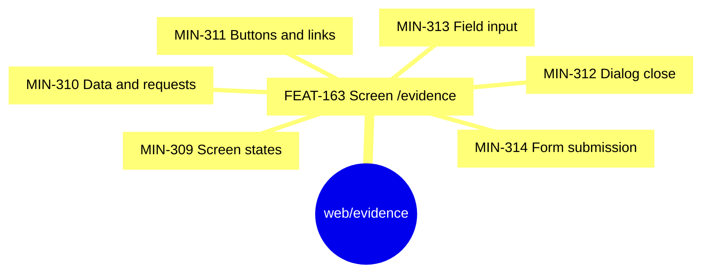
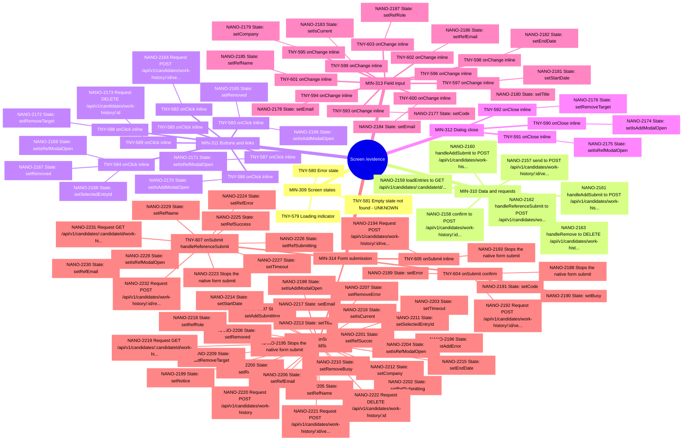

# web/evidence (MOD-168)

Generated by `project-mindmap/tools/catalog.py` from `master/MASTER_PROJECT_GRAPH.json` at commit `9b3032f`. Do not edit by hand. Back to the [feature catalog](../FEATURE_CATALOG.md).

**Application:** apps/web (MOD-002). **Purpose:** Routed screens under /evidence in apps/web/src/App.tsx.

**Nodes by level:** MODULE 1, MAJOR 1, MINOR 6, TINY 29, NANO 76. **Status:** IMPLEMENTED 112, UNKNOWN 1. **Verification:** PATH_LEVEL 34, UNKNOWN 78, VERIFIED 1.

## Module map (to minor features)

## FEAT-163 Screen /evidence

EvidencePage at route /evidence (signed-in only); 12 buttons, 4 forms, 10 inputs; calls 5 endpoint(s).

| ID        | Level | Parent   | Name                                                                                 | Description                                                                                                                                                                                                                                                                                                                                                                                                      | Status      | Verification | Evidence                                | Related                                                       |
| --------- | ----- | -------- | ------------------------------------------------------------------------------------ | ---------------------------------------------------------------------------------------------------------------------------------------------------------------------------------------------------------------------------------------------------------------------------------------------------------------------------------------------------------------------------------------------------------------- | ----------- | ------------ | --------------------------------------- | ------------------------------------------------------------- |
| FEAT-163  | MAJOR | MOD-168  | Screen /evidence                                                                     | EvidencePage at route /evidence (signed-in only); 12 buttons, 4 forms, 10 inputs; calls 5 endpoint(s).                                                                                                                                                                                                                                                                                                           | IMPLEMENTED | VERIFIED     | apps/web/src/App.tsx:69                 | SCR-013, TEST-162, TEST-178, TEST-194, TEST-195, TEST-220 ... |
| MIN-309   | MINOR | FEAT-163 | Screen states                                                                        | Loading, empty and error presentation found in the screen source; not found: Empty state.                                                                                                                                                                                                                                                                                                                        | IMPLEMENTED | PATH_LEVEL   | apps/web/src/pages/EvidencePage.tsx     |                                                               |
| TNY-579   | TINY  | MIN-309  | Loading indicator                                                                    | Loading indicator rendered by EvidencePage (detected in source).                                                                                                                                                                                                                                                                                                                                                 | IMPLEMENTED | PATH_LEVEL   | apps/web/src/pages/EvidencePage.tsx     |                                                               |
| TNY-580   | TINY  | MIN-309  | Error state                                                                          | Error state rendered by EvidencePage (detected in source).                                                                                                                                                                                                                                                                                                                                                       | IMPLEMENTED | PATH_LEVEL   | apps/web/src/pages/EvidencePage.tsx     |                                                               |
| TNY-581   | TINY  | MIN-309  | Empty state (not found)                                                              | No empty state pattern was detected in apps/web/src/pages/EvidencePage.tsx although the screen calls the API. May be handled by a shared component; confirm before treating as a gap.                                                                                                                                                                                                                            | UNKNOWN     | UNKNOWN      | apps/web/src/pages/EvidencePage.tsx     |                                                               |
| MIN-310   | MINOR | FEAT-163 | Data and requests                                                                    | API endpoints this screen calls (5).                                                                                                                                                                                                                                                                                                                                                                             | IMPLEMENTED | PATH_LEVEL   | apps/web/src/pages/EvidencePage.tsx     |                                                               |
| NANO-2157 | NANO  | MIN-310  | send -> POST /api/v1/candidates/work-history/:id/verify-email                        | send() at apps/web/src/pages/EvidencePage.tsx:128 sends POST /api/v1/candidates/work-history/:id/verify-email.                                                                                                                                                                                                                                                                                                   | IMPLEMENTED | UNKNOWN      | apps/web/src/pages/EvidencePage.tsx:128 | API-272                                                       |
| NANO-2158 | NANO  | MIN-310  | confirm -> POST /api/v1/candidates/work-history/:id/verify-email                     | confirm() at apps/web/src/pages/EvidencePage.tsx:147 sends POST /api/v1/candidates/work-history/:id/verify-email.                                                                                                                                                                                                                                                                                                | IMPLEMENTED | UNKNOWN      | apps/web/src/pages/EvidencePage.tsx:147 | API-272                                                       |
| NANO-2159 | NANO  | MIN-310  | loadEntries -> GET /api/v1/candidates/:candidateId/work-history                      | loadEntries() at apps/web/src/pages/EvidencePage.tsx:345 sends GET /api/v1/candidates/:candidateId/work-history.                                                                                                                                                                                                                                                                                                 | IMPLEMENTED | UNKNOWN      | apps/web/src/pages/EvidencePage.tsx:345 | API-276                                                       |
| NANO-2160 | NANO  | MIN-310  | handleAddSubmit -> POST /api/v1/candidates/work-history                              | handleAddSubmit() at apps/web/src/pages/EvidencePage.tsx:402 sends POST /api/v1/candidates/work-history.                                                                                                                                                                                                                                                                                                         | IMPLEMENTED | UNKNOWN      | apps/web/src/pages/EvidencePage.tsx:402 | API-271                                                       |
| NANO-2161 | NANO  | MIN-310  | handleAddSubmit -> POST /api/v1/candidates/work-history/:id/verify-email             | handleAddSubmit() at apps/web/src/pages/EvidencePage.tsx:414 sends POST /api/v1/candidates/work-history/:id/verify-email.                                                                                                                                                                                                                                                                                        | IMPLEMENTED | UNKNOWN      | apps/web/src/pages/EvidencePage.tsx:414 | API-272                                                       |
| NANO-2162 | NANO  | MIN-310  | handleReferenceSubmit -> POST /api/v1/candidates/work-history/:id/references/request | handleReferenceSubmit() at apps/web/src/pages/EvidencePage.tsx:466 sends POST /api/v1/candidates/work-history/:id/references/request.                                                                                                                                                                                                                                                                            | IMPLEMENTED | UNKNOWN      | apps/web/src/pages/EvidencePage.tsx:466 | API-273                                                       |
| NANO-2163 | NANO  | MIN-310  | handleRemove -> DELETE /api/v1/candidates/work-history/:id                           | handleRemove() at apps/web/src/pages/EvidencePage.tsx:509 sends DELETE /api/v1/candidates/work-history/:id.                                                                                                                                                                                                                                                                                                      | IMPLEMENTED | UNKNOWN      | apps/web/src/pages/EvidencePage.tsx:509 | API-278                                                       |
| MIN-311   | MINOR | FEAT-163 | Buttons and links                                                                    | 8 'buttons and links' binding(s) in apps/web/src/pages/EvidencePage.tsx.                                                                                                                                                                                                                                                                                                                                         | IMPLEMENTED | PATH_LEVEL   | apps/web/src/pages/EvidencePage.tsx:204 |                                                               |
| TNY-582   | TINY  | MIN-311  | onClick inline                                                                       | onClick at apps/web/src/pages/EvidencePage.tsx:204 runs inline: () => void send(pending.email); calls POST /api/v1/candidates/work-history/:id/verify-email.                                                                                                                                                                                                                                                     | IMPLEMENTED | PATH_LEVEL   | apps/web/src/pages/EvidencePage.tsx:204 | INT-074                                                       |
| NANO-2164 | NANO  | TNY-582  | Request POST /api/v1/candidates/work-history/:id/verify-email                        | Sends POST /api/v1/candidates/work-history/:id/verify-email through apiFetch/apiJson (apps/web/src/lib/api.ts).                                                                                                                                                                                                                                                                                                  | IMPLEMENTED | UNKNOWN      | apps/web/src/pages/EvidencePage.tsx:204 | API-272                                                       |
| TNY-583   | TINY  | MIN-311  | onClick inline                                                                       | onClick at apps/web/src/pages/EvidencePage.tsx:535 runs inline: () => { setRemoved(null); setIsAddModalOpen(true);; changes state setRemoved, setIsAddModalOpen.                                                                                                                                                                                                                                                 | IMPLEMENTED | PATH_LEVEL   | apps/web/src/pages/EvidencePage.tsx:535 | INT-077                                                       |
| NANO-2165 | NANO  | TNY-583  | State: setRemoved                                                                    | Updates component state through setRemoved.                                                                                                                                                                                                                                                                                                                                                                      | IMPLEMENTED | UNKNOWN      | apps/web/src/pages/EvidencePage.tsx:535 |                                                               |
| NANO-2166 | NANO  | TNY-583  | State: setIsAddModalOpen                                                             | Updates component state through setIsAddModalOpen.                                                                                                                                                                                                                                                                                                                                                               | IMPLEMENTED | UNKNOWN      | apps/web/src/pages/EvidencePage.tsx:535 |                                                               |
| TNY-584   | TINY  | MIN-311  | onClick inline                                                                       | onClick at apps/web/src/pages/EvidencePage.tsx:683 runs inline: () => { setRemoved(null); setSelectedEntryId(item.; changes state setRemoved, setSelectedEntryId, setIsRefModalOpen.                                                                                                                                                                                                                             | IMPLEMENTED | PATH_LEVEL   | apps/web/src/pages/EvidencePage.tsx:683 | INT-078                                                       |
| NANO-2167 | NANO  | TNY-584  | State: setRemoved                                                                    | Updates component state through setRemoved.                                                                                                                                                                                                                                                                                                                                                                      | IMPLEMENTED | UNKNOWN      | apps/web/src/pages/EvidencePage.tsx:683 |                                                               |
| NANO-2168 | NANO  | TNY-584  | State: setSelectedEntryId                                                            | Updates component state through setSelectedEntryId.                                                                                                                                                                                                                                                                                                                                                              | IMPLEMENTED | UNKNOWN      | apps/web/src/pages/EvidencePage.tsx:683 |                                                               |
| NANO-2169 | NANO  | TNY-584  | State: setIsRefModalOpen                                                             | Updates component state through setIsRefModalOpen.                                                                                                                                                                                                                                                                                                                                                               | IMPLEMENTED | UNKNOWN      | apps/web/src/pages/EvidencePage.tsx:683 |                                                               |
| TNY-585   | TINY  | MIN-311  | onClick inline                                                                       | onClick at apps/web/src/pages/EvidencePage.tsx:747 runs inline: () => openRemove(item).                                                                                                                                                                                                                                                                                                                          | IMPLEMENTED | PATH_LEVEL   | apps/web/src/pages/EvidencePage.tsx:747 | INT-079                                                       |
| TNY-586   | TINY  | MIN-311  | onClick inline                                                                       | onClick at apps/web/src/pages/EvidencePage.tsx:847 runs inline: () => setIsAddModalOpen(false); changes state setIsAddModalOpen.                                                                                                                                                                                                                                                                                 | IMPLEMENTED | PATH_LEVEL   | apps/web/src/pages/EvidencePage.tsx:847 | INT-088                                                       |
| NANO-2170 | NANO  | TNY-586  | State: setIsAddModalOpen                                                             | Updates component state through setIsAddModalOpen.                                                                                                                                                                                                                                                                                                                                                               | IMPLEMENTED | UNKNOWN      | apps/web/src/pages/EvidencePage.tsx:847 |                                                               |
| TNY-587   | TINY  | MIN-311  | onClick inline                                                                       | onClick at apps/web/src/pages/EvidencePage.tsx:907 runs inline: () => setIsRefModalOpen(false); changes state setIsRefModalOpen.                                                                                                                                                                                                                                                                                 | IMPLEMENTED | PATH_LEVEL   | apps/web/src/pages/EvidencePage.tsx:907 | INT-094                                                       |
| NANO-2171 | NANO  | TNY-587  | State: setIsRefModalOpen                                                             | Updates component state through setIsRefModalOpen.                                                                                                                                                                                                                                                                                                                                                               | IMPLEMENTED | UNKNOWN      | apps/web/src/pages/EvidencePage.tsx:907 |                                                               |
| TNY-588   | TINY  | MIN-311  | onClick inline                                                                       | onClick at apps/web/src/pages/EvidencePage.tsx:966 runs inline: () => setRemoveTarget(null); changes state setRemoveTarget.                                                                                                                                                                                                                                                                                      | IMPLEMENTED | PATH_LEVEL   | apps/web/src/pages/EvidencePage.tsx:966 | INT-096                                                       |
| NANO-2172 | NANO  | TNY-588  | State: setRemoveTarget                                                               | Updates component state through setRemoveTarget.                                                                                                                                                                                                                                                                                                                                                                 | IMPLEMENTED | UNKNOWN      | apps/web/src/pages/EvidencePage.tsx:966 |                                                               |
| TNY-589   | TINY  | MIN-311  | onClick inline                                                                       | onClick at apps/web/src/pages/EvidencePage.tsx:974 runs inline: () => void handleRemove(); calls DELETE /api/v1/candidates/work-history/:id.                                                                                                                                                                                                                                                                     | IMPLEMENTED | PATH_LEVEL   | apps/web/src/pages/EvidencePage.tsx:974 | INT-097                                                       |
| NANO-2173 | NANO  | TNY-589  | Request DELETE /api/v1/candidates/work-history/:id                                   | Sends DELETE /api/v1/candidates/work-history/:id through apiFetch/apiJson (apps/web/src/lib/api.ts).                                                                                                                                                                                                                                                                                                             | IMPLEMENTED | UNKNOWN      | apps/web/src/pages/EvidencePage.tsx:974 | API-278                                                       |
| MIN-312   | MINOR | FEAT-163 | Dialog close                                                                         | 3 'dialog close' binding(s) in apps/web/src/pages/EvidencePage.tsx.                                                                                                                                                                                                                                                                                                                                              | IMPLEMENTED | PATH_LEVEL   | apps/web/src/pages/EvidencePage.tsx:760 |                                                               |
| TNY-590   | TINY  | MIN-312  | onClose inline                                                                       | onClose at apps/web/src/pages/EvidencePage.tsx:760 runs inline: () => setIsAddModalOpen(false); changes state setIsAddModalOpen.                                                                                                                                                                                                                                                                                 | IMPLEMENTED | PATH_LEVEL   | apps/web/src/pages/EvidencePage.tsx:760 | INT-080                                                       |
| NANO-2174 | NANO  | TNY-590  | State: setIsAddModalOpen                                                             | Updates component state through setIsAddModalOpen.                                                                                                                                                                                                                                                                                                                                                               | IMPLEMENTED | UNKNOWN      | apps/web/src/pages/EvidencePage.tsx:760 |                                                               |
| TNY-591   | TINY  | MIN-312  | onClose inline                                                                       | onClose at apps/web/src/pages/EvidencePage.tsx:860 runs inline: () => setIsRefModalOpen(false); changes state setIsRefModalOpen.                                                                                                                                                                                                                                                                                 | IMPLEMENTED | PATH_LEVEL   | apps/web/src/pages/EvidencePage.tsx:860 | INT-089                                                       |
| NANO-2175 | NANO  | TNY-591  | State: setIsRefModalOpen                                                             | Updates component state through setIsRefModalOpen.                                                                                                                                                                                                                                                                                                                                                               | IMPLEMENTED | UNKNOWN      | apps/web/src/pages/EvidencePage.tsx:860 |                                                               |
| TNY-592   | TINY  | MIN-312  | onClose inline                                                                       | onClose at apps/web/src/pages/EvidencePage.tsx:920 runs inline: () => setRemoveTarget(null); changes state setRemoveTarget.                                                                                                                                                                                                                                                                                      | IMPLEMENTED | PATH_LEVEL   | apps/web/src/pages/EvidencePage.tsx:920 | INT-095                                                       |
| NANO-2176 | NANO  | TNY-592  | State: setRemoveTarget                                                               | Updates component state through setRemoveTarget.                                                                                                                                                                                                                                                                                                                                                                 | IMPLEMENTED | UNKNOWN      | apps/web/src/pages/EvidencePage.tsx:920 |                                                               |
| MIN-313   | MINOR | FEAT-163 | Field input                                                                          | 11 'field input' binding(s) in apps/web/src/pages/EvidencePage.tsx.                                                                                                                                                                                                                                                                                                                                              | IMPLEMENTED | PATH_LEVEL   | apps/web/src/pages/EvidencePage.tsx:187 |                                                               |
| TNY-593   | TINY  | MIN-313  | onChange inline                                                                      | onChange at apps/web/src/pages/EvidencePage.tsx:187 runs inline: (e) => setCode(e.target.value); changes state setCode.                                                                                                                                                                                                                                                                                          | IMPLEMENTED | PATH_LEVEL   | apps/web/src/pages/EvidencePage.tsx:187 | INT-073                                                       |
| NANO-2177 | NANO  | TNY-593  | State: setCode                                                                       | Updates component state through setCode.                                                                                                                                                                                                                                                                                                                                                                         | IMPLEMENTED | UNKNOWN      | apps/web/src/pages/EvidencePage.tsx:187 |                                                               |
| TNY-594   | TINY  | MIN-313  | onChange inline                                                                      | onChange at apps/web/src/pages/EvidencePage.tsx:238 runs inline: (e) => setEmail(e.target.value); changes state setEmail.                                                                                                                                                                                                                                                                                        | IMPLEMENTED | PATH_LEVEL   | apps/web/src/pages/EvidencePage.tsx:238 | INT-076                                                       |
| NANO-2178 | NANO  | TNY-594  | State: setEmail                                                                      | Updates component state through setEmail.                                                                                                                                                                                                                                                                                                                                                                        | IMPLEMENTED | UNKNOWN      | apps/web/src/pages/EvidencePage.tsx:238 |                                                               |
| TNY-595   | TINY  | MIN-313  | onChange inline                                                                      | onChange at apps/web/src/pages/EvidencePage.tsx:777 runs inline: (e) => setCompany(e.target.value); changes state setCompany.                                                                                                                                                                                                                                                                                    | IMPLEMENTED | PATH_LEVEL   | apps/web/src/pages/EvidencePage.tsx:777 | INT-082                                                       |
| NANO-2179 | NANO  | TNY-595  | State: setCompany                                                                    | Updates component state through setCompany.                                                                                                                                                                                                                                                                                                                                                                      | IMPLEMENTED | UNKNOWN      | apps/web/src/pages/EvidencePage.tsx:777 |                                                               |
| TNY-596   | TINY  | MIN-313  | onChange inline                                                                      | onChange at apps/web/src/pages/EvidencePage.tsx:786 runs inline: (e) => setTitle(e.target.value); changes state setTitle.                                                                                                                                                                                                                                                                                        | IMPLEMENTED | PATH_LEVEL   | apps/web/src/pages/EvidencePage.tsx:786 | INT-083                                                       |
| NANO-2180 | NANO  | TNY-596  | State: setTitle                                                                      | Updates component state through setTitle.                                                                                                                                                                                                                                                                                                                                                                        | IMPLEMENTED | UNKNOWN      | apps/web/src/pages/EvidencePage.tsx:786 |                                                               |
| TNY-597   | TINY  | MIN-313  | onChange inline                                                                      | onChange at apps/web/src/pages/EvidencePage.tsx:802 runs inline: (e) => setStartDate(e.target.value); changes state setStartDate.                                                                                                                                                                                                                                                                                | IMPLEMENTED | PATH_LEVEL   | apps/web/src/pages/EvidencePage.tsx:802 | INT-084                                                       |
| NANO-2181 | NANO  | TNY-597  | State: setStartDate                                                                  | Updates component state through setStartDate.                                                                                                                                                                                                                                                                                                                                                                    | IMPLEMENTED | UNKNOWN      | apps/web/src/pages/EvidencePage.tsx:802 |                                                               |
| TNY-598   | TINY  | MIN-313  | onChange inline                                                                      | onChange at apps/web/src/pages/EvidencePage.tsx:811 runs inline: (e) => setEndDate(e.target.value); changes state setEndDate.                                                                                                                                                                                                                                                                                    | IMPLEMENTED | PATH_LEVEL   | apps/web/src/pages/EvidencePage.tsx:811 | INT-085                                                       |
| NANO-2182 | NANO  | TNY-598  | State: setEndDate                                                                    | Updates component state through setEndDate.                                                                                                                                                                                                                                                                                                                                                                      | IMPLEMENTED | UNKNOWN      | apps/web/src/pages/EvidencePage.tsx:811 |                                                               |
| TNY-599   | TINY  | MIN-313  | onChange inline                                                                      | onChange at apps/web/src/pages/EvidencePage.tsx:827 runs inline: (e) => setIsCurrent(e.target.checked); changes state setIsCurrent.                                                                                                                                                                                                                                                                              | IMPLEMENTED | PATH_LEVEL   | apps/web/src/pages/EvidencePage.tsx:827 | INT-086                                                       |
| NANO-2183 | NANO  | TNY-599  | State: setIsCurrent                                                                  | Updates component state through setIsCurrent.                                                                                                                                                                                                                                                                                                                                                                    | IMPLEMENTED | UNKNOWN      | apps/web/src/pages/EvidencePage.tsx:827 |                                                               |
| TNY-600   | TINY  | MIN-313  | onChange inline                                                                      | onChange at apps/web/src/pages/EvidencePage.tsx:839 runs inline: (e) => setEmail(e.target.value); changes state setEmail.                                                                                                                                                                                                                                                                                        | IMPLEMENTED | PATH_LEVEL   | apps/web/src/pages/EvidencePage.tsx:839 | INT-087                                                       |
| NANO-2184 | NANO  | TNY-600  | State: setEmail                                                                      | Updates component state through setEmail.                                                                                                                                                                                                                                                                                                                                                                        | IMPLEMENTED | UNKNOWN      | apps/web/src/pages/EvidencePage.tsx:839 |                                                               |
| TNY-601   | TINY  | MIN-313  | onChange inline                                                                      | onChange at apps/web/src/pages/EvidencePage.tsx:881 runs inline: (e) => setRefName(e.target.value); changes state setRefName.                                                                                                                                                                                                                                                                                    | IMPLEMENTED | PATH_LEVEL   | apps/web/src/pages/EvidencePage.tsx:881 | INT-091                                                       |
| NANO-2185 | NANO  | TNY-601  | State: setRefName                                                                    | Updates component state through setRefName.                                                                                                                                                                                                                                                                                                                                                                      | IMPLEMENTED | UNKNOWN      | apps/web/src/pages/EvidencePage.tsx:881 |                                                               |
| TNY-602   | TINY  | MIN-313  | onChange inline                                                                      | onChange at apps/web/src/pages/EvidencePage.tsx:891 runs inline: (e) => setRefEmail(e.target.value); changes state setRefEmail.                                                                                                                                                                                                                                                                                  | IMPLEMENTED | PATH_LEVEL   | apps/web/src/pages/EvidencePage.tsx:891 | INT-092                                                       |
| NANO-2186 | NANO  | TNY-602  | State: setRefEmail                                                                   | Updates component state through setRefEmail.                                                                                                                                                                                                                                                                                                                                                                     | IMPLEMENTED | UNKNOWN      | apps/web/src/pages/EvidencePage.tsx:891 |                                                               |
| TNY-603   | TINY  | MIN-313  | onChange inline                                                                      | onChange at apps/web/src/pages/EvidencePage.tsx:898 runs inline: (e) => setRefRole(e.target.value); changes state setRefRole.                                                                                                                                                                                                                                                                                    | IMPLEMENTED | PATH_LEVEL   | apps/web/src/pages/EvidencePage.tsx:898 | INT-093                                                       |
| NANO-2187 | NANO  | TNY-603  | State: setRefRole                                                                    | Updates component state through setRefRole.                                                                                                                                                                                                                                                                                                                                                                      | IMPLEMENTED | UNKNOWN      | apps/web/src/pages/EvidencePage.tsx:898 |                                                               |
| MIN-314   | MINOR | FEAT-163 | Form submission                                                                      | 4 'form submission' binding(s) in apps/web/src/pages/EvidencePage.tsx.                                                                                                                                                                                                                                                                                                                                           | IMPLEMENTED | PATH_LEVEL   | apps/web/src/pages/EvidencePage.tsx:168 |                                                               |
| TNY-604   | TINY  | MIN-314  | onSubmit confirm                                                                     | onSubmit at apps/web/src/pages/EvidencePage.tsx:168 runs confirm; changes state setError, setBusy, setCode; calls POST /api/v1/candidates/work-history/:id/verify-email.                                                                                                                                                                                                                                         | IMPLEMENTED | PATH_LEVEL   | apps/web/src/pages/EvidencePage.tsx:168 | INT-072                                                       |
| NANO-2188 | NANO  | TNY-604  | Stops the native form submit                                                         | Calls event.preventDefault() so the page does not reload.                                                                                                                                                                                                                                                                                                                                                        | IMPLEMENTED | UNKNOWN      | apps/web/src/pages/EvidencePage.tsx:141 |                                                               |
| NANO-2189 | NANO  | TNY-604  | State: setError                                                                      | Updates component state through setError.                                                                                                                                                                                                                                                                                                                                                                        | IMPLEMENTED | UNKNOWN      | apps/web/src/pages/EvidencePage.tsx:141 |                                                               |
| NANO-2190 | NANO  | TNY-604  | State: setBusy                                                                       | Updates component state through setBusy.                                                                                                                                                                                                                                                                                                                                                                         | IMPLEMENTED | UNKNOWN      | apps/web/src/pages/EvidencePage.tsx:141 |                                                               |
| NANO-2191 | NANO  | TNY-604  | State: setCode                                                                       | Updates component state through setCode.                                                                                                                                                                                                                                                                                                                                                                         | IMPLEMENTED | UNKNOWN      | apps/web/src/pages/EvidencePage.tsx:141 |                                                               |
| NANO-2192 | NANO  | TNY-604  | Request POST /api/v1/candidates/work-history/:id/verify-email                        | Sends POST /api/v1/candidates/work-history/:id/verify-email through apiFetch/apiJson (apps/web/src/lib/api.ts).                                                                                                                                                                                                                                                                                                  | IMPLEMENTED | UNKNOWN      | apps/web/src/pages/EvidencePage.tsx:141 | API-272                                                       |
| TNY-605   | TINY  | MIN-314  | onSubmit inline                                                                      | onSubmit at apps/web/src/pages/EvidencePage.tsx:221 runs inline: (e) => { e.preventDefault(); void send(email.trim(; calls POST /api/v1/candidates/work-history/:id/verify-email.                                                                                                                                                                                                                                | IMPLEMENTED | PATH_LEVEL   | apps/web/src/pages/EvidencePage.tsx:221 | INT-075                                                       |
| NANO-2193 | NANO  | TNY-605  | Stops the native form submit                                                         | Calls event.preventDefault() so the page does not reload.                                                                                                                                                                                                                                                                                                                                                        | IMPLEMENTED | UNKNOWN      | apps/web/src/pages/EvidencePage.tsx:221 |                                                               |
| NANO-2194 | NANO  | TNY-605  | Request POST /api/v1/candidates/work-history/:id/verify-email                        | Sends POST /api/v1/candidates/work-history/:id/verify-email through apiFetch/apiJson (apps/web/src/lib/api.ts).                                                                                                                                                                                                                                                                                                  | IMPLEMENTED | UNKNOWN      | apps/web/src/pages/EvidencePage.tsx:221 | API-272                                                       |
| TNY-606   | TINY  | MIN-314  | onSubmit handleAddSubmit                                                             | onSubmit at apps/web/src/pages/EvidencePage.tsx:770 runs handleAddSubmit; changes state setAddError, setAddSubmitting, setIsAddModalOpen, setNotice, setRefError, setRefSuccess, setRefSubmitting, setTimeout, setIsRefModalOpen, setRefName, setRefEmail, setRemoveError, setRemoved, setRemoveTarget, setRemoveBusy, setSelectedEntryId, setCompany, setTitle, setStartDate, setEndDate, setIsCurrent, setEmai | IMPLEMENTED | PATH_LEVEL   | apps/web/src/pages/EvidencePage.tsx:770 | INT-081                                                       |
| NANO-2195 | NANO  | TNY-606  | Stops the native form submit                                                         | Calls event.preventDefault() so the page does not reload.                                                                                                                                                                                                                                                                                                                                                        | IMPLEMENTED | UNKNOWN      | apps/web/src/pages/EvidencePage.tsx:370 |                                                               |
| NANO-2196 | NANO  | TNY-606  | State: setAddError                                                                   | Updates component state through setAddError.                                                                                                                                                                                                                                                                                                                                                                     | IMPLEMENTED | UNKNOWN      | apps/web/src/pages/EvidencePage.tsx:370 |                                                               |
| NANO-2197 | NANO  | TNY-606  | State: setAddSubmitting                                                              | Updates component state through setAddSubmitting.                                                                                                                                                                                                                                                                                                                                                                | IMPLEMENTED | UNKNOWN      | apps/web/src/pages/EvidencePage.tsx:370 |                                                               |
| NANO-2198 | NANO  | TNY-606  | State: setIsAddModalOpen                                                             | Updates component state through setIsAddModalOpen.                                                                                                                                                                                                                                                                                                                                                               | IMPLEMENTED | UNKNOWN      | apps/web/src/pages/EvidencePage.tsx:370 |                                                               |
| NANO-2199 | NANO  | TNY-606  | State: setNotice                                                                     | Updates component state through setNotice.                                                                                                                                                                                                                                                                                                                                                                       | IMPLEMENTED | UNKNOWN      | apps/web/src/pages/EvidencePage.tsx:370 |                                                               |
| NANO-2200 | NANO  | TNY-606  | State: setRefError                                                                   | Updates component state through setRefError.                                                                                                                                                                                                                                                                                                                                                                     | IMPLEMENTED | UNKNOWN      | apps/web/src/pages/EvidencePage.tsx:370 |                                                               |
| NANO-2201 | NANO  | TNY-606  | State: setRefSuccess                                                                 | Updates component state through setRefSuccess.                                                                                                                                                                                                                                                                                                                                                                   | IMPLEMENTED | UNKNOWN      | apps/web/src/pages/EvidencePage.tsx:370 |                                                               |
| NANO-2202 | NANO  | TNY-606  | State: setRefSubmitting                                                              | Updates component state through setRefSubmitting.                                                                                                                                                                                                                                                                                                                                                                | IMPLEMENTED | UNKNOWN      | apps/web/src/pages/EvidencePage.tsx:370 |                                                               |
| NANO-2203 | NANO  | TNY-606  | State: setTimeout                                                                    | Updates component state through setTimeout.                                                                                                                                                                                                                                                                                                                                                                      | IMPLEMENTED | UNKNOWN      | apps/web/src/pages/EvidencePage.tsx:370 |                                                               |
| NANO-2204 | NANO  | TNY-606  | State: setIsRefModalOpen                                                             | Updates component state through setIsRefModalOpen.                                                                                                                                                                                                                                                                                                                                                               | IMPLEMENTED | UNKNOWN      | apps/web/src/pages/EvidencePage.tsx:370 |                                                               |
| NANO-2205 | NANO  | TNY-606  | State: setRefName                                                                    | Updates component state through setRefName.                                                                                                                                                                                                                                                                                                                                                                      | IMPLEMENTED | UNKNOWN      | apps/web/src/pages/EvidencePage.tsx:370 |                                                               |
| NANO-2206 | NANO  | TNY-606  | State: setRefEmail                                                                   | Updates component state through setRefEmail.                                                                                                                                                                                                                                                                                                                                                                     | IMPLEMENTED | UNKNOWN      | apps/web/src/pages/EvidencePage.tsx:370 |                                                               |
| NANO-2207 | NANO  | TNY-606  | State: setRemoveError                                                                | Updates component state through setRemoveError.                                                                                                                                                                                                                                                                                                                                                                  | IMPLEMENTED | UNKNOWN      | apps/web/src/pages/EvidencePage.tsx:370 |                                                               |
| NANO-2208 | NANO  | TNY-606  | State: setRemoved                                                                    | Updates component state through setRemoved.                                                                                                                                                                                                                                                                                                                                                                      | IMPLEMENTED | UNKNOWN      | apps/web/src/pages/EvidencePage.tsx:370 |                                                               |
| NANO-2209 | NANO  | TNY-606  | State: setRemoveTarget                                                               | Updates component state through setRemoveTarget.                                                                                                                                                                                                                                                                                                                                                                 | IMPLEMENTED | UNKNOWN      | apps/web/src/pages/EvidencePage.tsx:370 |                                                               |
| NANO-2210 | NANO  | TNY-606  | State: setRemoveBusy                                                                 | Updates component state through setRemoveBusy.                                                                                                                                                                                                                                                                                                                                                                   | IMPLEMENTED | UNKNOWN      | apps/web/src/pages/EvidencePage.tsx:370 |                                                               |
| NANO-2211 | NANO  | TNY-606  | State: setSelectedEntryId                                                            | Updates component state through setSelectedEntryId.                                                                                                                                                                                                                                                                                                                                                              | IMPLEMENTED | UNKNOWN      | apps/web/src/pages/EvidencePage.tsx:370 |                                                               |
| NANO-2212 | NANO  | TNY-606  | State: setCompany                                                                    | Updates component state through setCompany.                                                                                                                                                                                                                                                                                                                                                                      | IMPLEMENTED | UNKNOWN      | apps/web/src/pages/EvidencePage.tsx:370 |                                                               |
| NANO-2213 | NANO  | TNY-606  | State: setTitle                                                                      | Updates component state through setTitle.                                                                                                                                                                                                                                                                                                                                                                        | IMPLEMENTED | UNKNOWN      | apps/web/src/pages/EvidencePage.tsx:370 |                                                               |
| NANO-2214 | NANO  | TNY-606  | State: setStartDate                                                                  | Updates component state through setStartDate.                                                                                                                                                                                                                                                                                                                                                                    | IMPLEMENTED | UNKNOWN      | apps/web/src/pages/EvidencePage.tsx:370 |                                                               |
| NANO-2215 | NANO  | TNY-606  | State: setEndDate                                                                    | Updates component state through setEndDate.                                                                                                                                                                                                                                                                                                                                                                      | IMPLEMENTED | UNKNOWN      | apps/web/src/pages/EvidencePage.tsx:370 |                                                               |
| NANO-2216 | NANO  | TNY-606  | State: setIsCurrent                                                                  | Updates component state through setIsCurrent.                                                                                                                                                                                                                                                                                                                                                                    | IMPLEMENTED | UNKNOWN      | apps/web/src/pages/EvidencePage.tsx:370 |                                                               |
| NANO-2217 | NANO  | TNY-606  | State: setEmail                                                                      | Updates component state through setEmail.                                                                                                                                                                                                                                                                                                                                                                        | IMPLEMENTED | UNKNOWN      | apps/web/src/pages/EvidencePage.tsx:370 |                                                               |
| NANO-2218 | NANO  | TNY-606  | State: setRefRole                                                                    | Updates component state through setRefRole.                                                                                                                                                                                                                                                                                                                                                                      | IMPLEMENTED | UNKNOWN      | apps/web/src/pages/EvidencePage.tsx:370 |                                                               |
| NANO-2219 | NANO  | TNY-606  | Request GET /api/v1/candidates/:candidateId/work-history                             | Sends GET /api/v1/candidates/:candidateId/work-history through apiFetch/apiJson (apps/web/src/lib/api.ts).                                                                                                                                                                                                                                                                                                       | IMPLEMENTED | UNKNOWN      | apps/web/src/pages/EvidencePage.tsx:370 | API-276                                                       |
| NANO-2220 | NANO  | TNY-606  | Request POST /api/v1/candidates/work-history                                         | Sends POST /api/v1/candidates/work-history through apiFetch/apiJson (apps/web/src/lib/api.ts).                                                                                                                                                                                                                                                                                                                   | IMPLEMENTED | UNKNOWN      | apps/web/src/pages/EvidencePage.tsx:370 | API-271                                                       |
| NANO-2221 | NANO  | TNY-606  | Request POST /api/v1/candidates/work-history/:id/verify-email                        | Sends POST /api/v1/candidates/work-history/:id/verify-email through apiFetch/apiJson (apps/web/src/lib/api.ts).                                                                                                                                                                                                                                                                                                  | IMPLEMENTED | UNKNOWN      | apps/web/src/pages/EvidencePage.tsx:370 | API-272                                                       |
| NANO-2222 | NANO  | TNY-606  | Request DELETE /api/v1/candidates/work-history/:id                                   | Sends DELETE /api/v1/candidates/work-history/:id through apiFetch/apiJson (apps/web/src/lib/api.ts).                                                                                                                                                                                                                                                                                                             | IMPLEMENTED | UNKNOWN      | apps/web/src/pages/EvidencePage.tsx:370 | API-278                                                       |
| TNY-607   | TINY  | MIN-314  | onSubmit handleReferenceSubmit                                                       | onSubmit at apps/web/src/pages/EvidencePage.tsx:875 runs handleReferenceSubmit; changes state setRefError, setRefSuccess, setRefSubmitting, setTimeout, setIsRefModalOpen, setRefName, setRefEmail; calls GET /api/v1/candidates/:candidateId/work-history, POST /api/v1/candidates/work-history/:id/references/request.                                                                                         | IMPLEMENTED | PATH_LEVEL   | apps/web/src/pages/EvidencePage.tsx:875 | INT-090                                                       |
| NANO-2223 | NANO  | TNY-607  | Stops the native form submit                                                         | Calls event.preventDefault() so the page does not reload.                                                                                                                                                                                                                                                                                                                                                        | IMPLEMENTED | UNKNOWN      | apps/web/src/pages/EvidencePage.tsx:436 |                                                               |
| NANO-2224 | NANO  | TNY-607  | State: setRefError                                                                   | Updates component state through setRefError.                                                                                                                                                                                                                                                                                                                                                                     | IMPLEMENTED | UNKNOWN      | apps/web/src/pages/EvidencePage.tsx:436 |                                                               |
| NANO-2225 | NANO  | TNY-607  | State: setRefSuccess                                                                 | Updates component state through setRefSuccess.                                                                                                                                                                                                                                                                                                                                                                   | IMPLEMENTED | UNKNOWN      | apps/web/src/pages/EvidencePage.tsx:436 |                                                               |
| NANO-2226 | NANO  | TNY-607  | State: setRefSubmitting                                                              | Updates component state through setRefSubmitting.                                                                                                                                                                                                                                                                                                                                                                | IMPLEMENTED | UNKNOWN      | apps/web/src/pages/EvidencePage.tsx:436 |                                                               |
| NANO-2227 | NANO  | TNY-607  | State: setTimeout                                                                    | Updates component state through setTimeout.                                                                                                                                                                                                                                                                                                                                                                      | IMPLEMENTED | UNKNOWN      | apps/web/src/pages/EvidencePage.tsx:436 |                                                               |
| NANO-2228 | NANO  | TNY-607  | State: setIsRefModalOpen                                                             | Updates component state through setIsRefModalOpen.                                                                                                                                                                                                                                                                                                                                                               | IMPLEMENTED | UNKNOWN      | apps/web/src/pages/EvidencePage.tsx:436 |                                                               |
| NANO-2229 | NANO  | TNY-607  | State: setRefName                                                                    | Updates component state through setRefName.                                                                                                                                                                                                                                                                                                                                                                      | IMPLEMENTED | UNKNOWN      | apps/web/src/pages/EvidencePage.tsx:436 |                                                               |
| NANO-2230 | NANO  | TNY-607  | State: setRefEmail                                                                   | Updates component state through setRefEmail.                                                                                                                                                                                                                                                                                                                                                                     | IMPLEMENTED | UNKNOWN      | apps/web/src/pages/EvidencePage.tsx:436 |                                                               |
| NANO-2231 | NANO  | TNY-607  | Request GET /api/v1/candidates/:candidateId/work-history                             | Sends GET /api/v1/candidates/:candidateId/work-history through apiFetch/apiJson (apps/web/src/lib/api.ts).                                                                                                                                                                                                                                                                                                       | IMPLEMENTED | UNKNOWN      | apps/web/src/pages/EvidencePage.tsx:436 | API-276                                                       |
| NANO-2232 | NANO  | TNY-607  | Request POST /api/v1/candidates/work-history/:id/references/request                  | Sends POST /api/v1/candidates/work-history/:id/references/request through apiFetch/apiJson (apps/web/src/lib/api.ts).                                                                                                                                                                                                                                                                                            | IMPLEMENTED | UNKNOWN      | apps/web/src/pages/EvidencePage.tsx:436 | API-273                                                       |
