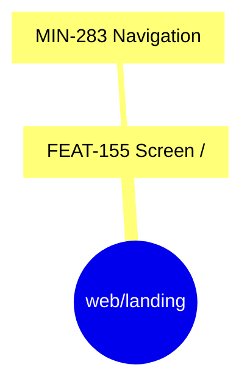
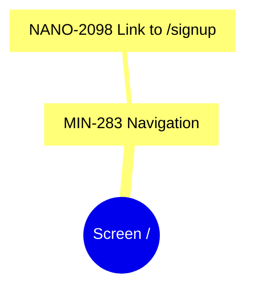

# web/landing (MOD-160)

Generated by `project-mindmap/tools/catalog.py` from `master/MASTER_PROJECT_GRAPH.json` at commit `9b3032f`. Do not edit by hand. Back to the [feature catalog](../FEATURE_CATALOG.md).

**Application:** apps/web (MOD-002). **Purpose:** Routed screens under / in apps/web/src/App.tsx.

**Nodes by level:** MODULE 1, MAJOR 1, MINOR 1, NANO 1. **Status:** IMPLEMENTED 4. **Verification:** PATH_LEVEL 1, UNKNOWN 2, VERIFIED 1.

**Known gaps:** FEAT-155 no API call found in this screen file.

## Module map (to minor features)

## FEAT-155 Screen /

LandingPage at route / (public); 0 buttons, 0 forms, 0 inputs; calls 0 endpoint(s).

| ID        | Level | Parent   | Name            | Description                                                                                                                     | Status      | Verification | Evidence                           | Related                                                   |
| --------- | ----- | -------- | --------------- | ------------------------------------------------------------------------------------------------------------------------------- | ----------- | ------------ | ---------------------------------- | --------------------------------------------------------- |
| FEAT-155  | MAJOR | MOD-160  | Screen /        | LandingPage at route / (public); 0 buttons, 0 forms, 0 inputs; calls 0 endpoint(s). Gaps: no API call found in this screen file | IMPLEMENTED | VERIFIED     | apps/web/src/App.tsx:55            | SCR-001, TEST-162, TEST-194, TEST-195, TEST-199, TEST-220 |
| MIN-283   | MINOR | FEAT-155 | Navigation      | Links from this screen to 1 other screen(s).                                                                                    | IMPLEMENTED | PATH_LEVEL   | apps/web/src/pages/LandingPage.tsx |                                                           |
| NANO-2098 | NANO  | MIN-283  | Link to /signup | Navigates to /signup (SignUpPage).                                                                                              | IMPLEMENTED | UNKNOWN      | apps/web/src/pages/LandingPage.tsx | SCR-003                                                   |
