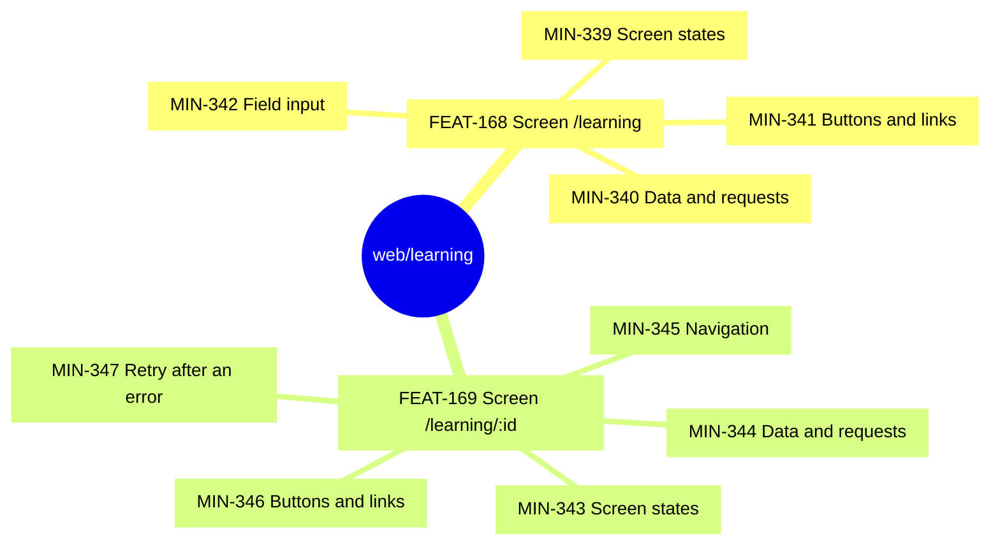
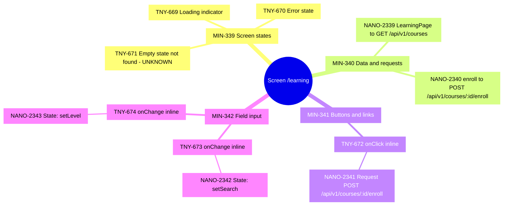
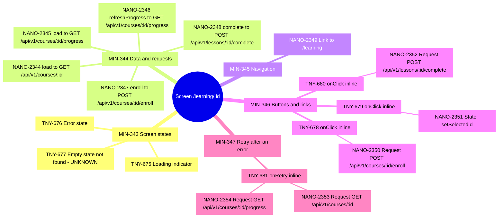

# web/learning (MOD-171)

Generated by `project-mindmap/tools/catalog.py` from `master/MASTER_PROJECT_GRAPH.json` at commit `9b3032f`. Do not edit by hand. Back to the [feature catalog](../FEATURE_CATALOG.md).

**Application:** apps/web (MOD-002). **Purpose:** Routed screens under /learning in apps/web/src/App.tsx.

**Nodes by level:** MODULE 1, MAJOR 2, MINOR 9, TINY 13, NANO 16. **Status:** IMPLEMENTED 39, UNKNOWN 2. **Verification:** PATH_LEVEL 20, UNKNOWN 19, VERIFIED 2.

## Module map (to minor features)

## FEAT-168 Screen /learning

LearningPage at route /learning (signed-in only); 1 buttons, 0 forms, 1 inputs; calls 2 endpoint(s).

| ID        | Level | Parent   | Name                                      | Description                                                                                                                                                                           | Status      | Verification | Evidence                                | Related                     |
| --------- | ----- | -------- | ----------------------------------------- | ------------------------------------------------------------------------------------------------------------------------------------------------------------------------------------- | ----------- | ------------ | --------------------------------------- | --------------------------- |
| FEAT-168  | MAJOR | MOD-171  | Screen /learning                          | LearningPage at route /learning (signed-in only); 1 buttons, 0 forms, 1 inputs; calls 2 endpoint(s).                                                                                  | IMPLEMENTED | VERIFIED     | apps/web/src/App.tsx:75                 | SCR-019, TEST-189, TEST-190 |
| MIN-339   | MINOR | FEAT-168 | Screen states                             | Loading, empty and error presentation found in the screen source; not found: Empty state.                                                                                             | IMPLEMENTED | PATH_LEVEL   | apps/web/src/pages/LearningPage.tsx     |                             |
| TNY-669   | TINY  | MIN-339  | Loading indicator                         | Loading indicator rendered by LearningPage (detected in source).                                                                                                                      | IMPLEMENTED | PATH_LEVEL   | apps/web/src/pages/LearningPage.tsx     |                             |
| TNY-670   | TINY  | MIN-339  | Error state                               | Error state rendered by LearningPage (detected in source).                                                                                                                            | IMPLEMENTED | PATH_LEVEL   | apps/web/src/pages/LearningPage.tsx     |                             |
| TNY-671   | TINY  | MIN-339  | Empty state (not found)                   | No empty state pattern was detected in apps/web/src/pages/LearningPage.tsx although the screen calls the API. May be handled by a shared component; confirm before treating as a gap. | UNKNOWN     | UNKNOWN      | apps/web/src/pages/LearningPage.tsx     |                             |
| MIN-340   | MINOR | FEAT-168 | Data and requests                         | API endpoints this screen calls (2).                                                                                                                                                  | IMPLEMENTED | PATH_LEVEL   | apps/web/src/pages/LearningPage.tsx     |                             |
| NANO-2339 | NANO  | MIN-340  | LearningPage -> GET /api/v1/courses       | LearningPage() at apps/web/src/pages/LearningPage.tsx:54 sends GET /api/v1/courses.                                                                                                   | IMPLEMENTED | UNKNOWN      | apps/web/src/pages/LearningPage.tsx:54  | API-098                     |
| NANO-2340 | NANO  | MIN-340  | enroll -> POST /api/v1/courses/:id/enroll | enroll() at apps/web/src/pages/LearningPage.tsx:72 sends POST /api/v1/courses/:id/enroll.                                                                                             | IMPLEMENTED | UNKNOWN      | apps/web/src/pages/LearningPage.tsx:72  | API-104                     |
| MIN-341   | MINOR | FEAT-168 | Buttons and links                         | 1 'buttons and links' binding(s) in apps/web/src/pages/LearningPage.tsx.                                                                                                              | IMPLEMENTED | PATH_LEVEL   | apps/web/src/pages/LearningPage.tsx:167 |                             |
| TNY-672   | TINY  | MIN-341  | onClick inline                            | onClick at apps/web/src/pages/LearningPage.tsx:167 runs inline: () => void enroll(course); calls POST /api/v1/courses/:id/enroll.                                                     | IMPLEMENTED | PATH_LEVEL   | apps/web/src/pages/LearningPage.tsx:167 | INT-149                     |
| NANO-2341 | NANO  | TNY-672  | Request POST /api/v1/courses/:id/enroll   | Sends POST /api/v1/courses/:id/enroll through apiFetch/apiJson (apps/web/src/lib/api.ts).                                                                                             | IMPLEMENTED | UNKNOWN      | apps/web/src/pages/LearningPage.tsx:167 | API-104                     |
| MIN-342   | MINOR | FEAT-168 | Field input                               | 2 'field input' binding(s) in apps/web/src/pages/LearningPage.tsx.                                                                                                                    | IMPLEMENTED | PATH_LEVEL   | apps/web/src/pages/LearningPage.tsx:96  |                             |
| TNY-673   | TINY  | MIN-342  | onChange inline                           | onChange at apps/web/src/pages/LearningPage.tsx:96 runs inline: (e) => setSearch(e.target.value); changes state setSearch.                                                            | IMPLEMENTED | PATH_LEVEL   | apps/web/src/pages/LearningPage.tsx:96  | INT-147                     |
| NANO-2342 | NANO  | TNY-673  | State: setSearch                          | Updates component state through setSearch.                                                                                                                                            | IMPLEMENTED | UNKNOWN      | apps/web/src/pages/LearningPage.tsx:96  |                             |
| TNY-674   | TINY  | MIN-342  | onChange inline                           | onChange at apps/web/src/pages/LearningPage.tsx:103 runs inline: (e) => setLevel(e.target.value); changes state setLevel.                                                             | IMPLEMENTED | PATH_LEVEL   | apps/web/src/pages/LearningPage.tsx:103 | INT-148                     |
| NANO-2343 | NANO  | TNY-674  | State: setLevel                           | Updates component state through setLevel.                                                                                                                                             | IMPLEMENTED | UNKNOWN      | apps/web/src/pages/LearningPage.tsx:103 |                             |

## FEAT-169 Screen /learning/:id

CoursePage at route /learning/:id (signed-in only); 3 buttons, 0 forms, 0 inputs; calls 4 endpoint(s).

| ID        | Level | Parent   | Name                                                | Description                                                                                                                                                                         | Status      | Verification | Evidence                              | Related           |
| --------- | ----- | -------- | --------------------------------------------------- | ----------------------------------------------------------------------------------------------------------------------------------------------------------------------------------- | ----------- | ------------ | ------------------------------------- | ----------------- |
| FEAT-169  | MAJOR | MOD-171  | Screen /learning/:id                                | CoursePage at route /learning/:id (signed-in only); 3 buttons, 0 forms, 0 inputs; calls 4 endpoint(s).                                                                              | IMPLEMENTED | VERIFIED     | apps/web/src/App.tsx:76               | SCR-020, TEST-190 |
| MIN-343   | MINOR | FEAT-169 | Screen states                                       | Loading, empty and error presentation found in the screen source; not found: Empty state.                                                                                           | IMPLEMENTED | PATH_LEVEL   | apps/web/src/pages/CoursePage.tsx     |                   |
| TNY-675   | TINY  | MIN-343  | Loading indicator                                   | Loading indicator rendered by CoursePage (detected in source).                                                                                                                      | IMPLEMENTED | PATH_LEVEL   | apps/web/src/pages/CoursePage.tsx     |                   |
| TNY-676   | TINY  | MIN-343  | Error state                                         | Error state rendered by CoursePage (detected in source).                                                                                                                            | IMPLEMENTED | PATH_LEVEL   | apps/web/src/pages/CoursePage.tsx     |                   |
| TNY-677   | TINY  | MIN-343  | Empty state (not found)                             | No empty state pattern was detected in apps/web/src/pages/CoursePage.tsx although the screen calls the API. May be handled by a shared component; confirm before treating as a gap. | UNKNOWN     | UNKNOWN      | apps/web/src/pages/CoursePage.tsx     |                   |
| MIN-344   | MINOR | FEAT-169 | Data and requests                                   | API endpoints this screen calls (4).                                                                                                                                                | IMPLEMENTED | PATH_LEVEL   | apps/web/src/pages/CoursePage.tsx     |                   |
| NANO-2344 | NANO  | MIN-344  | load -> GET /api/v1/courses/:id                     | load() at apps/web/src/pages/CoursePage.tsx:57 sends GET /api/v1/courses/:id.                                                                                                       | IMPLEMENTED | UNKNOWN      | apps/web/src/pages/CoursePage.tsx:57  | API-100           |
| NANO-2345 | NANO  | MIN-344  | load -> GET /api/v1/courses/:id/progress            | load() at apps/web/src/pages/CoursePage.tsx:58 sends GET /api/v1/courses/:id/progress.                                                                                              | IMPLEMENTED | UNKNOWN      | apps/web/src/pages/CoursePage.tsx:58  | API-105           |
| NANO-2346 | NANO  | MIN-344  | refreshProgress -> GET /api/v1/courses/:id/progress | refreshProgress() at apps/web/src/pages/CoursePage.tsx:79 sends GET /api/v1/courses/:id/progress.                                                                                   | IMPLEMENTED | UNKNOWN      | apps/web/src/pages/CoursePage.tsx:79  | API-105           |
| NANO-2347 | NANO  | MIN-344  | enroll -> POST /api/v1/courses/:id/enroll           | enroll() at apps/web/src/pages/CoursePage.tsx:89 sends POST /api/v1/courses/:id/enroll.                                                                                             | IMPLEMENTED | UNKNOWN      | apps/web/src/pages/CoursePage.tsx:89  | API-104           |
| NANO-2348 | NANO  | MIN-344  | complete -> POST /api/v1/lessons/:id/complete       | complete() at apps/web/src/pages/CoursePage.tsx:103 sends POST /api/v1/lessons/:id/complete.                                                                                        | IMPLEMENTED | UNKNOWN      | apps/web/src/pages/CoursePage.tsx:103 | API-106           |
| MIN-345   | MINOR | FEAT-169 | Navigation                                          | Links from this screen to 1 other screen(s).                                                                                                                                        | IMPLEMENTED | PATH_LEVEL   | apps/web/src/pages/CoursePage.tsx     |                   |
| NANO-2349 | NANO  | MIN-345  | Link to /learning                                   | Navigates to /learning (LearningPage).                                                                                                                                              | IMPLEMENTED | UNKNOWN      | apps/web/src/pages/CoursePage.tsx     | SCR-019           |
| MIN-346   | MINOR | FEAT-169 | Buttons and links                                   | 3 'buttons and links' binding(s) in apps/web/src/pages/CoursePage.tsx.                                                                                                              | IMPLEMENTED | PATH_LEVEL   | apps/web/src/pages/CoursePage.tsx:157 |                   |
| TNY-678   | TINY  | MIN-346  | onClick inline                                      | onClick at apps/web/src/pages/CoursePage.tsx:157 runs inline: () => void enroll(); calls POST /api/v1/courses/:id/enroll.                                                           | IMPLEMENTED | PATH_LEVEL   | apps/web/src/pages/CoursePage.tsx:157 | INT-069           |
| NANO-2350 | NANO  | TNY-678  | Request POST /api/v1/courses/:id/enroll             | Sends POST /api/v1/courses/:id/enroll through apiFetch/apiJson (apps/web/src/lib/api.ts).                                                                                           | IMPLEMENTED | UNKNOWN      | apps/web/src/pages/CoursePage.tsx:157 | API-104           |
| TNY-679   | TINY  | MIN-346  | onClick inline                                      | onClick at apps/web/src/pages/CoursePage.tsx:220 runs inline: () => setSelectedId(l.id); changes state setSelectedId.                                                               | IMPLEMENTED | PATH_LEVEL   | apps/web/src/pages/CoursePage.tsx:220 | INT-070           |
| NANO-2351 | NANO  | TNY-679  | State: setSelectedId                                | Updates component state through setSelectedId.                                                                                                                                      | IMPLEMENTED | UNKNOWN      | apps/web/src/pages/CoursePage.tsx:220 |                   |
| TNY-680   | TINY  | MIN-346  | onClick inline                                      | onClick at apps/web/src/pages/CoursePage.tsx:292 runs inline: () => void complete(selected); calls POST /api/v1/lessons/:id/complete.                                               | IMPLEMENTED | PATH_LEVEL   | apps/web/src/pages/CoursePage.tsx:292 | INT-071           |
| NANO-2352 | NANO  | TNY-680  | Request POST /api/v1/lessons/:id/complete           | Sends POST /api/v1/lessons/:id/complete through apiFetch/apiJson (apps/web/src/lib/api.ts).                                                                                         | IMPLEMENTED | UNKNOWN      | apps/web/src/pages/CoursePage.tsx:292 | API-106           |
| MIN-347   | MINOR | FEAT-169 | Retry after an error                                | 1 'retry after an error' binding(s) in apps/web/src/pages/CoursePage.tsx.                                                                                                           | IMPLEMENTED | PATH_LEVEL   | apps/web/src/pages/CoursePage.tsx:126 |                   |
| TNY-681   | TINY  | MIN-347  | onRetry inline                                      | onRetry at apps/web/src/pages/CoursePage.tsx:126 runs inline: () => void load(); calls GET /api/v1/courses/:id, GET /api/v1/courses/:id/progress.                                   | IMPLEMENTED | PATH_LEVEL   | apps/web/src/pages/CoursePage.tsx:126 | INT-068           |
| NANO-2353 | NANO  | TNY-681  | Request GET /api/v1/courses/:id                     | Sends GET /api/v1/courses/:id through apiFetch/apiJson (apps/web/src/lib/api.ts).                                                                                                   | IMPLEMENTED | UNKNOWN      | apps/web/src/pages/CoursePage.tsx:126 | API-100           |
| NANO-2354 | NANO  | TNY-681  | Request GET /api/v1/courses/:id/progress            | Sends GET /api/v1/courses/:id/progress through apiFetch/apiJson (apps/web/src/lib/api.ts).                                                                                          | IMPLEMENTED | UNKNOWN      | apps/web/src/pages/CoursePage.tsx:126 | API-105           |
