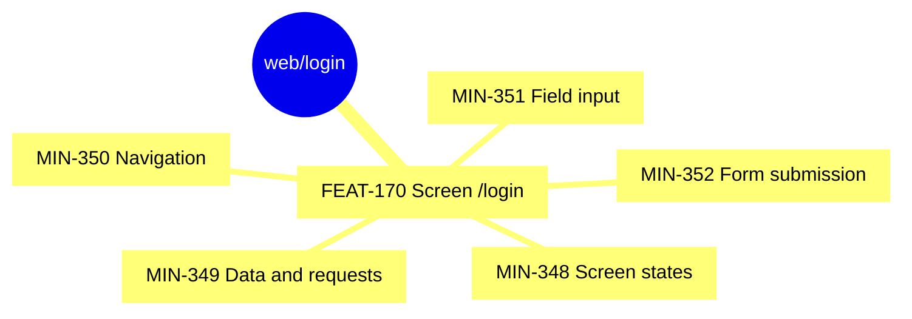
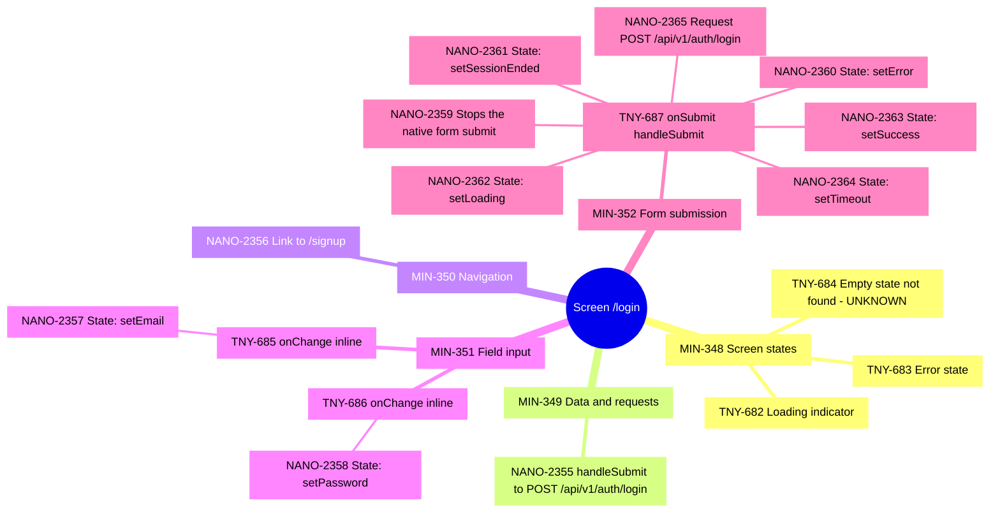

# web/login (MOD-172)

Generated by `project-mindmap/tools/catalog.py` from `master/MASTER_PROJECT_GRAPH.json` at commit `9b3032f`. Do not edit by hand. Back to the [feature catalog](../FEATURE_CATALOG.md).

**Application:** apps/web (MOD-002). **Purpose:** Routed screens under /login in apps/web/src/App.tsx.

**Nodes by level:** MODULE 1, MAJOR 1, MINOR 5, TINY 6, NANO 11. **Status:** IMPLEMENTED 23, UNKNOWN 1. **Verification:** PATH_LEVEL 10, UNKNOWN 13, VERIFIED 1.

## Module map (to minor features)

## FEAT-170 Screen /login

LoginPage at route /login (public); 1 buttons, 1 forms, 2 inputs; calls 1 endpoint(s).

| ID        | Level | Parent   | Name                                    | Description                                                                                                                                                                        | Status      | Verification | Evidence                             | Related                                                       |
| --------- | ----- | -------- | --------------------------------------- | ---------------------------------------------------------------------------------------------------------------------------------------------------------------------------------- | ----------- | ------------ | ------------------------------------ | ------------------------------------------------------------- |
| FEAT-170  | MAJOR | MOD-172  | Screen /login                           | LoginPage at route /login (public); 1 buttons, 1 forms, 2 inputs; calls 1 endpoint(s).                                                                                             | IMPLEMENTED | VERIFIED     | apps/web/src/App.tsx:56              | SCR-002, TEST-162, TEST-173, TEST-176, TEST-179, TEST-182 ... |
| MIN-348   | MINOR | FEAT-170 | Screen states                           | Loading, empty and error presentation found in the screen source; not found: Empty state.                                                                                          | IMPLEMENTED | PATH_LEVEL   | apps/web/src/pages/LoginPage.tsx     |                                                               |
| TNY-682   | TINY  | MIN-348  | Loading indicator                       | Loading indicator rendered by LoginPage (detected in source).                                                                                                                      | IMPLEMENTED | PATH_LEVEL   | apps/web/src/pages/LoginPage.tsx     |                                                               |
| TNY-683   | TINY  | MIN-348  | Error state                             | Error state rendered by LoginPage (detected in source).                                                                                                                            | IMPLEMENTED | PATH_LEVEL   | apps/web/src/pages/LoginPage.tsx     |                                                               |
| TNY-684   | TINY  | MIN-348  | Empty state (not found)                 | No empty state pattern was detected in apps/web/src/pages/LoginPage.tsx although the screen calls the API. May be handled by a shared component; confirm before treating as a gap. | UNKNOWN     | UNKNOWN      | apps/web/src/pages/LoginPage.tsx     |                                                               |
| MIN-349   | MINOR | FEAT-170 | Data and requests                       | API endpoints this screen calls (1).                                                                                                                                               | IMPLEMENTED | PATH_LEVEL   | apps/web/src/pages/LoginPage.tsx     |                                                               |
| NANO-2355 | NANO  | MIN-349  | handleSubmit -> POST /api/v1/auth/login | handleSubmit() at apps/web/src/pages/LoginPage.tsx:62 sends POST /api/v1/auth/login.                                                                                               | IMPLEMENTED | UNKNOWN      | apps/web/src/pages/LoginPage.tsx:62  | API-006                                                       |
| MIN-350   | MINOR | FEAT-170 | Navigation                              | Links from this screen to 1 other screen(s).                                                                                                                                       | IMPLEMENTED | PATH_LEVEL   | apps/web/src/pages/LoginPage.tsx     |                                                               |
| NANO-2356 | NANO  | MIN-350  | Link to /signup                         | Navigates to /signup (SignUpPage).                                                                                                                                                 | IMPLEMENTED | UNKNOWN      | apps/web/src/pages/LoginPage.tsx     | SCR-003                                                       |
| MIN-351   | MINOR | FEAT-170 | Field input                             | 2 'field input' binding(s) in apps/web/src/pages/LoginPage.tsx.                                                                                                                    | IMPLEMENTED | PATH_LEVEL   | apps/web/src/pages/LoginPage.tsx:192 |                                                               |
| TNY-685   | TINY  | MIN-351  | onChange inline                         | onChange at apps/web/src/pages/LoginPage.tsx:192 runs inline: (e) => setEmail(e.target.value); changes state setEmail.                                                             | IMPLEMENTED | PATH_LEVEL   | apps/web/src/pages/LoginPage.tsx:192 | INT-151                                                       |
| NANO-2357 | NANO  | TNY-685  | State: setEmail                         | Updates component state through setEmail.                                                                                                                                          | IMPLEMENTED | UNKNOWN      | apps/web/src/pages/LoginPage.tsx:192 |                                                               |
| TNY-686   | TINY  | MIN-351  | onChange inline                         | onChange at apps/web/src/pages/LoginPage.tsx:235 runs inline: (e) => setPassword(e.target.value); changes state setPassword.                                                       | IMPLEMENTED | PATH_LEVEL   | apps/web/src/pages/LoginPage.tsx:235 | INT-152                                                       |
| NANO-2358 | NANO  | TNY-686  | State: setPassword                      | Updates component state through setPassword.                                                                                                                                       | IMPLEMENTED | UNKNOWN      | apps/web/src/pages/LoginPage.tsx:235 |                                                               |
| MIN-352   | MINOR | FEAT-170 | Form submission                         | 1 'form submission' binding(s) in apps/web/src/pages/LoginPage.tsx.                                                                                                                | IMPLEMENTED | PATH_LEVEL   | apps/web/src/pages/LoginPage.tsx:171 |                                                               |
| TNY-687   | TINY  | MIN-352  | onSubmit handleSubmit                   | onSubmit at apps/web/src/pages/LoginPage.tsx:171 runs handleSubmit; changes state setError, setSessionEnded, setLoading, setSuccess, setTimeout; calls POST /api/v1/auth/login.    | IMPLEMENTED | PATH_LEVEL   | apps/web/src/pages/LoginPage.tsx:171 | INT-150                                                       |
| NANO-2359 | NANO  | TNY-687  | Stops the native form submit            | Calls event.preventDefault() so the page does not reload.                                                                                                                          | IMPLEMENTED | UNKNOWN      | apps/web/src/pages/LoginPage.tsx:40  |                                                               |
| NANO-2360 | NANO  | TNY-687  | State: setError                         | Updates component state through setError.                                                                                                                                          | IMPLEMENTED | UNKNOWN      | apps/web/src/pages/LoginPage.tsx:40  |                                                               |
| NANO-2361 | NANO  | TNY-687  | State: setSessionEnded                  | Updates component state through setSessionEnded.                                                                                                                                   | IMPLEMENTED | UNKNOWN      | apps/web/src/pages/LoginPage.tsx:40  |                                                               |
| NANO-2362 | NANO  | TNY-687  | State: setLoading                       | Updates component state through setLoading.                                                                                                                                        | IMPLEMENTED | UNKNOWN      | apps/web/src/pages/LoginPage.tsx:40  |                                                               |
| NANO-2363 | NANO  | TNY-687  | State: setSuccess                       | Updates component state through setSuccess.                                                                                                                                        | IMPLEMENTED | UNKNOWN      | apps/web/src/pages/LoginPage.tsx:40  |                                                               |
| NANO-2364 | NANO  | TNY-687  | State: setTimeout                       | Updates component state through setTimeout.                                                                                                                                        | IMPLEMENTED | UNKNOWN      | apps/web/src/pages/LoginPage.tsx:40  |                                                               |
| NANO-2365 | NANO  | TNY-687  | Request POST /api/v1/auth/login         | Sends POST /api/v1/auth/login through apiFetch/apiJson (apps/web/src/lib/api.ts).                                                                                                  | IMPLEMENTED | UNKNOWN      | apps/web/src/pages/LoginPage.tsx:40  | API-006                                                       |
