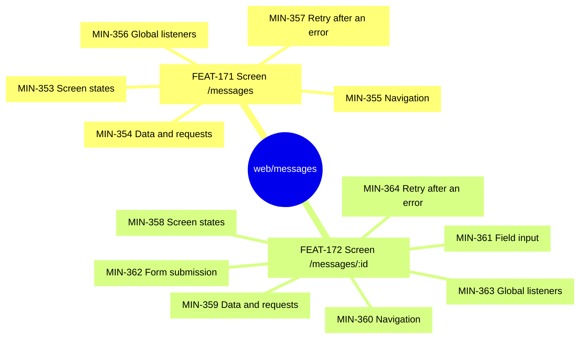
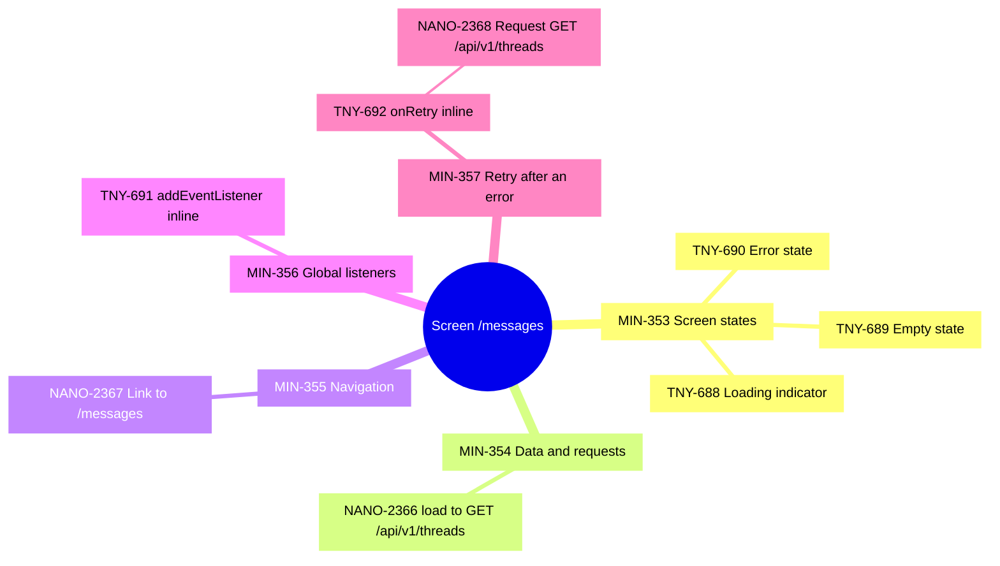
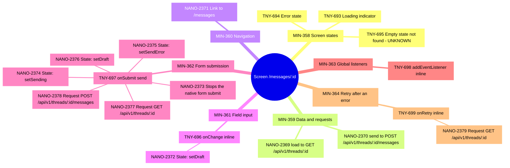

# web/messages (MOD-173)

Generated by `project-mindmap/tools/catalog.py` from `master/MASTER_PROJECT_GRAPH.json` at commit `9b3032f`. Do not edit by hand. Back to the [feature catalog](../FEATURE_CATALOG.md).

**Application:** apps/web (MOD-002). **Purpose:** Routed screens under /messages in apps/web/src/App.tsx.

**Nodes by level:** MODULE 1, MAJOR 2, MINOR 12, TINY 12, NANO 14. **Status:** IMPLEMENTED 40, UNKNOWN 1. **Verification:** PATH_LEVEL 10, UNKNOWN 30, VERIFIED 1.

## Module map (to minor features)

## FEAT-171 Screen /messages

MessagesPage at route /messages (signed-in only); 0 buttons, 0 forms, 0 inputs; calls 1 endpoint(s).

| ID        | Level | Parent   | Name                        | Description                                                                                                  | Status      | Verification | Evidence                               | Related           |
| --------- | ----- | -------- | --------------------------- | ------------------------------------------------------------------------------------------------------------ | ----------- | ------------ | -------------------------------------- | ----------------- |
| FEAT-171  | MAJOR | MOD-173  | Screen /messages            | MessagesPage at route /messages (signed-in only); 0 buttons, 0 forms, 0 inputs; calls 1 endpoint(s).         | IMPLEMENTED | VERIFIED     | apps/web/src/App.tsx:79                | SCR-023, TEST-192 |
| MIN-353   | MINOR | FEAT-171 | Screen states               | Loading, empty and error presentation found in the screen source.                                            | IMPLEMENTED | PATH_LEVEL   | apps/web/src/pages/MessagesPage.tsx    |                   |
| TNY-688   | TINY  | MIN-353  | Loading indicator           | Loading indicator rendered by MessagesPage (detected in source).                                             | IMPLEMENTED | PATH_LEVEL   | apps/web/src/pages/MessagesPage.tsx    |                   |
| TNY-689   | TINY  | MIN-353  | Empty state                 | Empty state rendered by MessagesPage (detected in source).                                                   | IMPLEMENTED | PATH_LEVEL   | apps/web/src/pages/MessagesPage.tsx    |                   |
| TNY-690   | TINY  | MIN-353  | Error state                 | Error state rendered by MessagesPage (detected in source).                                                   | IMPLEMENTED | PATH_LEVEL   | apps/web/src/pages/MessagesPage.tsx    |                   |
| MIN-354   | MINOR | FEAT-171 | Data and requests           | API endpoints this screen calls (1).                                                                         | IMPLEMENTED | PATH_LEVEL   | apps/web/src/pages/MessagesPage.tsx    |                   |
| NANO-2366 | NANO  | MIN-354  | load -> GET /api/v1/threads | load() at apps/web/src/pages/MessagesPage.tsx:24 sends GET /api/v1/threads.                                  | IMPLEMENTED | UNKNOWN      | apps/web/src/pages/MessagesPage.tsx:24 | API-112           |
| MIN-355   | MINOR | FEAT-171 | Navigation                  | Links from this screen to 1 other screen(s).                                                                 | IMPLEMENTED | PATH_LEVEL   | apps/web/src/pages/MessagesPage.tsx    |                   |
| NANO-2367 | NANO  | MIN-355  | Link to /messages           | Navigates to /messages (MessagesPage).                                                                       | IMPLEMENTED | UNKNOWN      | apps/web/src/pages/MessagesPage.tsx    | SCR-023           |
| MIN-356   | MINOR | FEAT-171 | Global listeners            | 1 'global listeners' binding(s) in apps/web/src/pages/MessagesPage.tsx.                                      | IMPLEMENTED | PATH_LEVEL   | apps/web/src/pages/MessagesPage.tsx:35 |                   |
| TNY-691   | TINY  | MIN-356  | addEventListener inline     | addEventListener at apps/web/src/pages/MessagesPage.tsx:35 runs inline: .                                    | IMPLEMENTED | PATH_LEVEL   | apps/web/src/pages/MessagesPage.tsx:35 | INT-153           |
| MIN-357   | MINOR | FEAT-171 | Retry after an error        | 1 'retry after an error' binding(s) in apps/web/src/pages/MessagesPage.tsx.                                  | IMPLEMENTED | PATH_LEVEL   | apps/web/src/pages/MessagesPage.tsx:51 |                   |
| TNY-692   | TINY  | MIN-357  | onRetry inline              | onRetry at apps/web/src/pages/MessagesPage.tsx:51 runs inline: () => void load(); calls GET /api/v1/threads. | IMPLEMENTED | PATH_LEVEL   | apps/web/src/pages/MessagesPage.tsx:51 | INT-154           |
| NANO-2368 | NANO  | TNY-692  | Request GET /api/v1/threads | Sends GET /api/v1/threads through apiFetch/apiJson (apps/web/src/lib/api.ts).                                | IMPLEMENTED | UNKNOWN      | apps/web/src/pages/MessagesPage.tsx:51 | API-112           |

## FEAT-172 Screen /messages/:id

ConversationPage at route /messages/:id (signed-in only); 1 buttons, 1 forms, 0 inputs; calls 2 endpoint(s).

| ID        | Level | Parent   | Name                                      | Description                                                                                                                                                                               | Status      | Verification | Evidence                                    | Related |
| --------- | ----- | -------- | ----------------------------------------- | ----------------------------------------------------------------------------------------------------------------------------------------------------------------------------------------- | ----------- | ------------ | ------------------------------------------- | ------- |
| FEAT-172  | MAJOR | MOD-173  | Screen /messages/:id                      | ConversationPage at route /messages/:id (signed-in only); 1 buttons, 1 forms, 0 inputs; calls 2 endpoint(s).                                                                              | IMPLEMENTED | UNKNOWN      | apps/web/src/App.tsx:80                     | SCR-024 |
| MIN-358   | MINOR | FEAT-172 | Screen states                             | Loading, empty and error presentation found in the screen source; not found: Empty state.                                                                                                 | IMPLEMENTED | UNKNOWN      | apps/web/src/pages/ConversationPage.tsx     |         |
| TNY-693   | TINY  | MIN-358  | Loading indicator                         | Loading indicator rendered by ConversationPage (detected in source).                                                                                                                      | IMPLEMENTED | UNKNOWN      | apps/web/src/pages/ConversationPage.tsx     |         |
| TNY-694   | TINY  | MIN-358  | Error state                               | Error state rendered by ConversationPage (detected in source).                                                                                                                            | IMPLEMENTED | UNKNOWN      | apps/web/src/pages/ConversationPage.tsx     |         |
| TNY-695   | TINY  | MIN-358  | Empty state (not found)                   | No empty state pattern was detected in apps/web/src/pages/ConversationPage.tsx although the screen calls the API. May be handled by a shared component; confirm before treating as a gap. | UNKNOWN     | UNKNOWN      | apps/web/src/pages/ConversationPage.tsx     |         |
| MIN-359   | MINOR | FEAT-172 | Data and requests                         | API endpoints this screen calls (2).                                                                                                                                                      | IMPLEMENTED | UNKNOWN      | apps/web/src/pages/ConversationPage.tsx     |         |
| NANO-2369 | NANO  | MIN-359  | load -> GET /api/v1/threads/:id           | load() at apps/web/src/pages/ConversationPage.tsx:52 sends GET /api/v1/threads/:id.                                                                                                       | IMPLEMENTED | UNKNOWN      | apps/web/src/pages/ConversationPage.tsx:52  | API-114 |
| NANO-2370 | NANO  | MIN-359  | send -> POST /api/v1/threads/:id/messages | send() at apps/web/src/pages/ConversationPage.tsx:95 sends POST /api/v1/threads/:id/messages.                                                                                             | IMPLEMENTED | UNKNOWN      | apps/web/src/pages/ConversationPage.tsx:95  | API-115 |
| MIN-360   | MINOR | FEAT-172 | Navigation                                | Links from this screen to 1 other screen(s).                                                                                                                                              | IMPLEMENTED | UNKNOWN      | apps/web/src/pages/ConversationPage.tsx     |         |
| NANO-2371 | NANO  | MIN-360  | Link to /messages                         | Navigates to /messages (MessagesPage).                                                                                                                                                    | IMPLEMENTED | UNKNOWN      | apps/web/src/pages/ConversationPage.tsx     | SCR-023 |
| MIN-361   | MINOR | FEAT-172 | Field input                               | 1 'field input' binding(s) in apps/web/src/pages/ConversationPage.tsx.                                                                                                                    | IMPLEMENTED | UNKNOWN      | apps/web/src/pages/ConversationPage.tsx:219 |         |
| TNY-696   | TINY  | MIN-361  | onChange inline                           | onChange at apps/web/src/pages/ConversationPage.tsx:219 runs inline: (e) => setDraft(e.target.value); changes state setDraft.                                                             | IMPLEMENTED | UNKNOWN      | apps/web/src/pages/ConversationPage.tsx:219 | INT-067 |
| NANO-2372 | NANO  | TNY-696  | State: setDraft                           | Updates component state through setDraft.                                                                                                                                                 | IMPLEMENTED | UNKNOWN      | apps/web/src/pages/ConversationPage.tsx:219 |         |
| MIN-362   | MINOR | FEAT-172 | Form submission                           | 1 'form submission' binding(s) in apps/web/src/pages/ConversationPage.tsx.                                                                                                                | IMPLEMENTED | UNKNOWN      | apps/web/src/pages/ConversationPage.tsx:205 |         |
| TNY-697   | TINY  | MIN-362  | onSubmit send                             | onSubmit at apps/web/src/pages/ConversationPage.tsx:205 runs send; changes state setSending, setSendError, setDraft; calls GET /api/v1/threads/:id, POST /api/v1/threads/:id/messages.    | IMPLEMENTED | UNKNOWN      | apps/web/src/pages/ConversationPage.tsx:205 | INT-066 |
| NANO-2373 | NANO  | TNY-697  | Stops the native form submit              | Calls event.preventDefault() so the page does not reload.                                                                                                                                 | IMPLEMENTED | UNKNOWN      | apps/web/src/pages/ConversationPage.tsx:88  |         |
| NANO-2374 | NANO  | TNY-697  | State: setSending                         | Updates component state through setSending.                                                                                                                                               | IMPLEMENTED | UNKNOWN      | apps/web/src/pages/ConversationPage.tsx:88  |         |
| NANO-2375 | NANO  | TNY-697  | State: setSendError                       | Updates component state through setSendError.                                                                                                                                             | IMPLEMENTED | UNKNOWN      | apps/web/src/pages/ConversationPage.tsx:88  |         |
| NANO-2376 | NANO  | TNY-697  | State: setDraft                           | Updates component state through setDraft.                                                                                                                                                 | IMPLEMENTED | UNKNOWN      | apps/web/src/pages/ConversationPage.tsx:88  |         |
| NANO-2377 | NANO  | TNY-697  | Request GET /api/v1/threads/:id           | Sends GET /api/v1/threads/:id through apiFetch/apiJson (apps/web/src/lib/api.ts).                                                                                                         | IMPLEMENTED | UNKNOWN      | apps/web/src/pages/ConversationPage.tsx:88  | API-114 |
| NANO-2378 | NANO  | TNY-697  | Request POST /api/v1/threads/:id/messages | Sends POST /api/v1/threads/:id/messages through apiFetch/apiJson (apps/web/src/lib/api.ts).                                                                                               | IMPLEMENTED | UNKNOWN      | apps/web/src/pages/ConversationPage.tsx:88  | API-115 |
| MIN-363   | MINOR | FEAT-172 | Global listeners                          | 1 'global listeners' binding(s) in apps/web/src/pages/ConversationPage.tsx.                                                                                                               | IMPLEMENTED | UNKNOWN      | apps/web/src/pages/ConversationPage.tsx:70  |         |
| TNY-698   | TINY  | MIN-363  | addEventListener inline                   | addEventListener at apps/web/src/pages/ConversationPage.tsx:70 runs inline: .                                                                                                             | IMPLEMENTED | UNKNOWN      | apps/web/src/pages/ConversationPage.tsx:70  | INT-064 |
| MIN-364   | MINOR | FEAT-172 | Retry after an error                      | 1 'retry after an error' binding(s) in apps/web/src/pages/ConversationPage.tsx.                                                                                                           | IMPLEMENTED | UNKNOWN      | apps/web/src/pages/ConversationPage.tsx:132 |         |
| TNY-699   | TINY  | MIN-364  | onRetry inline                            | onRetry at apps/web/src/pages/ConversationPage.tsx:132 runs inline: () => void load(); calls GET /api/v1/threads/:id.                                                                     | IMPLEMENTED | UNKNOWN      | apps/web/src/pages/ConversationPage.tsx:132 | INT-065 |
| NANO-2379 | NANO  | TNY-699  | Request GET /api/v1/threads/:id           | Sends GET /api/v1/threads/:id through apiFetch/apiJson (apps/web/src/lib/api.ts).                                                                                                         | IMPLEMENTED | UNKNOWN      | apps/web/src/pages/ConversationPage.tsx:132 | API-114 |
