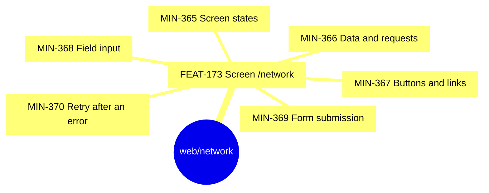
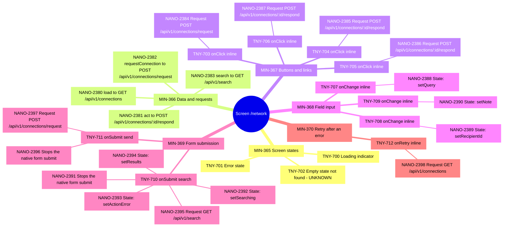

# web/network (MOD-174)

Generated by `project-mindmap/tools/catalog.py` from `master/MASTER_PROJECT_GRAPH.json` at commit `9b3032f`. Do not edit by hand. Back to the [feature catalog](../FEATURE_CATALOG.md).

**Application:** apps/web (MOD-002). **Purpose:** Routed screens under /network in apps/web/src/App.tsx.

**Nodes by level:** MODULE 1, MAJOR 1, MINOR 6, TINY 13, NANO 19. **Status:** IMPLEMENTED 39, UNKNOWN 1. **Verification:** PATH_LEVEL 18, UNKNOWN 21, VERIFIED 1.

## Module map (to minor features)

## FEAT-173 Screen /network

NetworkPage at route /network (signed-in only); 6 buttons, 2 forms, 2 inputs; calls 4 endpoint(s).

| ID        | Level | Parent   | Name                                                  | Description                                                                                                                                                                          | Status      | Verification | Evidence                               | Related           |
| --------- | ----- | -------- | ----------------------------------------------------- | ------------------------------------------------------------------------------------------------------------------------------------------------------------------------------------ | ----------- | ------------ | -------------------------------------- | ----------------- |
| FEAT-173  | MAJOR | MOD-174  | Screen /network                                       | NetworkPage at route /network (signed-in only); 6 buttons, 2 forms, 2 inputs; calls 4 endpoint(s).                                                                                   | IMPLEMENTED | VERIFIED     | apps/web/src/App.tsx:74                | SCR-018, TEST-196 |
| MIN-365   | MINOR | FEAT-173 | Screen states                                         | Loading, empty and error presentation found in the screen source; not found: Empty state.                                                                                            | IMPLEMENTED | PATH_LEVEL   | apps/web/src/pages/NetworkPage.tsx     |                   |
| TNY-700   | TINY  | MIN-365  | Loading indicator                                     | Loading indicator rendered by NetworkPage (detected in source).                                                                                                                      | IMPLEMENTED | PATH_LEVEL   | apps/web/src/pages/NetworkPage.tsx     |                   |
| TNY-701   | TINY  | MIN-365  | Error state                                           | Error state rendered by NetworkPage (detected in source).                                                                                                                            | IMPLEMENTED | PATH_LEVEL   | apps/web/src/pages/NetworkPage.tsx     |                   |
| TNY-702   | TINY  | MIN-365  | Empty state (not found)                               | No empty state pattern was detected in apps/web/src/pages/NetworkPage.tsx although the screen calls the API. May be handled by a shared component; confirm before treating as a gap. | UNKNOWN     | UNKNOWN      | apps/web/src/pages/NetworkPage.tsx     |                   |
| MIN-366   | MINOR | FEAT-173 | Data and requests                                     | API endpoints this screen calls (4).                                                                                                                                                 | IMPLEMENTED | PATH_LEVEL   | apps/web/src/pages/NetworkPage.tsx     |                   |
| NANO-2380 | NANO  | MIN-366  | load -> GET /api/v1/connections                       | load() at apps/web/src/pages/NetworkPage.tsx:79 sends GET /api/v1/connections.                                                                                                       | IMPLEMENTED | UNKNOWN      | apps/web/src/pages/NetworkPage.tsx:79  | API-135           |
| NANO-2381 | NANO  | MIN-366  | act -> POST /api/v1/connections/:id/respond           | act() at apps/web/src/pages/NetworkPage.tsx:103 sends POST /api/v1/connections/:id/respond.                                                                                          | IMPLEMENTED | UNKNOWN      | apps/web/src/pages/NetworkPage.tsx:103 | API-137           |
| NANO-2382 | NANO  | MIN-366  | requestConnection -> POST /api/v1/connections/request | requestConnection() at apps/web/src/pages/NetworkPage.tsx:124 sends POST /api/v1/connections/request.                                                                                | IMPLEMENTED | UNKNOWN      | apps/web/src/pages/NetworkPage.tsx:124 | API-134           |
| NANO-2383 | NANO  | MIN-366  | search -> GET /api/v1/search                          | search() at apps/web/src/pages/NetworkPage.tsx:155 sends GET /api/v1/search.                                                                                                         | IMPLEMENTED | UNKNOWN      | apps/web/src/pages/NetworkPage.tsx:155 | API-237           |
| MIN-367   | MINOR | FEAT-173 | Buttons and links                                     | 4 'buttons and links' binding(s) in apps/web/src/pages/NetworkPage.tsx.                                                                                                              | IMPLEMENTED | PATH_LEVEL   | apps/web/src/pages/NetworkPage.tsx:247 |                   |
| TNY-703   | TINY  | MIN-367  | onClick inline                                        | onClick at apps/web/src/pages/NetworkPage.tsx:247 runs inline: () => void requestConnection(hit.id); calls POST /api/v1/connections/request.                                         | IMPLEMENTED | PATH_LEVEL   | apps/web/src/pages/NetworkPage.tsx:247 | INT-158           |
| NANO-2384 | NANO  | TNY-703  | Request POST /api/v1/connections/request              | Sends POST /api/v1/connections/request through apiFetch/apiJson (apps/web/src/lib/api.ts).                                                                                           | IMPLEMENTED | UNKNOWN      | apps/web/src/pages/NetworkPage.tsx:247 | API-134           |
| TNY-704   | TINY  | MIN-367  | onClick inline                                        | onClick at apps/web/src/pages/NetworkPage.tsx:325 runs inline: () => void act( connection.id, 'respond', { action; calls POST /api/v1/connections/:id/respond.                       | IMPLEMENTED | PATH_LEVEL   | apps/web/src/pages/NetworkPage.tsx:325 | INT-162           |
| NANO-2385 | NANO  | TNY-704  | Request POST /api/v1/connections/:id/respond          | Sends POST /api/v1/connections/:id/respond through apiFetch/apiJson (apps/web/src/lib/api.ts).                                                                                       | IMPLEMENTED | UNKNOWN      | apps/web/src/pages/NetworkPage.tsx:325 | API-137           |
| TNY-705   | TINY  | MIN-367  | onClick inline                                        | onClick at apps/web/src/pages/NetworkPage.tsx:340 runs inline: () => void act( connection.id, 'respond', { action; calls POST /api/v1/connections/:id/respond.                       | IMPLEMENTED | PATH_LEVEL   | apps/web/src/pages/NetworkPage.tsx:340 | INT-163           |
| NANO-2386 | NANO  | TNY-705  | Request POST /api/v1/connections/:id/respond          | Sends POST /api/v1/connections/:id/respond through apiFetch/apiJson (apps/web/src/lib/api.ts).                                                                                       | IMPLEMENTED | UNKNOWN      | apps/web/src/pages/NetworkPage.tsx:340 | API-137           |
| TNY-706   | TINY  | MIN-367  | onClick inline                                        | onClick at apps/web/src/pages/NetworkPage.tsx:358 runs inline: () => void act(connection.id, 'withdraw', undefine; calls POST /api/v1/connections/:id/respond.                       | IMPLEMENTED | PATH_LEVEL   | apps/web/src/pages/NetworkPage.tsx:358 | INT-164           |
| NANO-2387 | NANO  | TNY-706  | Request POST /api/v1/connections/:id/respond          | Sends POST /api/v1/connections/:id/respond through apiFetch/apiJson (apps/web/src/lib/api.ts).                                                                                       | IMPLEMENTED | UNKNOWN      | apps/web/src/pages/NetworkPage.tsx:358 | API-137           |
| MIN-368   | MINOR | FEAT-173 | Field input                                           | 3 'field input' binding(s) in apps/web/src/pages/NetworkPage.tsx.                                                                                                                    | IMPLEMENTED | PATH_LEVEL   | apps/web/src/pages/NetworkPage.tsx:198 |                   |
| TNY-707   | TINY  | MIN-368  | onChange inline                                       | onChange at apps/web/src/pages/NetworkPage.tsx:198 runs inline: (e) => setQuery(e.target.value); changes state setQuery.                                                             | IMPLEMENTED | PATH_LEVEL   | apps/web/src/pages/NetworkPage.tsx:198 | INT-157           |
| NANO-2388 | NANO  | TNY-707  | State: setQuery                                       | Updates component state through setQuery.                                                                                                                                            | IMPLEMENTED | UNKNOWN      | apps/web/src/pages/NetworkPage.tsx:198 |                   |
| TNY-708   | TINY  | MIN-368  | onChange inline                                       | onChange at apps/web/src/pages/NetworkPage.tsx:266 runs inline: (e) => setRecipientId(e.target.value); changes state setRecipientId.                                                 | IMPLEMENTED | PATH_LEVEL   | apps/web/src/pages/NetworkPage.tsx:266 | INT-160           |
| NANO-2389 | NANO  | TNY-708  | State: setRecipientId                                 | Updates component state through setRecipientId.                                                                                                                                      | IMPLEMENTED | UNKNOWN      | apps/web/src/pages/NetworkPage.tsx:266 |                   |
| TNY-709   | TINY  | MIN-368  | onChange inline                                       | onChange at apps/web/src/pages/NetworkPage.tsx:275 runs inline: (e) => setNote(e.target.value); changes state setNote.                                                               | IMPLEMENTED | PATH_LEVEL   | apps/web/src/pages/NetworkPage.tsx:275 | INT-161           |
| NANO-2390 | NANO  | TNY-709  | State: setNote                                        | Updates component state through setNote.                                                                                                                                             | IMPLEMENTED | UNKNOWN      | apps/web/src/pages/NetworkPage.tsx:275 |                   |
| MIN-369   | MINOR | FEAT-173 | Form submission                                       | 2 'form submission' binding(s) in apps/web/src/pages/NetworkPage.tsx.                                                                                                                | IMPLEMENTED | PATH_LEVEL   | apps/web/src/pages/NetworkPage.tsx:192 |                   |
| TNY-710   | TINY  | MIN-369  | onSubmit search                                       | onSubmit at apps/web/src/pages/NetworkPage.tsx:192 runs search; changes state setSearching, setActionError, setResults; calls GET /api/v1/search.                                    | IMPLEMENTED | PATH_LEVEL   | apps/web/src/pages/NetworkPage.tsx:192 | INT-156           |
| NANO-2391 | NANO  | TNY-710  | Stops the native form submit                          | Calls event.preventDefault() so the page does not reload.                                                                                                                            | IMPLEMENTED | UNKNOWN      | apps/web/src/pages/NetworkPage.tsx:146 |                   |
| NANO-2392 | NANO  | TNY-710  | State: setSearching                                   | Updates component state through setSearching.                                                                                                                                        | IMPLEMENTED | UNKNOWN      | apps/web/src/pages/NetworkPage.tsx:146 |                   |
| NANO-2393 | NANO  | TNY-710  | State: setActionError                                 | Updates component state through setActionError.                                                                                                                                      | IMPLEMENTED | UNKNOWN      | apps/web/src/pages/NetworkPage.tsx:146 |                   |
| NANO-2394 | NANO  | TNY-710  | State: setResults                                     | Updates component state through setResults.                                                                                                                                          | IMPLEMENTED | UNKNOWN      | apps/web/src/pages/NetworkPage.tsx:146 |                   |
| NANO-2395 | NANO  | TNY-710  | Request GET /api/v1/search                            | Sends GET /api/v1/search through apiFetch/apiJson (apps/web/src/lib/api.ts).                                                                                                         | IMPLEMENTED | UNKNOWN      | apps/web/src/pages/NetworkPage.tsx:146 | API-237           |
| TNY-711   | TINY  | MIN-369  | onSubmit send                                         | onSubmit at apps/web/src/pages/NetworkPage.tsx:260 runs send; calls POST /api/v1/connections/request.                                                                                | IMPLEMENTED | PATH_LEVEL   | apps/web/src/pages/NetworkPage.tsx:260 | INT-159           |
| NANO-2396 | NANO  | TNY-711  | Stops the native form submit                          | Calls event.preventDefault() so the page does not reload.                                                                                                                            | IMPLEMENTED | UNKNOWN      | apps/web/src/pages/NetworkPage.tsx:141 |                   |
| NANO-2397 | NANO  | TNY-711  | Request POST /api/v1/connections/request              | Sends POST /api/v1/connections/request through apiFetch/apiJson (apps/web/src/lib/api.ts).                                                                                           | IMPLEMENTED | UNKNOWN      | apps/web/src/pages/NetworkPage.tsx:141 | API-134           |
| MIN-370   | MINOR | FEAT-173 | Retry after an error                                  | 1 'retry after an error' binding(s) in apps/web/src/pages/NetworkPage.tsx.                                                                                                           | IMPLEMENTED | PATH_LEVEL   | apps/web/src/pages/NetworkPage.tsx:175 |                   |
| TNY-712   | TINY  | MIN-370  | onRetry inline                                        | onRetry at apps/web/src/pages/NetworkPage.tsx:175 runs inline: () => void load(); calls GET /api/v1/connections.                                                                     | IMPLEMENTED | PATH_LEVEL   | apps/web/src/pages/NetworkPage.tsx:175 | INT-155           |
| NANO-2398 | NANO  | TNY-712  | Request GET /api/v1/connections                       | Sends GET /api/v1/connections through apiFetch/apiJson (apps/web/src/lib/api.ts).                                                                                                    | IMPLEMENTED | UNKNOWN      | apps/web/src/pages/NetworkPage.tsx:175 | API-135           |
