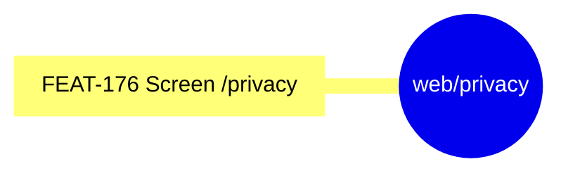

# web/privacy (MOD-177)

Generated by `project-mindmap/tools/catalog.py` from `master/MASTER_PROJECT_GRAPH.json` at commit `9b3032f`. Do not edit by hand. Back to the [feature catalog](../FEATURE_CATALOG.md).

**Application:** apps/web (MOD-002). **Purpose:** Routed screens under /privacy in apps/web/src/App.tsx.

**Nodes by level:** MODULE 1, MAJOR 1. **Status:** IMPLEMENTED 2. **Verification:** UNKNOWN 1, VERIFIED 1.

**Known gaps:** FEAT-176 no API call found in this screen file.

## Module map (to minor features)

## FEAT-176 Screen /privacy

PrivacyPage at route /privacy (public); 0 buttons, 0 forms, 0 inputs; calls 0 endpoint(s).

| ID       | Level | Parent  | Name            | Description                                                                                                                            | Status      | Verification | Evidence                | Related                                                   |
| -------- | ----- | ------- | --------------- | -------------------------------------------------------------------------------------------------------------------------------------- | ----------- | ------------ | ----------------------- | --------------------------------------------------------- |
| FEAT-176 | MAJOR | MOD-177 | Screen /privacy | PrivacyPage at route /privacy (public); 0 buttons, 0 forms, 0 inputs; calls 0 endpoint(s). Gaps: no API call found in this screen file | IMPLEMENTED | VERIFIED     | apps/web/src/App.tsx:59 | SCR-005, TEST-162, TEST-184, TEST-199, TEST-201, TEST-220 |
