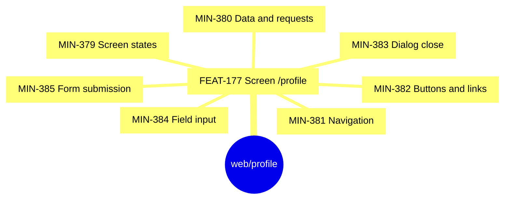
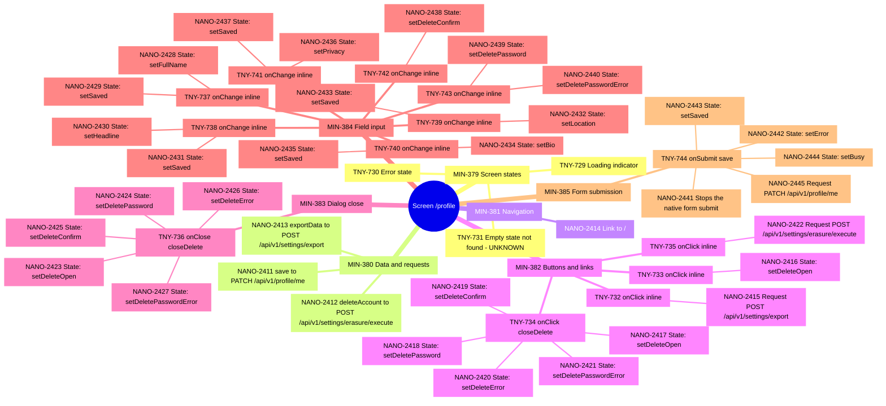

# web/profile (MOD-178)

Generated by `project-mindmap/tools/catalog.py` from `master/MASTER_PROJECT_GRAPH.json` at commit `9b3032f`. Do not edit by hand. Back to the [feature catalog](../FEATURE_CATALOG.md).

**Application:** apps/web (MOD-002). **Purpose:** Routed screens under /profile in apps/web/src/App.tsx.

**Nodes by level:** MODULE 1, MAJOR 1, MINOR 7, TINY 16, NANO 35. **Status:** IMPLEMENTED 59, UNKNOWN 1. **Verification:** PATH_LEVEL 22, UNKNOWN 37, VERIFIED 1.

## Module map (to minor features)

## FEAT-177 Screen /profile

ProfilePage at route /profile (signed-in only); 5 buttons, 1 forms, 5 inputs; calls 3 endpoint(s).

| ID        | Level | Parent   | Name                                                   | Description                                                                                                                                                                          | Status      | Verification | Evidence                               | Related                                                   |
| --------- | ----- | -------- | ------------------------------------------------------ | ------------------------------------------------------------------------------------------------------------------------------------------------------------------------------------ | ----------- | ------------ | -------------------------------------- | --------------------------------------------------------- |
| FEAT-177  | MAJOR | MOD-178  | Screen /profile                                        | ProfilePage at route /profile (signed-in only); 5 buttons, 1 forms, 5 inputs; calls 3 endpoint(s).                                                                                   | IMPLEMENTED | VERIFIED     | apps/web/src/App.tsx:70                | SCR-014, TEST-163, TEST-164, TEST-179, TEST-210, TEST-213 |
| MIN-379   | MINOR | FEAT-177 | Screen states                                          | Loading, empty and error presentation found in the screen source; not found: Empty state.                                                                                            | IMPLEMENTED | PATH_LEVEL   | apps/web/src/pages/ProfilePage.tsx     |                                                           |
| TNY-729   | TINY  | MIN-379  | Loading indicator                                      | Loading indicator rendered by ProfilePage (detected in source).                                                                                                                      | IMPLEMENTED | PATH_LEVEL   | apps/web/src/pages/ProfilePage.tsx     |                                                           |
| TNY-730   | TINY  | MIN-379  | Error state                                            | Error state rendered by ProfilePage (detected in source).                                                                                                                            | IMPLEMENTED | PATH_LEVEL   | apps/web/src/pages/ProfilePage.tsx     |                                                           |
| TNY-731   | TINY  | MIN-379  | Empty state (not found)                                | No empty state pattern was detected in apps/web/src/pages/ProfilePage.tsx although the screen calls the API. May be handled by a shared component; confirm before treating as a gap. | UNKNOWN     | UNKNOWN      | apps/web/src/pages/ProfilePage.tsx     |                                                           |
| MIN-380   | MINOR | FEAT-177 | Data and requests                                      | API endpoints this screen calls (3).                                                                                                                                                 | IMPLEMENTED | PATH_LEVEL   | apps/web/src/pages/ProfilePage.tsx     |                                                           |
| NANO-2411 | NANO  | MIN-380  | save -> PATCH /api/v1/profile/me                       | save() at apps/web/src/pages/ProfilePage.tsx:95 sends PATCH /api/v1/profile/me.                                                                                                      | IMPLEMENTED | UNKNOWN      | apps/web/src/pages/ProfilePage.tsx:95  | API-012                                                   |
| NANO-2412 | NANO  | MIN-380  | deleteAccount -> POST /api/v1/settings/erasure/execute | deleteAccount() at apps/web/src/pages/ProfilePage.tsx:121 sends POST /api/v1/settings/erasure/execute.                                                                               | IMPLEMENTED | UNKNOWN      | apps/web/src/pages/ProfilePage.tsx:121 | API-219                                                   |
| NANO-2413 | NANO  | MIN-380  | exportData -> POST /api/v1/settings/export             | exportData() at apps/web/src/pages/ProfilePage.tsx:152 sends POST /api/v1/settings/export.                                                                                           | IMPLEMENTED | UNKNOWN      | apps/web/src/pages/ProfilePage.tsx:152 | API-214                                                   |
| MIN-381   | MINOR | FEAT-177 | Navigation                                             | Links from this screen to 1 other screen(s).                                                                                                                                         | IMPLEMENTED | PATH_LEVEL   | apps/web/src/pages/ProfilePage.tsx     |                                                           |
| NANO-2414 | NANO  | MIN-381  | Link to /                                              | Navigates to / (LandingPage).                                                                                                                                                        | IMPLEMENTED | UNKNOWN      | apps/web/src/pages/ProfilePage.tsx     | SCR-001                                                   |
| MIN-382   | MINOR | FEAT-177 | Buttons and links                                      | 4 'buttons and links' binding(s) in apps/web/src/pages/ProfilePage.tsx.                                                                                                              | IMPLEMENTED | PATH_LEVEL   | apps/web/src/pages/ProfilePage.tsx:319 |                                                           |
| TNY-732   | TINY  | MIN-382  | onClick inline                                         | onClick at apps/web/src/pages/ProfilePage.tsx:319 runs inline: () => void exportData(); calls POST /api/v1/settings/export.                                                          | IMPLEMENTED | PATH_LEVEL   | apps/web/src/pages/ProfilePage.tsx:319 | INT-181                                                   |
| NANO-2415 | NANO  | TNY-732  | Request POST /api/v1/settings/export                   | Sends POST /api/v1/settings/export through apiFetch/apiJson (apps/web/src/lib/api.ts).                                                                                               | IMPLEMENTED | UNKNOWN      | apps/web/src/pages/ProfilePage.tsx:319 | API-214                                                   |
| TNY-733   | TINY  | MIN-382  | onClick inline                                         | onClick at apps/web/src/pages/ProfilePage.tsx:331 runs inline: () => setDeleteOpen(true); changes state setDeleteOpen.                                                               | IMPLEMENTED | PATH_LEVEL   | apps/web/src/pages/ProfilePage.tsx:331 | INT-182                                                   |
| NANO-2416 | NANO  | TNY-733  | State: setDeleteOpen                                   | Updates component state through setDeleteOpen.                                                                                                                                       | IMPLEMENTED | UNKNOWN      | apps/web/src/pages/ProfilePage.tsx:331 |                                                           |
| TNY-734   | TINY  | MIN-382  | onClick closeDelete                                    | onClick at apps/web/src/pages/ProfilePage.tsx:372 runs closeDelete; changes state setDeleteOpen, setDeletePassword, setDeleteConfirm, setDeleteError, setDeletePasswordError.        | IMPLEMENTED | PATH_LEVEL   | apps/web/src/pages/ProfilePage.tsx:372 | INT-186                                                   |
| NANO-2417 | NANO  | TNY-734  | State: setDeleteOpen                                   | Updates component state through setDeleteOpen.                                                                                                                                       | IMPLEMENTED | UNKNOWN      | apps/web/src/pages/ProfilePage.tsx:106 |                                                           |
| NANO-2418 | NANO  | TNY-734  | State: setDeletePassword                               | Updates component state through setDeletePassword.                                                                                                                                   | IMPLEMENTED | UNKNOWN      | apps/web/src/pages/ProfilePage.tsx:106 |                                                           |
| NANO-2419 | NANO  | TNY-734  | State: setDeleteConfirm                                | Updates component state through setDeleteConfirm.                                                                                                                                    | IMPLEMENTED | UNKNOWN      | apps/web/src/pages/ProfilePage.tsx:106 |                                                           |
| NANO-2420 | NANO  | TNY-734  | State: setDeleteError                                  | Updates component state through setDeleteError.                                                                                                                                      | IMPLEMENTED | UNKNOWN      | apps/web/src/pages/ProfilePage.tsx:106 |                                                           |
| NANO-2421 | NANO  | TNY-734  | State: setDeletePasswordError                          | Updates component state through setDeletePasswordError.                                                                                                                              | IMPLEMENTED | UNKNOWN      | apps/web/src/pages/ProfilePage.tsx:106 |                                                           |
| TNY-735   | TINY  | MIN-382  | onClick inline                                         | onClick at apps/web/src/pages/ProfilePage.tsx:378 runs inline: () => void deleteAccount(); calls POST /api/v1/settings/erasure/execute.                                              | IMPLEMENTED | PATH_LEVEL   | apps/web/src/pages/ProfilePage.tsx:378 | INT-187                                                   |
| NANO-2422 | NANO  | TNY-735  | Request POST /api/v1/settings/erasure/execute          | Sends POST /api/v1/settings/erasure/execute through apiFetch/apiJson (apps/web/src/lib/api.ts).                                                                                      | IMPLEMENTED | UNKNOWN      | apps/web/src/pages/ProfilePage.tsx:378 | API-219                                                   |
| MIN-383   | MINOR | FEAT-177 | Dialog close                                           | 1 'dialog close' binding(s) in apps/web/src/pages/ProfilePage.tsx.                                                                                                                   | IMPLEMENTED | PATH_LEVEL   | apps/web/src/pages/ProfilePage.tsx:341 |                                                           |
| TNY-736   | TINY  | MIN-383  | onClose closeDelete                                    | onClose at apps/web/src/pages/ProfilePage.tsx:341 runs closeDelete; changes state setDeleteOpen, setDeletePassword, setDeleteConfirm, setDeleteError, setDeletePasswordError.        | IMPLEMENTED | PATH_LEVEL   | apps/web/src/pages/ProfilePage.tsx:341 | INT-183                                                   |
| NANO-2423 | NANO  | TNY-736  | State: setDeleteOpen                                   | Updates component state through setDeleteOpen.                                                                                                                                       | IMPLEMENTED | UNKNOWN      | apps/web/src/pages/ProfilePage.tsx:106 |                                                           |
| NANO-2424 | NANO  | TNY-736  | State: setDeletePassword                               | Updates component state through setDeletePassword.                                                                                                                                   | IMPLEMENTED | UNKNOWN      | apps/web/src/pages/ProfilePage.tsx:106 |                                                           |
| NANO-2425 | NANO  | TNY-736  | State: setDeleteConfirm                                | Updates component state through setDeleteConfirm.                                                                                                                                    | IMPLEMENTED | UNKNOWN      | apps/web/src/pages/ProfilePage.tsx:106 |                                                           |
| NANO-2426 | NANO  | TNY-736  | State: setDeleteError                                  | Updates component state through setDeleteError.                                                                                                                                      | IMPLEMENTED | UNKNOWN      | apps/web/src/pages/ProfilePage.tsx:106 |                                                           |
| NANO-2427 | NANO  | TNY-736  | State: setDeletePasswordError                          | Updates component state through setDeletePasswordError.                                                                                                                              | IMPLEMENTED | UNKNOWN      | apps/web/src/pages/ProfilePage.tsx:106 |                                                           |
| MIN-384   | MINOR | FEAT-177 | Field input                                            | 7 'field input' binding(s) in apps/web/src/pages/ProfilePage.tsx.                                                                                                                    | IMPLEMENTED | PATH_LEVEL   | apps/web/src/pages/ProfilePage.tsx:220 |                                                           |
| TNY-737   | TINY  | MIN-384  | onChange inline                                        | onChange at apps/web/src/pages/ProfilePage.tsx:220 runs inline: (e) => { setFullName(e.target.value); setSaved(fal; changes state setFullName, setSaved.                             | IMPLEMENTED | PATH_LEVEL   | apps/web/src/pages/ProfilePage.tsx:220 | INT-176                                                   |
| NANO-2428 | NANO  | TNY-737  | State: setFullName                                     | Updates component state through setFullName.                                                                                                                                         | IMPLEMENTED | UNKNOWN      | apps/web/src/pages/ProfilePage.tsx:220 |                                                           |
| NANO-2429 | NANO  | TNY-737  | State: setSaved                                        | Updates component state through setSaved.                                                                                                                                            | IMPLEMENTED | UNKNOWN      | apps/web/src/pages/ProfilePage.tsx:220 |                                                           |
| TNY-738   | TINY  | MIN-384  | onChange inline                                        | onChange at apps/web/src/pages/ProfilePage.tsx:233 runs inline: (e) => { setHeadline(e.target.value); setSaved(fal; changes state setHeadline, setSaved.                             | IMPLEMENTED | PATH_LEVEL   | apps/web/src/pages/ProfilePage.tsx:233 | INT-177                                                   |
| NANO-2430 | NANO  | TNY-738  | State: setHeadline                                     | Updates component state through setHeadline.                                                                                                                                         | IMPLEMENTED | UNKNOWN      | apps/web/src/pages/ProfilePage.tsx:233 |                                                           |
| NANO-2431 | NANO  | TNY-738  | State: setSaved                                        | Updates component state through setSaved.                                                                                                                                            | IMPLEMENTED | UNKNOWN      | apps/web/src/pages/ProfilePage.tsx:233 |                                                           |
| TNY-739   | TINY  | MIN-384  | onChange inline                                        | onChange at apps/web/src/pages/ProfilePage.tsx:244 runs inline: (e) => { setLocation(e.target.value); setSaved(fal; changes state setLocation, setSaved.                             | IMPLEMENTED | PATH_LEVEL   | apps/web/src/pages/ProfilePage.tsx:244 | INT-178                                                   |
| NANO-2432 | NANO  | TNY-739  | State: setLocation                                     | Updates component state through setLocation.                                                                                                                                         | IMPLEMENTED | UNKNOWN      | apps/web/src/pages/ProfilePage.tsx:244 |                                                           |
| NANO-2433 | NANO  | TNY-739  | State: setSaved                                        | Updates component state through setSaved.                                                                                                                                            | IMPLEMENTED | UNKNOWN      | apps/web/src/pages/ProfilePage.tsx:244 |                                                           |
| TNY-740   | TINY  | MIN-384  | onChange inline                                        | onChange at apps/web/src/pages/ProfilePage.tsx:256 runs inline: (e) => { setBio(e.target.value); setSaved(false); ; changes state setBio, setSaved.                                  | IMPLEMENTED | PATH_LEVEL   | apps/web/src/pages/ProfilePage.tsx:256 | INT-179                                                   |
| NANO-2434 | NANO  | TNY-740  | State: setBio                                          | Updates component state through setBio.                                                                                                                                              | IMPLEMENTED | UNKNOWN      | apps/web/src/pages/ProfilePage.tsx:256 |                                                           |
| NANO-2435 | NANO  | TNY-740  | State: setSaved                                        | Updates component state through setSaved.                                                                                                                                            | IMPLEMENTED | UNKNOWN      | apps/web/src/pages/ProfilePage.tsx:256 |                                                           |
| TNY-741   | TINY  | MIN-384  | onChange inline                                        | onChange at apps/web/src/pages/ProfilePage.tsx:266 runs inline: (e) => { setPrivacy(e.target.value as SessionProfi; changes state setPrivacy, setSaved.                              | IMPLEMENTED | PATH_LEVEL   | apps/web/src/pages/ProfilePage.tsx:266 | INT-180                                                   |
| NANO-2436 | NANO  | TNY-741  | State: setPrivacy                                      | Updates component state through setPrivacy.                                                                                                                                          | IMPLEMENTED | UNKNOWN      | apps/web/src/pages/ProfilePage.tsx:266 |                                                           |
| NANO-2437 | NANO  | TNY-741  | State: setSaved                                        | Updates component state through setSaved.                                                                                                                                            | IMPLEMENTED | UNKNOWN      | apps/web/src/pages/ProfilePage.tsx:266 |                                                           |
| TNY-742   | TINY  | MIN-384  | onChange inline                                        | onChange at apps/web/src/pages/ProfilePage.tsx:355 runs inline: (e) => setDeleteConfirm(e.target.value); changes state setDeleteConfirm.                                             | IMPLEMENTED | PATH_LEVEL   | apps/web/src/pages/ProfilePage.tsx:355 | INT-184                                                   |
| NANO-2438 | NANO  | TNY-742  | State: setDeleteConfirm                                | Updates component state through setDeleteConfirm.                                                                                                                                    | IMPLEMENTED | UNKNOWN      | apps/web/src/pages/ProfilePage.tsx:355 |                                                           |
| TNY-743   | TINY  | MIN-384  | onChange inline                                        | onChange at apps/web/src/pages/ProfilePage.tsx:365 runs inline: (e) => { setDeletePassword(e.target.value); setDel; changes state setDeletePassword, setDeletePasswordError.         | IMPLEMENTED | PATH_LEVEL   | apps/web/src/pages/ProfilePage.tsx:365 | INT-185                                                   |
| NANO-2439 | NANO  | TNY-743  | State: setDeletePassword                               | Updates component state through setDeletePassword.                                                                                                                                   | IMPLEMENTED | UNKNOWN      | apps/web/src/pages/ProfilePage.tsx:365 |                                                           |
| NANO-2440 | NANO  | TNY-743  | State: setDeletePasswordError                          | Updates component state through setDeletePasswordError.                                                                                                                              | IMPLEMENTED | UNKNOWN      | apps/web/src/pages/ProfilePage.tsx:365 |                                                           |
| MIN-385   | MINOR | FEAT-177 | Form submission                                        | 1 'form submission' binding(s) in apps/web/src/pages/ProfilePage.tsx.                                                                                                                | IMPLEMENTED | PATH_LEVEL   | apps/web/src/pages/ProfilePage.tsx:214 |                                                           |
| TNY-744   | TINY  | MIN-385  | onSubmit save                                          | onSubmit at apps/web/src/pages/ProfilePage.tsx:214 runs save; changes state setError, setSaved, setBusy; calls PATCH /api/v1/profile/me.                                             | IMPLEMENTED | PATH_LEVEL   | apps/web/src/pages/ProfilePage.tsx:214 | INT-175                                                   |
| NANO-2441 | NANO  | TNY-744  | Stops the native form submit                           | Calls event.preventDefault() so the page does not reload.                                                                                                                            | IMPLEMENTED | UNKNOWN      | apps/web/src/pages/ProfilePage.tsx:73  |                                                           |
| NANO-2442 | NANO  | TNY-744  | State: setError                                        | Updates component state through setError.                                                                                                                                            | IMPLEMENTED | UNKNOWN      | apps/web/src/pages/ProfilePage.tsx:73  |                                                           |
| NANO-2443 | NANO  | TNY-744  | State: setSaved                                        | Updates component state through setSaved.                                                                                                                                            | IMPLEMENTED | UNKNOWN      | apps/web/src/pages/ProfilePage.tsx:73  |                                                           |
| NANO-2444 | NANO  | TNY-744  | State: setBusy                                         | Updates component state through setBusy.                                                                                                                                             | IMPLEMENTED | UNKNOWN      | apps/web/src/pages/ProfilePage.tsx:73  |                                                           |
| NANO-2445 | NANO  | TNY-744  | Request PATCH /api/v1/profile/me                       | Sends PATCH /api/v1/profile/me through apiFetch/apiJson (apps/web/src/lib/api.ts).                                                                                                   | IMPLEMENTED | UNKNOWN      | apps/web/src/pages/ProfilePage.tsx:73  | API-012                                                   |
