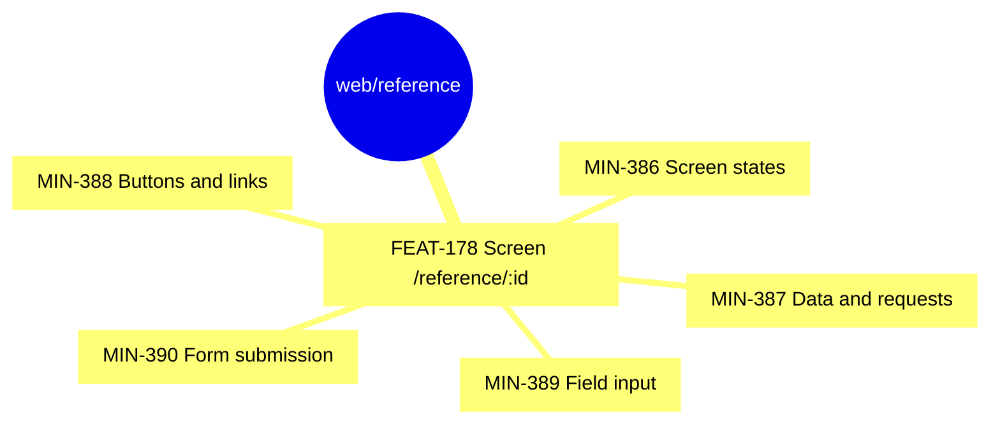
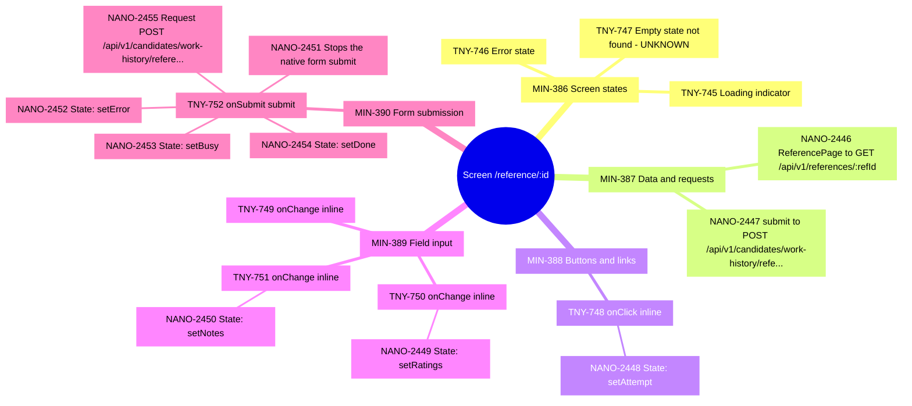

# web/reference (MOD-179)

Generated by `project-mindmap/tools/catalog.py` from `master/MASTER_PROJECT_GRAPH.json` at commit `9b3032f`. Do not edit by hand. Back to the [feature catalog](../FEATURE_CATALOG.md).

**Application:** apps/web (MOD-002). **Purpose:** Routed screens under /reference in apps/web/src/App.tsx.

**Nodes by level:** MODULE 1, MAJOR 1, MINOR 5, TINY 8, NANO 10. **Status:** IMPLEMENTED 24, UNKNOWN 1. **Verification:** PATH_LEVEL 12, UNKNOWN 12, VERIFIED 1.

## Module map (to minor features)

## FEAT-178 Screen /reference/:id

ReferencePage at route /reference/:id (public); 2 buttons, 1 forms, 2 inputs; calls 2 endpoint(s).

| ID        | Level | Parent   | Name                                                                    | Description                                                                                                                                                                            | Status      | Verification | Evidence                                 | Related           |
| --------- | ----- | -------- | ----------------------------------------------------------------------- | -------------------------------------------------------------------------------------------------------------------------------------------------------------------------------------- | ----------- | ------------ | ---------------------------------------- | ----------------- |
| FEAT-178  | MAJOR | MOD-179  | Screen /reference/:id                                                   | ReferencePage at route /reference/:id (public); 2 buttons, 1 forms, 2 inputs; calls 2 endpoint(s).                                                                                     | IMPLEMENTED | VERIFIED     | apps/web/src/App.tsx:65                  | SCR-009, TEST-182 |
| MIN-386   | MINOR | FEAT-178 | Screen states                                                           | Loading, empty and error presentation found in the screen source; not found: Empty state.                                                                                              | IMPLEMENTED | PATH_LEVEL   | apps/web/src/pages/ReferencePage.tsx     |                   |
| TNY-745   | TINY  | MIN-386  | Loading indicator                                                       | Loading indicator rendered by ReferencePage (detected in source).                                                                                                                      | IMPLEMENTED | PATH_LEVEL   | apps/web/src/pages/ReferencePage.tsx     |                   |
| TNY-746   | TINY  | MIN-386  | Error state                                                             | Error state rendered by ReferencePage (detected in source).                                                                                                                            | IMPLEMENTED | PATH_LEVEL   | apps/web/src/pages/ReferencePage.tsx     |                   |
| TNY-747   | TINY  | MIN-386  | Empty state (not found)                                                 | No empty state pattern was detected in apps/web/src/pages/ReferencePage.tsx although the screen calls the API. May be handled by a shared component; confirm before treating as a gap. | UNKNOWN     | UNKNOWN      | apps/web/src/pages/ReferencePage.tsx     |                   |
| MIN-387   | MINOR | FEAT-178 | Data and requests                                                       | API endpoints this screen calls (2).                                                                                                                                                   | IMPLEMENTED | PATH_LEVEL   | apps/web/src/pages/ReferencePage.tsx     |                   |
| NANO-2446 | NANO  | MIN-387  | ReferencePage -> GET /api/v1/references/:refId                          | ReferencePage() at apps/web/src/pages/ReferencePage.tsx:72 sends GET /api/v1/references/:refId.                                                                                        | IMPLEMENTED | UNKNOWN      | apps/web/src/pages/ReferencePage.tsx:72  | API-274           |
| NANO-2447 | NANO  | MIN-387  | submit -> POST /api/v1/candidates/work-history/references/:refId/submit | submit() at apps/web/src/pages/ReferencePage.tsx:108 sends POST /api/v1/candidates/work-history/references/:refId/submit.                                                              | IMPLEMENTED | UNKNOWN      | apps/web/src/pages/ReferencePage.tsx:108 | API-275           |
| MIN-388   | MINOR | FEAT-178 | Buttons and links                                                       | 1 'buttons and links' binding(s) in apps/web/src/pages/ReferencePage.tsx.                                                                                                              | IMPLEMENTED | PATH_LEVEL   | apps/web/src/pages/ReferencePage.tsx:177 |                   |
| TNY-748   | TINY  | MIN-388  | onClick inline                                                          | onClick at apps/web/src/pages/ReferencePage.tsx:177 runs inline: () => setAttempt((n) => n + 1); changes state setAttempt.                                                             | IMPLEMENTED | PATH_LEVEL   | apps/web/src/pages/ReferencePage.tsx:177 | INT-189           |
| NANO-2448 | NANO  | TNY-748  | State: setAttempt                                                       | Updates component state through setAttempt.                                                                                                                                            | IMPLEMENTED | UNKNOWN      | apps/web/src/pages/ReferencePage.tsx:177 |                   |
| MIN-389   | MINOR | FEAT-178 | Field input                                                             | 3 'field input' binding(s) in apps/web/src/pages/ReferencePage.tsx.                                                                                                                    | IMPLEMENTED | PATH_LEVEL   | apps/web/src/pages/ReferencePage.tsx:139 |                   |
| TNY-749   | TINY  | MIN-389  | onChange inline                                                         | onChange at apps/web/src/pages/ReferencePage.tsx:139 runs inline: () => set(option).                                                                                                   | IMPLEMENTED | PATH_LEVEL   | apps/web/src/pages/ReferencePage.tsx:139 | INT-188           |
| TNY-750   | TINY  | MIN-389  | onChange inline                                                         | onChange at apps/web/src/pages/ReferencePage.tsx:240 runs inline: () => setRatings((r) => ({ ...r, [rating.key]: n }; changes state setRatings.                                        | IMPLEMENTED | PATH_LEVEL   | apps/web/src/pages/ReferencePage.tsx:240 | INT-191           |
| NANO-2449 | NANO  | TNY-750  | State: setRatings                                                       | Updates component state through setRatings.                                                                                                                                            | IMPLEMENTED | UNKNOWN      | apps/web/src/pages/ReferencePage.tsx:240 |                   |
| TNY-751   | TINY  | MIN-389  | onChange inline                                                         | onChange at apps/web/src/pages/ReferencePage.tsx:254 runs inline: (e) => setNotes(e.target.value); changes state setNotes.                                                             | IMPLEMENTED | PATH_LEVEL   | apps/web/src/pages/ReferencePage.tsx:254 | INT-192           |
| NANO-2450 | NANO  | TNY-751  | State: setNotes                                                         | Updates component state through setNotes.                                                                                                                                              | IMPLEMENTED | UNKNOWN      | apps/web/src/pages/ReferencePage.tsx:254 |                   |
| MIN-390   | MINOR | FEAT-178 | Form submission                                                         | 1 'form submission' binding(s) in apps/web/src/pages/ReferencePage.tsx.                                                                                                                | IMPLEMENTED | PATH_LEVEL   | apps/web/src/pages/ReferencePage.tsx:210 |                   |
| TNY-752   | TINY  | MIN-390  | onSubmit submit                                                         | onSubmit at apps/web/src/pages/ReferencePage.tsx:210 runs submit; changes state setError, setBusy, setDone; calls POST /api/v1/candidates/work-history/references/:refId/submit.       | IMPLEMENTED | PATH_LEVEL   | apps/web/src/pages/ReferencePage.tsx:210 | INT-190           |
| NANO-2451 | NANO  | TNY-752  | Stops the native form submit                                            | Calls event.preventDefault() so the page does not reload.                                                                                                                              | IMPLEMENTED | UNKNOWN      | apps/web/src/pages/ReferencePage.tsx:92  |                   |
| NANO-2452 | NANO  | TNY-752  | State: setError                                                         | Updates component state through setError.                                                                                                                                              | IMPLEMENTED | UNKNOWN      | apps/web/src/pages/ReferencePage.tsx:92  |                   |
| NANO-2453 | NANO  | TNY-752  | State: setBusy                                                          | Updates component state through setBusy.                                                                                                                                               | IMPLEMENTED | UNKNOWN      | apps/web/src/pages/ReferencePage.tsx:92  |                   |
| NANO-2454 | NANO  | TNY-752  | State: setDone                                                          | Updates component state through setDone.                                                                                                                                               | IMPLEMENTED | UNKNOWN      | apps/web/src/pages/ReferencePage.tsx:92  |                   |
| NANO-2455 | NANO  | TNY-752  | Request POST /api/v1/candidates/work-history/references/:refId/submit   | Sends POST /api/v1/candidates/work-history/references/:refId/submit through apiFetch/apiJson (apps/web/src/lib/api.ts).                                                                | IMPLEMENTED | UNKNOWN      | apps/web/src/pages/ReferencePage.tsx:92  | API-275           |
