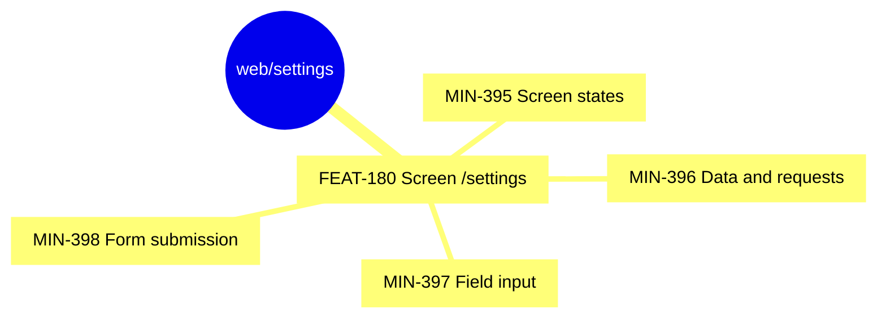
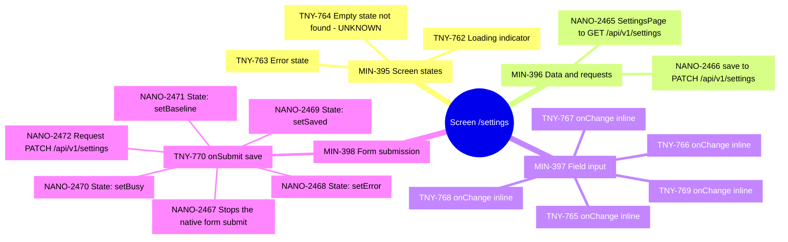

# web/settings (MOD-181)

Generated by `project-mindmap/tools/catalog.py` from `master/MASTER_PROJECT_GRAPH.json` at commit `9b3032f`. Do not edit by hand. Back to the [feature catalog](../FEATURE_CATALOG.md).

**Application:** apps/web (MOD-002). **Purpose:** Routed screens under /settings in apps/web/src/App.tsx.

**Nodes by level:** MODULE 1, MAJOR 1, MINOR 4, TINY 9, NANO 8. **Status:** IMPLEMENTED 22, UNKNOWN 1. **Verification:** PATH_LEVEL 12, UNKNOWN 10, VERIFIED 1.

## Module map (to minor features)

## FEAT-180 Screen /settings

SettingsPage at route /settings (signed-in only); 1 buttons, 1 forms, 1 inputs; calls 2 endpoint(s).

| ID        | Level | Parent   | Name                                 | Description                                                                                                                                                                           | Status      | Verification | Evidence                                | Related           |
| --------- | ----- | -------- | ------------------------------------ | ------------------------------------------------------------------------------------------------------------------------------------------------------------------------------------- | ----------- | ------------ | --------------------------------------- | ----------------- |
| FEAT-180  | MAJOR | MOD-181  | Screen /settings                     | SettingsPage at route /settings (signed-in only); 1 buttons, 1 forms, 1 inputs; calls 2 endpoint(s).                                                                                  | IMPLEMENTED | VERIFIED     | apps/web/src/App.tsx:71                 | SCR-015, TEST-210 |
| MIN-395   | MINOR | FEAT-180 | Screen states                        | Loading, empty and error presentation found in the screen source; not found: Empty state.                                                                                             | IMPLEMENTED | PATH_LEVEL   | apps/web/src/pages/SettingsPage.tsx     |                   |
| TNY-762   | TINY  | MIN-395  | Loading indicator                    | Loading indicator rendered by SettingsPage (detected in source).                                                                                                                      | IMPLEMENTED | PATH_LEVEL   | apps/web/src/pages/SettingsPage.tsx     |                   |
| TNY-763   | TINY  | MIN-395  | Error state                          | Error state rendered by SettingsPage (detected in source).                                                                                                                            | IMPLEMENTED | PATH_LEVEL   | apps/web/src/pages/SettingsPage.tsx     |                   |
| TNY-764   | TINY  | MIN-395  | Empty state (not found)              | No empty state pattern was detected in apps/web/src/pages/SettingsPage.tsx although the screen calls the API. May be handled by a shared component; confirm before treating as a gap. | UNKNOWN     | UNKNOWN      | apps/web/src/pages/SettingsPage.tsx     |                   |
| MIN-396   | MINOR | FEAT-180 | Data and requests                    | API endpoints this screen calls (2).                                                                                                                                                  | IMPLEMENTED | PATH_LEVEL   | apps/web/src/pages/SettingsPage.tsx     |                   |
| NANO-2465 | NANO  | MIN-396  | SettingsPage -> GET /api/v1/settings | SettingsPage() at apps/web/src/pages/SettingsPage.tsx:123 sends GET /api/v1/settings.                                                                                                 | IMPLEMENTED | UNKNOWN      | apps/web/src/pages/SettingsPage.tsx:123 | API-212           |
| NANO-2466 | NANO  | MIN-396  | save -> PATCH /api/v1/settings       | save() at apps/web/src/pages/SettingsPage.tsx:157 sends PATCH /api/v1/settings.                                                                                                       | IMPLEMENTED | UNKNOWN      | apps/web/src/pages/SettingsPage.tsx:157 | API-213           |
| MIN-397   | MINOR | FEAT-180 | Field input                          | 5 'field input' binding(s) in apps/web/src/pages/SettingsPage.tsx.                                                                                                                    | IMPLEMENTED | PATH_LEVEL   | apps/web/src/pages/SettingsPage.tsx:75  |                   |
| TNY-765   | TINY  | MIN-397  | onChange inline                      | onChange at apps/web/src/pages/SettingsPage.tsx:75 runs inline: (e) => onChange(e.target.checked).                                                                                    | IMPLEMENTED | PATH_LEVEL   | apps/web/src/pages/SettingsPage.tsx:75  | INT-199           |
| TNY-766   | TINY  | MIN-397  | onChange inline                      | onChange at apps/web/src/pages/SettingsPage.tsx:210 runs inline: (e) => update('profileVisibility', e.target.value .                                                                  | IMPLEMENTED | PATH_LEVEL   | apps/web/src/pages/SettingsPage.tsx:210 | INT-201           |
| TNY-767   | TINY  | MIN-397  | onChange inline                      | onChange at apps/web/src/pages/SettingsPage.tsx:218 runs inline: (checked) => update('showEmail', checked).                                                                           | IMPLEMENTED | PATH_LEVEL   | apps/web/src/pages/SettingsPage.tsx:218 | INT-202           |
| TNY-768   | TINY  | MIN-397  | onChange inline                      | onChange at apps/web/src/pages/SettingsPage.tsx:224 runs inline: (checked) => update('showActivity', checked).                                                                        | IMPLEMENTED | PATH_LEVEL   | apps/web/src/pages/SettingsPage.tsx:224 | INT-203           |
| TNY-769   | TINY  | MIN-397  | onChange inline                      | onChange at apps/web/src/pages/SettingsPage.tsx:230 runs inline: (checked) => update('allowConnectionRequests', che.                                                                  | IMPLEMENTED | PATH_LEVEL   | apps/web/src/pages/SettingsPage.tsx:230 | INT-204           |
| MIN-398   | MINOR | FEAT-180 | Form submission                      | 1 'form submission' binding(s) in apps/web/src/pages/SettingsPage.tsx.                                                                                                                | IMPLEMENTED | PATH_LEVEL   | apps/web/src/pages/SettingsPage.tsx:204 |                   |
| TNY-770   | TINY  | MIN-398  | onSubmit save                        | onSubmit at apps/web/src/pages/SettingsPage.tsx:204 runs save; changes state setError, setSaved, setBusy, setBaseline; calls PATCH /api/v1/settings.                                  | IMPLEMENTED | PATH_LEVEL   | apps/web/src/pages/SettingsPage.tsx:204 | INT-200           |
| NANO-2467 | NANO  | TNY-770  | Stops the native form submit         | Calls event.preventDefault() so the page does not reload.                                                                                                                             | IMPLEMENTED | UNKNOWN      | apps/web/src/pages/SettingsPage.tsx:142 |                   |
| NANO-2468 | NANO  | TNY-770  | State: setError                      | Updates component state through setError.                                                                                                                                             | IMPLEMENTED | UNKNOWN      | apps/web/src/pages/SettingsPage.tsx:142 |                   |
| NANO-2469 | NANO  | TNY-770  | State: setSaved                      | Updates component state through setSaved.                                                                                                                                             | IMPLEMENTED | UNKNOWN      | apps/web/src/pages/SettingsPage.tsx:142 |                   |
| NANO-2470 | NANO  | TNY-770  | State: setBusy                       | Updates component state through setBusy.                                                                                                                                              | IMPLEMENTED | UNKNOWN      | apps/web/src/pages/SettingsPage.tsx:142 |                   |
| NANO-2471 | NANO  | TNY-770  | State: setBaseline                   | Updates component state through setBaseline.                                                                                                                                          | IMPLEMENTED | UNKNOWN      | apps/web/src/pages/SettingsPage.tsx:142 |                   |
| NANO-2472 | NANO  | TNY-770  | Request PATCH /api/v1/settings       | Sends PATCH /api/v1/settings through apiFetch/apiJson (apps/web/src/lib/api.ts).                                                                                                      | IMPLEMENTED | UNKNOWN      | apps/web/src/pages/SettingsPage.tsx:142 | API-213           |
