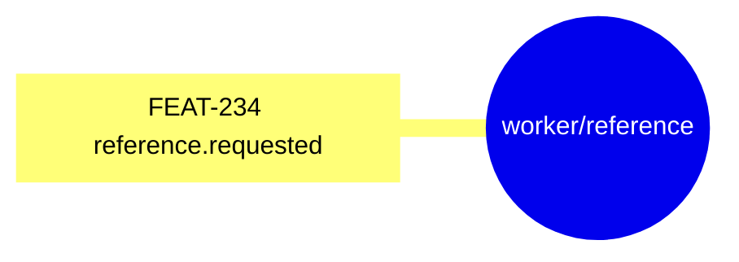
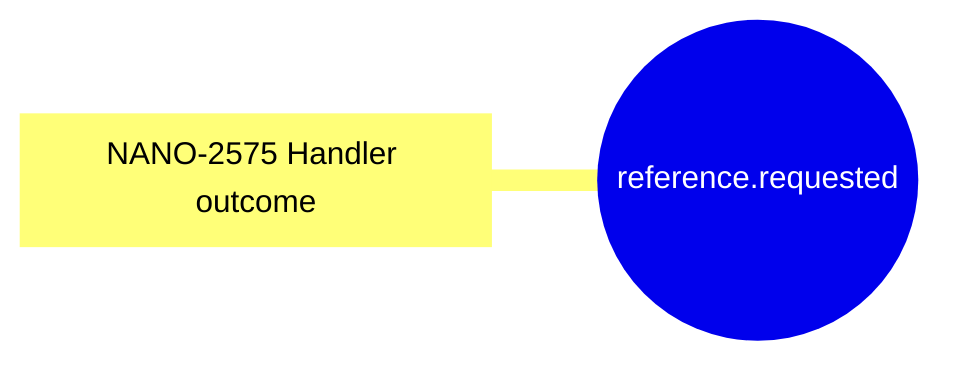

# worker/reference (MOD-203)

Generated by `project-mindmap/tools/catalog.py` from `master/MASTER_PROJECT_GRAPH.json` at commit `9b3032f`. Do not edit by hand. Back to the [feature catalog](../FEATURE_CATALOG.md).

**Application:** apps/worker (MOD-003). **Purpose:** Background job kinds starting with 'reference.' claimed by apps/worker.

**Nodes by level:** MODULE 1, MAJOR 1, NANO 1. **Status:** IMPLEMENTED 3. **Verification:** UNKNOWN 3.

## Module map (to minor features)

## FEAT-234 reference.requested

Handler: email delivery. Enqueued by 0 endpoint(s).

| ID        | Level | Parent   | Name                | Description                                         | Status      | Verification | Evidence                                   | Related |
| --------- | ----- | -------- | ------------------- | --------------------------------------------------- | ----------- | ------------ | ------------------------------------------ | ------- |
| FEAT-234  | MAJOR | MOD-203  | reference.requested | Handler: email delivery. Enqueued by 0 endpoint(s). | IMPLEMENTED | UNKNOWN      | packages/domain/src/background-jobs.ts:171 | SVC-038 |
| NANO-2575 | NANO  | FEAT-234 | Handler outcome     | email delivery.                                     | IMPLEMENTED | UNKNOWN      | packages/domain/src/background-jobs.ts:171 |         |
