# Database Entity Map (Branch 12)

Source: `supabase/migrations/*.sql` (56 files) plus SQL strings in application source. Static scan: columns counted from `CREATE TABLE` bodies and `ADD COLUMN`; constraints, defaults and types are not reproduced here (see the migration at the evidence location).

- Tables: **112** · with RLS enabled: **112** · policies: **159** · indexes: **198** · enums: **6** · functions: **1** · triggers: **0** · views: **1**.
- Tables with **no SQL consumer found in source** (schema only): **76** of 112. This matches ADR-015: only the core career loop is persisted; most other modules run in process memory.
- Tables **without RLS enabled** in any migration: 0.

## 1. Tables

Columns: ID, table, columns, FKs out, FKs in, RLS, policies, indexes, migration, persist kinds (kind:C/U/D via `core-store.ts`; C includes upserts), SQL verbs seen in source, number of endpoints that write it through a persist kind, consuming data-access files, status.

| ID     | Table                           | Cols | FK out | FK in | RLS | Pol | Idx | Mig   | Persist kinds                                             | SQL verbs              | Routes writing | Consumer files                                         | Status              |
| ------ | ------------------------------- | ---- | ------ | ----- | --- | --- | --- | ----- | --------------------------------------------------------- | ---------------------- | -------------- | ------------------------------------------------------ | ------------------- |
| DB-001 | users                           | 8    | 0      | 47    | Y   | 1   | 1   | 00001 | user:C                                                    | READS, WRITES          | 9              | core-store.ts, erasure-store.ts, saved-search-store.ts | IMPLEMENTED/MEDIUM  |
| DB-002 | profiles                        | 10   | 0      | 24    | Y   | 3   | 1   | 00001 | profile:C                                                 | READS, WRITES          | 4              | core-store.ts                                          | IMPLEMENTED/MEDIUM  |
| DB-003 | evidence                        | 16   | 1      | 4     | Y   | 2   | 1   | 00001 | evidence:C, evidenceDelete:D                              | READS, WRITES          | 7              | core-store.ts                                          | IMPLEMENTED/MEDIUM  |
| DB-004 | organizations                   | 7    | 0      | 16    | Y   | 0   | 0   | 00001 | organization:C                                            | READS, WRITES          | 1              | core-store.ts                                          | IMPLEMENTED/MEDIUM  |
| DB-005 | org_memberships                 | 5    | 1      | 0     | Y   | 0   | 1   | 00001 | membership:C                                              | READS, WRITES          | 2              | core-store.ts                                          | IMPLEMENTED/MEDIUM  |
| DB-006 | jobs                            | 14   | 1      | 7     | Y   | 1   | 2   | 00001 | job:C                                                     | READS, WRITES          | 4              | core-store.ts                                          | IMPLEMENTED/MEDIUM  |
| DB-007 | job_applications                | 15   | 2      | 2     | Y   | 2   | 3   | 00001 | application:C                                             | READS, WRITES          | 5              | core-store.ts                                          | IMPLEMENTED/MEDIUM  |
| DB-008 | audit_logs                      | 7    | 0      | 0     | Y   | 0   | 2   | 00001 |                                                           |                        | 0              |                                                        | NOT_IMPLEMENTED/LOW |
| DB-009 | feature_flags                   | 5    | 0      | 0     | Y   | 1   | 0   | 00001 |                                                           | READS, WRITES          | 0              | feature-flag-store.ts                                  | IMPLEMENTED/MEDIUM  |
| DB-010 | skills                          | 7    | 0      | 8     | Y   | 1   | 2   | 00002 | skill:C                                                   | READS, WRITES          | 1              | core-store.ts                                          | IMPLEMENTED/MEDIUM  |
| DB-011 | skill_relationships             | 6    | 1      | 0     | Y   | 1   | 2   | 00002 |                                                           |                        | 0              |                                                        | NOT_IMPLEMENTED/LOW |
| DB-012 | evidence_skills                 | 3    | 2      | 0     | Y   | 2   | 1   | 00002 | evidence:CD                                               | READS, WRITES          | 6              | core-store.ts                                          | IMPLEMENTED/MEDIUM  |
| DB-013 | job_skills                      | 4    | 2      | 0     | Y   | 1   | 1   | 00003 | job:CD                                                    | READS, WRITES          | 4              | core-store.ts                                          | IMPLEMENTED/MEDIUM  |
| DB-014 | application_evidence            | 3    | 2      | 0     | Y   | 1   | 1   | 00003 | application:CD                                            | READS, WRITES          | 5              | core-store.ts                                          | IMPLEMENTED/MEDIUM  |
| DB-015 | challenges                      | 12   | 0      | 2     | Y   | 1   | 2   | 00004 |                                                           |                        | 0              |                                                        | NOT_IMPLEMENTED/LOW |
| DB-016 | assessment_sessions             | 10   | 2      | 1     | Y   | 1   | 2   | 00004 |                                                           |                        | 0              |                                                        | NOT_IMPLEMENTED/LOW |
| DB-017 | challenge_submissions           | 11   | 3      | 0     | Y   | 1   | 1   | 00004 |                                                           |                        | 0              |                                                        | NOT_IMPLEMENTED/LOW |
| DB-018 | xp_transactions                 | 7    | 0      | 0     | Y   | 1   | 1   | 00004 |                                                           |                        | 0              |                                                        | NOT_IMPLEMENTED/LOW |
| DB-019 | courses                         | 12   | 1      | 6     | Y   | 3   | 2   | 00005 |                                                           |                        | 0              |                                                        | NOT_IMPLEMENTED/LOW |
| DB-020 | course_modules                  | 7    | 1      | 1     | Y   | 2   | 1   | 00005 |                                                           |                        | 0              |                                                        | NOT_IMPLEMENTED/LOW |
| DB-021 | lessons                         | 11   | 2      | 2     | Y   | 1   | 2   | 00005 |                                                           |                        | 0              |                                                        | NOT_IMPLEMENTED/LOW |
| DB-022 | course_enrollments              | 8    | 2      | 2     | Y   | 2   | 2   | 00005 |                                                           |                        | 0              |                                                        | NOT_IMPLEMENTED/LOW |
| DB-023 | lesson_progress                 | 5    | 2      | 0     | Y   | 1   | 1   | 00005 |                                                           |                        | 0              |                                                        | NOT_IMPLEMENTED/LOW |
| DB-024 | course_certificates             | 10   | 4      | 1     | Y   | 1   | 2   | 00005 |                                                           |                        | 0              |                                                        | NOT_IMPLEMENTED/LOW |
| DB-025 | course_skills                   | 4    | 2      | 0     | Y   | 1   | 2   | 00005 |                                                           |                        | 0              |                                                        | NOT_IMPLEMENTED/LOW |
| DB-026 | message_threads                 | 5    | 0      | 2     | Y   | 2   | 1   | 00006 | messageThread:C                                           | READS, WRITES          | 2              | core-store.ts                                          | IMPLEMENTED/MEDIUM  |
| DB-027 | thread_participants             | 5    | 2      | 0     | Y   | 3   | 2   | 00006 | messageThread:C, messagesDeleteForProfile:D, threadRead:U | READS, UPDATES, WRITES | 6              | core-store.ts                                          | IMPLEMENTED/MEDIUM  |
| DB-028 | messages                        | 8    | 2      | 0     | Y   | 4   | 3   | 00006 | message:C, messagesDeleteForProfile:D                     | READS, WRITES          | 2              | core-store.ts                                          | IMPLEMENTED/MEDIUM  |
| DB-029 | notifications                   | 10   | 1      | 0     | Y   | 4   | 4   | 00007 | notification:CU, notificationsDeleteForRecipient:D        | READS, UPDATES, WRITES | 8              | core-store.ts                                          | IMPLEMENTED/MEDIUM  |
| DB-030 | notification_preferences        | 9    | 1      | 0     | Y   | 8   | 1   | 00007 | notificationPreferences:C                                 | READS, WRITES          | 1              | core-store.ts                                          | IMPLEMENTED/MEDIUM  |
| DB-031 | ai_conversations                | 6    | 1      | 1     | Y   | 1   | 1   | 00008 |                                                           |                        | 0              |                                                        | NOT_IMPLEMENTED/LOW |
| DB-032 | ai_messages                     | 8    | 1      | 0     | Y   | 1   | 1   | 00008 |                                                           |                        | 0              |                                                        | NOT_IMPLEMENTED/LOW |
| DB-033 | ai_usage_meters                 | 8    | 1      | 0     | Y   | 1   | 1   | 00008 |                                                           |                        | 0              |                                                        | NOT_IMPLEMENTED/LOW |
| DB-034 | resumes                         | 17   | 1      | 3     | Y   | 1   | 1   | 00009 |                                                           |                        | 0              |                                                        | NOT_IMPLEMENTED/LOW |
| DB-035 | resume_exports                  | 9    | 2      | 0     | Y   | 1   | 2   | 00009 |                                                           |                        | 0              |                                                        | NOT_IMPLEMENTED/LOW |
| DB-036 | connections                     | 8    | 1      | 0     | Y   | 4   | 3   | 00010 |                                                           |                        | 0              |                                                        | NOT_IMPLEMENTED/LOW |
| DB-037 | portfolio_projects              | 11   | 1      | 3     | Y   | 2   | 2   | 00011 |                                                           |                        | 0              |                                                        | NOT_IMPLEMENTED/LOW |
| DB-038 | portfolio_project_skills        | 4    | 2      | 0     | Y   | 2   | 2   | 00011 |                                                           |                        | 0              |                                                        | NOT_IMPLEMENTED/LOW |
| DB-039 | portfolio_project_media         | 7    | 1      | 0     | Y   | 2   | 1   | 00011 |                                                           |                        | 0              |                                                        | NOT_IMPLEMENTED/LOW |
| DB-040 | portfolio_project_evidence      | 4    | 2      | 0     | Y   | 2   | 1   | 00011 |                                                           |                        | 0              |                                                        | NOT_IMPLEMENTED/LOW |
| DB-041 | user_gamification_profiles      | 8    | 1      | 0     | Y   | 2   | 0   | 00012 |                                                           |                        | 0              |                                                        | NOT_IMPLEMENTED/LOW |
| DB-042 | gamification_badges             | 9    | 0      | 1     | Y   | 1   | 1   | 00012 |                                                           |                        | 0              |                                                        | NOT_IMPLEMENTED/LOW |
| DB-043 | user_badges                     | 4    | 2      | 0     | Y   | 2   | 2   | 00012 |                                                           |                        | 0              |                                                        | NOT_IMPLEMENTED/LOW |
| DB-044 | user_settings                   | 19   | 1      | 0     | Y   | 2   | 1   | 00013 |                                                           | READS, WRITES          | 0              | account-store.ts                                       | IMPLEMENTED/MEDIUM  |
| DB-045 | data_erasure_requests           | 11   | 1      | 0     | Y   | 3   | 2   | 00013 |                                                           | READS, UPDATES, WRITES | 0              | erasure-store.ts                                       | IMPLEMENTED/MEDIUM  |
| DB-046 | data_export_requests            | 8    | 1      | 0     | Y   | 2   | 1   | 00013 |                                                           | READS, WRITES          | 0              | account-store.ts                                       | IMPLEMENTED/MEDIUM  |
| DB-047 | subscriptions                   | 11   | 1      | 1     | Y   | 1   | 4   | 00014 |                                                           | READS, WRITES          | 0              | billing-store.ts                                       | IMPLEMENTED/MEDIUM  |
| DB-048 | invoices                        | 11   | 2      | 0     | Y   | 1   | 3   | 00014 |                                                           | READS, WRITES          | 0              | billing-store.ts                                       | IMPLEMENTED/MEDIUM  |
| DB-049 | entitlements                    | 8    | 1      | 0     | Y   | 1   | 0   | 00014 |                                                           | READS, WRITES          | 0              | billing-store.ts                                       | IMPLEMENTED/MEDIUM  |
| DB-050 | billing_events                  | 7    | 1      | 0     | Y   | 1   | 3   | 00014 |                                                           | WRITES                 | 0              | billing-store.ts                                       | IMPLEMENTED/MEDIUM  |
| DB-051 | platform_config                 | 5    | 1      | 0     | Y   | 2   | 1   | 00015 |                                                           |                        | 0              |                                                        | NOT_IMPLEMENTED/LOW |
| DB-052 | search_history                  | 6    | 1      | 0     | Y   | 0   | 2   | 00016 |                                                           |                        | 0              |                                                        | NOT_IMPLEMENTED/LOW |
| DB-053 | moderation_reports              | 15   | 1      | 1     | Y   | 0   | 4   | 00017 |                                                           |                        | 0              |                                                        | NOT_IMPLEMENTED/LOW |
| DB-054 | moderation_appeals              | 10   | 2      | 0     | Y   | 0   | 3   | 00017 |                                                           |                        | 0              |                                                        | NOT_IMPLEMENTED/LOW |
| DB-055 | saved_searches                  | 13   | 1      | 1     | Y   | 0   | 2   | 00018 |                                                           | READS, UPDATES, WRITES | 0              | saved-search-store.ts                                  | IMPLEMENTED/MEDIUM  |
| DB-056 | job_alerts                      | 7    | 3      | 0     | Y   | 0   | 2   | 00018 |                                                           |                        | 0              |                                                        | NOT_IMPLEMENTED/LOW |
| DB-057 | saved_jobs                      | 4    | 2      | 0     | Y   | 0   | 1   | 00018 |                                                           | READS, WRITES          | 0              | saved-job-store.ts                                     | IMPLEMENTED/MEDIUM  |
| DB-058 | application_drafts              | 12   | 3      | 1     | Y   | 0   | 2   | 00019 |                                                           | READS, UPDATES, WRITES | 0              | application-draft-store.ts                             | IMPLEMENTED/MEDIUM  |
| DB-059 | application_draft_versions      | 8    | 1      | 0     | Y   | 0   | 1   | 00019 |                                                           | READS, WRITES          | 0              | application-draft-store.ts                             | IMPLEMENTED/MEDIUM  |
| DB-060 | analytics_events                | 8    | 1      | 0     | Y   | 0   | 3   | 00020 |                                                           |                        | 0              |                                                        | NOT_IMPLEMENTED/LOW |
| DB-061 | analytics_daily_kpis            | 6    | 0      | 0     | Y   | 0   | 1   | 00020 |                                                           |                        | 0              |                                                        | NOT_IMPLEMENTED/LOW |
| DB-062 | certificate_revocations         | 5    | 2      | 0     | Y   | 0   | 1   | 00021 |                                                           |                        | 0              |                                                        | NOT_IMPLEMENTED/LOW |
| DB-063 | job_templates                   | 18   | 2      | 0     | Y   | 0   | 2   | 00022 |                                                           |                        | 0              |                                                        | NOT_IMPLEMENTED/LOW |
| DB-064 | salary_reports                  | 21   | 1      | 0     | Y   | 3   | 3   | 00023 |                                                           |                        | 0              |                                                        | NOT_IMPLEMENTED/LOW |
| DB-065 | salary_aggregates               | 17   | 0      | 0     | Y   | 1   | 1   | 00023 |                                                           |                        | 0              |                                                        | NOT_IMPLEMENTED/LOW |
| DB-066 | feedback_templates              | 10   | 0      | 0     | Y   | 0   | 1   | 00024 |                                                           |                        | 0              |                                                        | NOT_IMPLEMENTED/LOW |
| DB-067 | application_feedback            | 19   | 0      | 0     | Y   | 3   | 3   | 00024 |                                                           |                        | 0              |                                                        | NOT_IMPLEMENTED/LOW |
| DB-068 | skill_freshness                 | 11   | 0      | 0     | Y   | 2   | 2   | 00025 |                                                           |                        | 0              |                                                        | NOT_IMPLEMENTED/LOW |
| DB-069 | skill_freshness_history         | 6    | 0      | 0     | Y   | 1   | 1   | 00025 |                                                           |                        | 0              |                                                        | NOT_IMPLEMENTED/LOW |
| DB-070 | interview_questions             | 13   | 2      | 0     | Y   | 2   | 1   | 00026 |                                                           |                        | 0              |                                                        | NOT_IMPLEMENTED/LOW |
| DB-071 | interview_assessments           | 20   | 4      | 2     | Y   | 2   | 3   | 00026 |                                                           |                        | 0              |                                                        | NOT_IMPLEMENTED/LOW |
| DB-072 | interview_scorecards            | 16   | 3      | 1     | Y   | 2   | 1   | 00026 |                                                           |                        | 0              |                                                        | NOT_IMPLEMENTED/LOW |
| DB-073 | interview_ai_feedbacks          | 9    | 1      | 0     | Y   | 0   | 1   | 00026 |                                                           |                        | 0              |                                                        | NOT_IMPLEMENTED/LOW |
| DB-074 | reputation_scores               | 11   | 1      | 0     | Y   | 2   | 2   | 00027 |                                                           |                        | 0              |                                                        | NOT_IMPLEMENTED/LOW |
| DB-075 | reputation_signals              | 14   | 1      | 1     | Y   | 2   | 2   | 00027 |                                                           |                        | 0              |                                                        | NOT_IMPLEMENTED/LOW |
| DB-076 | reputation_history              | 8    | 1      | 0     | Y   | 1   | 1   | 00027 |                                                           |                        | 0              |                                                        | NOT_IMPLEMENTED/LOW |
| DB-077 | reputation_recovery_plans       | 9    | 2      | 0     | Y   | 1   | 1   | 00027 |                                                           |                        | 0              |                                                        | NOT_IMPLEMENTED/LOW |
| DB-078 | warm_introduction_preferences   | 5    | 1      | 0     | Y   | 1   | 0   | 00028 |                                                           |                        | 0              |                                                        | NOT_IMPLEMENTED/LOW |
| DB-079 | warm_introduction_requests      | 12   | 1      | 0     | Y   | 3   | 4   | 00028 |                                                           |                        | 0              |                                                        | NOT_IMPLEMENTED/LOW |
| DB-080 | referral_requests               | 11   | 4      | 1     | Y   | 3   | 4   | 00029 |                                                           |                        | 0              |                                                        | NOT_IMPLEMENTED/LOW |
| DB-081 | referral_outcomes               | 11   | 4      | 0     | Y   | 1   | 4   | 00029 |                                                           |                        | 0              |                                                        | NOT_IMPLEMENTED/LOW |
| DB-082 | activity_events                 | 8    | 1      | 0     | Y   | 1   | 3   | 00030 |                                                           |                        | 0              |                                                        | NOT_IMPLEMENTED/LOW |
| DB-083 | contribution_scores             | 11   | 1      | 0     | Y   | 2   | 1   | 00030 |                                                           |                        | 0              |                                                        | NOT_IMPLEMENTED/LOW |
| DB-084 | instructor_reputation_breakdown | 17   | 1      | 0     | Y   | 2   | 1   | 00031 |                                                           |                        | 0              |                                                        | NOT_IMPLEMENTED/LOW |
| DB-085 | instructor_endorsements         | 6    | 1      | 0     | Y   | 2   | 2   | 00031 |                                                           |                        | 0              |                                                        | NOT_IMPLEMENTED/LOW |
| DB-086 | skill_endorsements              | 8    | 2      | 1     | Y   | 3   | 3   | 00032 |                                                           |                        | 0              |                                                        | NOT_IMPLEMENTED/LOW |
| DB-087 | endorsement_weights             | 10   | 1      | 0     | Y   | 2   | 1   | 00032 |                                                           |                        | 0              |                                                        | NOT_IMPLEMENTED/LOW |
| DB-088 | alumni_affiliations             | 10   | 2      | 0     | Y   | 2   | 3   | 00033 |                                                           |                        | 0              |                                                        | NOT_IMPLEMENTED/LOW |
| DB-089 | alumni_groups                   | 7    | 2      | 1     | Y   | 1   | 1   | 00033 |                                                           |                        | 0              |                                                        | NOT_IMPLEMENTED/LOW |
| DB-090 | alumni_group_members            | 5    | 2      | 0     | Y   | 0   | 1   | 00033 |                                                           |                        | 0              |                                                        | NOT_IMPLEMENTED/LOW |
| DB-091 | alumni_mentorship               | 8    | 2      | 0     | Y   | 1   | 1   | 00033 |                                                           |                        | 0              |                                                        | NOT_IMPLEMENTED/LOW |
| DB-092 | employer_reputation_breakdown   | 10   | 1      | 0     | Y   | 1   | 1   | 00034 |                                                           |                        | 0              |                                                        | NOT_IMPLEMENTED/LOW |
| DB-093 | employer_reviews                | 13   | 2      | 0     | Y   | 2   | 2   | 00034 |                                                           |                        | 0              |                                                        | NOT_IMPLEMENTED/LOW |
| DB-094 | skill_market_signals            | 8    | 1      | 0     | Y   | 1   | 1   | 00035 |                                                           |                        | 0              |                                                        | NOT_IMPLEMENTED/LOW |
| DB-095 | skill_forecasts                 | 15   | 1      | 0     | Y   | 1   | 1   | 00035 |                                                           |                        | 0              |                                                        | NOT_IMPLEMENTED/LOW |
| DB-096 | career_transitions              | 11   | 2      | 0     | Y   | 1   | 2   | 00036 |                                                           |                        | 0              |                                                        | NOT_IMPLEMENTED/LOW |
| DB-097 | progression_benchmarks          | 14   | 0      | 0     | Y   | 1   | 1   | 00036 |                                                           |                        | 0              |                                                        | NOT_IMPLEMENTED/LOW |
| DB-098 | career_milestone_evaluations    | 10   | 1      | 0     | Y   | 1   | 1   | 00036 |                                                           |                        | 0              |                                                        | NOT_IMPLEMENTED/LOW |
| DB-099 | learning_outcomes               | 12   | 2      | 0     | Y   | 1   | 2   | 00037 |                                                           |                        | 0              |                                                        | NOT_IMPLEMENTED/LOW |
| DB-100 | learning_impact_metrics         | 15   | 1      | 0     | Y   | 1   | 1   | 00037 |                                                           |                        | 0              |                                                        | NOT_IMPLEMENTED/LOW |
| DB-101 | talent_pools                    | 9    | 2      | 1     | Y   | 2   | 1   | 00038 |                                                           |                        | 0              |                                                        | NOT_IMPLEMENTED/LOW |
| DB-102 | talent_pool_members             | 14   | 3      | 0     | Y   | 2   | 5   | 00038 |                                                           |                        | 0              |                                                        | NOT_IMPLEMENTED/LOW |
| DB-103 | behavioral_talent_profiles      | 13   | 1      | 0     | Y   | 3   | 3   | 00039 |                                                           |                        | 0              |                                                        | NOT_IMPLEMENTED/LOW |
| DB-104 | candidate_segmentations         | 11   | 1      | 0     | Y   | 3   | 5   | 00040 |                                                           |                        | 0              |                                                        | NOT_IMPLEMENTED/LOW |
| DB-105 | verified_work_histories         | 19   | 2      | 2     | Y   | 3   | 6   | 00041 | workHistory:C, workHistoryDelete:D                        | READS, WRITES          | 5              | core-store.ts                                          | IMPLEMENTED/MEDIUM  |
| DB-106 | employment_references           | 20   | 2      | 0     | Y   | 3   | 5   | 00041 | reference:C, referenceDelete:D                            | READS, WRITES          | 2              | core-store.ts                                          | IMPLEMENTED/MEDIUM  |
| DB-107 | background_jobs                 | 11   | 0      | 0     | Y   | 0   | 3   | 00042 |                                                           | READS, UPDATES, WRITES | 0              | background-jobs.ts                                     | IMPLEMENTED/MEDIUM  |
| DB-108 | work_history_email_challenges   | 6    | 1      | 0     | Y   | 0   | 0   | 00043 | emailChallenge:CU, emailChallengeDelete:D                 | READS, UPDATES, WRITES | 1              | core-store.ts                                          | IMPLEMENTED/MEDIUM  |
| DB-109 | revoked_sessions                | 4    | 1      | 0     | Y   | 0   | 1   | 00046 | sessionRevocation:CD                                      | READS, WRITES          | 1              | core-store.ts                                          | IMPLEMENTED/MEDIUM  |
| DB-110 | worker_health                   | 2    | 0      | 0     | Y   | 0   | 0   | 00049 |                                                           | READS, WRITES          | 0              | index.ts, index.ts                                     | IMPLEMENTED/MEDIUM  |
| DB-111 | admin_audit_logs                | 7    | 0      | 0     | Y   | 0   | 1   | 00050 |                                                           | READS, WRITES          | 0              | admin-audit-store.ts                                   | IMPLEMENTED/MEDIUM  |
| DB-112 | stripe_customers                | 3    | 1      | 0     | Y   | 0   | 0   | 00052 |                                                           | READS, WRITES          | 0              | billing-store.ts                                       | IMPLEMENTED/MEDIUM  |

## 2. Enums, functions, triggers, views

| Enum               | Values                                                                                                                                                        | Migration             |
| ------------------ | ------------------------------------------------------------------------------------------------------------------------------------------------------------- | --------------------- |
| user_role          | candidate, recruiter, hiring_manager, course_author, instructor, institution_admin, platform_admin                                                            | 00001_core_schema.sql |
| profile_privacy    | public, connections_only, recruiters_only, private                                                                                                            | 00001_core_schema.sql |
| application_status | draft, submitted, in_review, shortlisted, interviewing, offered, hired, rejected, withdrawn, expired                                                          | 00001_core_schema.sql |
| evidence_type      | self_declaration, course_completion, assessment, project, work_experience, contribution, employer_verification, institution_credential, external_verification | 00001_core_schema.sql |
| verification_level | unverified, peer_reviewed, institution_verified, authority_verified                                                                                           | 00001_core_schema.sql |
| evidence_status    | pending, verified, disputed, revoked, expired                                                                                                                 | 00001_core_schema.sql |

| Kind     | Name                             | Migration                                 |
| -------- | -------------------------------- | ----------------------------------------- |
| function | is_message_thread_participant    | 00047_private_data_rls_hardening.sql      |
| view     | public_certificate_verifications | 00021_certificate_verification_schema.sql |

## 3. CRUD by consumer (who creates/reads/updates/deletes)

Persist-kind operations (`core-store.ts`):

| Persist kind                    | Table                         | Operations |
| ------------------------------- | ----------------------------- | ---------- |
| application                     | application_evidence          | CD         |
| application                     | job_applications              | C          |
| emailChallenge                  | work_history_email_challenges | CU         |
| emailChallengeDelete            | work_history_email_challenges | D          |
| evidence                        | evidence                      | C          |
| evidence                        | evidence_skills               | CD         |
| evidenceDelete                  | evidence                      | D          |
| job                             | job_skills                    | CD         |
| job                             | jobs                          | C          |
| membership                      | org_memberships               | C          |
| message                         | messages                      | C          |
| messageThread                   | message_threads               | C          |
| messageThread                   | thread_participants           | C          |
| messagesDeleteForProfile        | messages                      | D          |
| messagesDeleteForProfile        | thread_participants           | D          |
| notification                    | notifications                 | CU         |
| notificationPreferences         | notification_preferences      | C          |
| notificationsDeleteForRecipient | notifications                 | D          |
| organization                    | organizations                 | C          |
| profile                         | profiles                      | C          |
| reference                       | employment_references         | C          |
| referenceDelete                 | employment_references         | D          |
| sessionRevocation               | revoked_sessions              | CD         |
| skill                           | skills                        | C          |
| threadRead                      | thread_participants           | U          |
| user                            | users                         | C          |
| workHistory                     | verified_work_histories       | C          |
| workHistoryDelete               | verified_work_histories       | D          |

Other consumers are the per-store files listed in the table above (`READS`/`WRITES`/`UPDATES` edges in the graph).

## 4. Foreign-key relationships (145 distinct)

```mermaid
erDiagram
  users ||--o{ activity_events : references
  users ||--o{ ai_conversations : references
  ai_conversations ||--o{ ai_messages : references
  users ||--o{ ai_usage_meters : references
  organizations ||--o{ alumni_affiliations : references
  users ||--o{ alumni_affiliations : references
  alumni_groups ||--o{ alumni_group_members : references
  users ||--o{ alumni_group_members : references
  organizations ||--o{ alumni_groups : references
  users ||--o{ alumni_groups : references
  organizations ||--o{ alumni_mentorship : references
  users ||--o{ alumni_mentorship : references
  users ||--o{ analytics_events : references
  application_drafts ||--o{ application_draft_versions : references
  jobs ||--o{ application_drafts : references
  profiles ||--o{ application_drafts : references
  resumes ||--o{ application_drafts : references
  evidence ||--o{ application_evidence : references
  job_applications ||--o{ application_evidence : references
  challenges ||--o{ assessment_sessions : references
  profiles ||--o{ assessment_sessions : references
  profiles ||--o{ behavioral_talent_profiles : references
  users ||--o{ billing_events : references
  profiles ||--o{ candidate_segmentations : references
  profiles ||--o{ career_milestone_evaluations : references
  organizations ||--o{ career_transitions : references
  profiles ||--o{ career_transitions : references
  course_certificates ||--o{ certificate_revocations : references
  users ||--o{ certificate_revocations : references
  assessment_sessions ||--o{ challenge_submissions : references
  challenges ||--o{ challenge_submissions : references
  profiles ||--o{ challenge_submissions : references
  users ||--o{ connections : references
  users ||--o{ contribution_scores : references
  course_enrollments ||--o{ course_certificates : references
  courses ||--o{ course_certificates : references
  evidence ||--o{ course_certificates : references
  profiles ||--o{ course_certificates : references
  courses ||--o{ course_enrollments : references
  profiles ||--o{ course_enrollments : references
  courses ||--o{ course_modules : references
  courses ||--o{ course_skills : references
  skills ||--o{ course_skills : references
  profiles ||--o{ courses : references
  users ||--o{ data_erasure_requests : references
  users ||--o{ data_export_requests : references
  organizations ||--o{ employer_reputation_breakdown : references
  organizations ||--o{ employer_reviews : references
  users ||--o{ employer_reviews : references
  profiles ||--o{ employment_references : references
  verified_work_histories ||--o{ employment_references : references
  skill_endorsements ||--o{ endorsement_weights : references
  users ||--o{ entitlements : references
  profiles ||--o{ evidence : references
  evidence ||--o{ evidence_skills : references
  skills ||--o{ evidence_skills : references
  users ||--o{ instructor_endorsements : references
  users ||--o{ instructor_reputation_breakdown : references
  interview_assessments ||--o{ interview_ai_feedbacks : references
  job_applications ||--o{ interview_assessments : references
  organizations ||--o{ interview_assessments : references
  profiles ||--o{ interview_assessments : references
  users ||--o{ interview_assessments : references
  organizations ||--o{ interview_questions : references
  users ||--o{ interview_questions : references
  interview_assessments ||--o{ interview_scorecards : references
  users ||--o{ interview_scorecards : references
  subscriptions ||--o{ invoices : references
  users ||--o{ invoices : references
  jobs ||--o{ job_alerts : references
  saved_searches ||--o{ job_alerts : references
  users ||--o{ job_alerts : references
  jobs ||--o{ job_applications : references
  profiles ||--o{ job_applications : references
  jobs ||--o{ job_skills : references
  skills ||--o{ job_skills : references
  organizations ||--o{ job_templates : references
  users ||--o{ job_templates : references
  organizations ||--o{ jobs : references
  courses ||--o{ learning_impact_metrics : references
  courses ||--o{ learning_outcomes : references
  profiles ||--o{ learning_outcomes : references
  course_enrollments ||--o{ lesson_progress : references
  lessons ||--o{ lesson_progress : references
  course_modules ||--o{ lessons : references
  message_threads ||--o{ messages : references
  profiles ||--o{ messages : references
  moderation_reports ||--o{ moderation_appeals : references
  profiles ||--o{ moderation_appeals : references
  profiles ||--o{ moderation_reports : references
  profiles ||--o{ notification_preferences : references
  profiles ||--o{ notifications : references
  organizations ||--o{ org_memberships : references
  users ||--o{ platform_config : references
  evidence ||--o{ portfolio_project_evidence : references
  portfolio_projects ||--o{ portfolio_project_evidence : references
  portfolio_projects ||--o{ portfolio_project_media : references
  portfolio_projects ||--o{ portfolio_project_skills : references
  skills ||--o{ portfolio_project_skills : references
  users ||--o{ portfolio_projects : references
  jobs ||--o{ referral_outcomes : references
  organizations ||--o{ referral_outcomes : references
  referral_requests ||--o{ referral_outcomes : references
  users ||--o{ referral_outcomes : references
  jobs ||--o{ referral_requests : references
  organizations ||--o{ referral_requests : references
  resumes ||--o{ referral_requests : references
  users ||--o{ referral_requests : references
  users ||--o{ reputation_history : references
  reputation_signals ||--o{ reputation_recovery_plans : references
  users ||--o{ reputation_recovery_plans : references
  users ||--o{ reputation_scores : references
  users ||--o{ reputation_signals : references
  resumes ||--o{ resume_exports : references
  users ||--o{ resume_exports : references
  users ||--o{ resumes : references
  users ||--o{ revoked_sessions : references
  users ||--o{ salary_reports : references
  jobs ||--o{ saved_jobs : references
  users ||--o{ saved_jobs : references
  users ||--o{ saved_searches : references
  users ||--o{ search_history : references
  skills ||--o{ skill_endorsements : references
  users ||--o{ skill_endorsements : references
  skills ||--o{ skill_forecasts : references
  skills ||--o{ skill_market_signals : references
  skills ||--o{ skill_relationships : references
  users ||--o{ stripe_customers : references
  users ||--o{ subscriptions : references
  organizations ||--o{ talent_pool_members : references
  profiles ||--o{ talent_pool_members : references
  talent_pools ||--o{ talent_pool_members : references
  organizations ||--o{ talent_pools : references
  profiles ||--o{ talent_pools : references
  message_threads ||--o{ thread_participants : references
  profiles ||--o{ thread_participants : references
  gamification_badges ||--o{ user_badges : references
  users ||--o{ user_badges : references
  users ||--o{ user_gamification_profiles : references
  users ||--o{ user_settings : references
  organizations ||--o{ verified_work_histories : references
  profiles ||--o{ verified_work_histories : references
  users ||--o{ warm_introduction_preferences : references
  users ||--o{ warm_introduction_requests : references
  verified_work_histories ||--o{ work_history_email_challenges : references
```

## 5. Schema-only tables (no SQL consumer found)

`audit_logs`, `skill_relationships`, `challenges`, `assessment_sessions`, `challenge_submissions`, `xp_transactions`, `courses`, `course_modules`, `lessons`, `course_enrollments`, `lesson_progress`, `course_certificates`, `course_skills`, `ai_conversations`, `ai_messages`, `ai_usage_meters`, `resumes`, `resume_exports`, `connections`, `portfolio_projects`, `portfolio_project_skills`, `portfolio_project_media`, `portfolio_project_evidence`, `user_gamification_profiles`, `gamification_badges`, `user_badges`, `platform_config`, `search_history`, `moderation_reports`, `moderation_appeals`, `job_alerts`, `analytics_events`, `analytics_daily_kpis`, `certificate_revocations`, `job_templates`, `salary_reports`, `salary_aggregates`, `feedback_templates`, `application_feedback`, `skill_freshness`, `skill_freshness_history`, `interview_questions`, `interview_assessments`, `interview_scorecards`, `interview_ai_feedbacks`, `reputation_scores`, `reputation_signals`, `reputation_history`, `reputation_recovery_plans`, `warm_introduction_preferences`, `warm_introduction_requests`, `referral_requests`, `referral_outcomes`, `activity_events`, `contribution_scores`, `instructor_reputation_breakdown`, `instructor_endorsements`, `skill_endorsements`, `endorsement_weights`, `alumni_affiliations`, `alumni_groups`, `alumni_group_members`, `alumni_mentorship`, `employer_reputation_breakdown`, `employer_reviews`, `skill_market_signals`, `skill_forecasts`, `career_transitions`, `progression_benchmarks`, `career_milestone_evaluations`, `learning_outcomes`, `learning_impact_metrics`, `talent_pools`, `talent_pool_members`, `behavioral_talent_profiles`, `candidate_segmentations`

## 6. Tables without RLS

none

Retention, ownership and access-permission rules per entity are encoded in RLS policies and handler checks; they are not extractable as a separate attribute without reading each policy, so they are **not** summarised here (unknown, not assumed).
