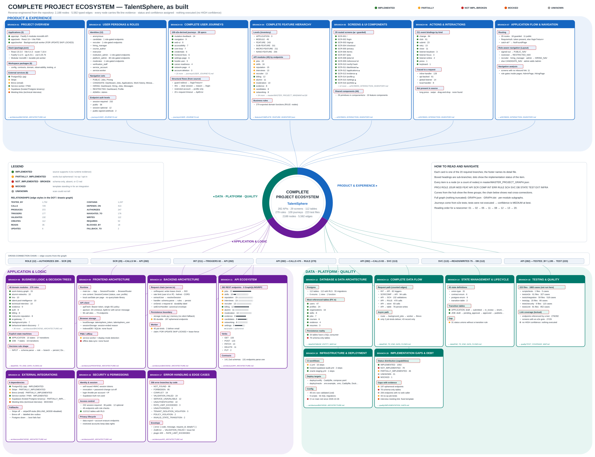
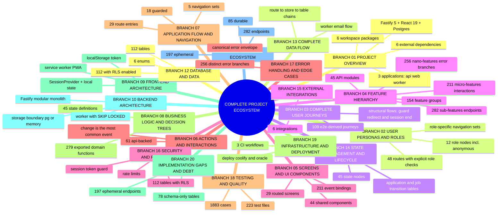
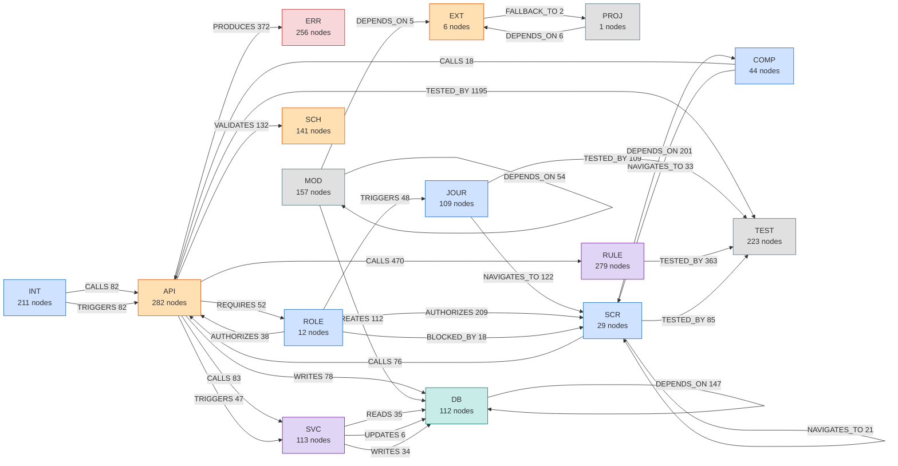

# Master Project Mind Map — COMPLETE PROJECT ECOSYSTEM

_The poster above is generated from the same graph (`tools/poster.py`): 20 branch cards in three zones, a central hub, status dots and a cross-connection chain. Open `MASTER_PROJECT_MINDMAP.svg` full-size in a browser, or edit `MASTER_PROJECT_MINDMAP.drawio` in diagrams.net. A 4400 px PNG copy is `MASTER_PROJECT_MINDMAP.png`._

> Generated from the repository by read-only static analysis. Every node below has a stable ID, evidence (file, line, symbol), an implementation status and a confidence. Nothing here was executed: see [README](../README.md) "Limits".

## 1. How to read this map

- The **mind map** (section 2) shows the 20 required branches with counts computed from the graph.
- The **interconnected graph** is `MASTER_PROJECT_GRAPH.json` (all 2,188 nodes and 5,582 typed edges, nothing truncated) and `MASTER_PROJECT_GRAPH.dot` (the same graph for Graphviz). Section 3 summarises it by node type; per-module subgraphs are in [MODULE_GRAPHS](../architecture/MODULE_GRAPHS.md).
- IDs are stable across every artifact. The prefix says what the node is.

| Prefix | Meaning                                                    | Count |
| ------ | ---------------------------------------------------------- | ----- |
| PROJ-  | Project                                                    | 1     |
| ROLE-  | Role / identity                                            | 12    |
| JOUR-  | User journey (derived from an e2e test)                    | 109   |
| MOD-   | Module (application, API module, domain module, migration) | 157   |
| FEAT-  | Feature group (API resource group)                         | 154   |
| API-   | API endpoint (sub-feature)                                 | 282   |
| SCR-   | Screen (routed page)                                       | 29    |
| COMP-  | Shared UI component                                        | 44    |
| INT-   | Interaction (UI event binding, micro-feature)              | 211   |
| ERR-   | Error branch (nano-feature, observable system response)    | 256   |
| RULE-  | Business rule: exported domain function                    | 279   |
| SCH-   | Contract schema (Zod)                                      | 141   |
| SVC-   | Service or data-access file, background job kind           | 113   |
| DB-    | Database table                                             | 112   |
| STATE- | State definition or transition table                       | 45    |
| TEST-  | Test file                                                  | 223   |
| EXT-   | External integration                                       | 6     |
| INFRA- | CI workflow, deploy target, script                         | 14    |

Not used (no evidence found, so no nodes exist): `ACT-`, `DATA-`, `NANO-`, `SUB-`, `MIC-` as separate prefixes. Their levels are carried by `INT-` (micro), `ERR-` (nano) and `API-` (sub-feature); see [feature inventory](../features/COMPLETE_FEATURE_INVENTORY.json) `level`.

## 2. Mind map (20 branches)

| Branch                               | Detail artifact                                                                         |
| ------------------------------------ | --------------------------------------------------------------------------------------- |
| 01 PROJECT OVERVIEW                  | [architecture/BACKEND_ARCHITECTURE.md](../architecture/BACKEND_ARCHITECTURE.md)         |
| 02 USER PERSONAS AND ROLES           | [journeys/USER_JOURNEYS.md](../journeys/USER_JOURNEYS.md)                               |
| 03 COMPLETE USER JOURNEYS            | [journeys/USER_JOURNEYS.md](../journeys/USER_JOURNEYS.md)                               |
| 04 FEATURE HIERARCHY                 | [features/COMPLETE_FEATURE_INVENTORY.json](../features/COMPLETE_FEATURE_INVENTORY.json) |
| 05 SCREENS AND UI COMPONENTS         | [ui/SCREEN_INTERACTION_INVENTORY.md](../ui/SCREEN_INTERACTION_INVENTORY.md)             |
| 06 ACTIONS AND INTERACTIONS          | [ui/SCREEN_INTERACTION_INVENTORY.md](../ui/SCREEN_INTERACTION_INVENTORY.md)             |
| 07 APPLICATION FLOW AND NAVIGATION   | [ui/SCREEN_INTERACTION_INVENTORY.md](../ui/SCREEN_INTERACTION_INVENTORY.md)             |
| 08 BUSINESS LOGIC AND DECISION TREES | [quality/TEST_COVERAGE_MAP.md](../quality/TEST_COVERAGE_MAP.md)                         |
| 09 FRONTEND ARCHITECTURE             | [architecture/FRONTEND_ARCHITECTURE.md](../architecture/FRONTEND_ARCHITECTURE.md)       |
| 10 BACKEND ARCHITECTURE              | [architecture/BACKEND_ARCHITECTURE.md](../architecture/BACKEND_ARCHITECTURE.md)         |
| 11 API ECOSYSTEM                     | [architecture/API_ARCHITECTURE.md](../architecture/API_ARCHITECTURE.md)                 |
| 12 DATABASE AND DATA                 | [data/DATABASE_ENTITY_MAP.md](../data/DATABASE_ENTITY_MAP.md)                           |
| 13 COMPLETE DATA FLOW                | [data/END_TO_END_DATA_FLOWS.md](../data/END_TO_END_DATA_FLOWS.md)                       |
| 14 STATE MANAGEMENT AND LIFECYCLE    | [data/END_TO_END_DATA_FLOWS.md](../data/END_TO_END_DATA_FLOWS.md)                       |
| 15 EXTERNAL INTEGRATIONS             | [architecture/SYSTEM_DEPENDENCY_GRAPH.md](../architecture/SYSTEM_DEPENDENCY_GRAPH.md)   |
| 16 SECURITY AND PERMISSIONS          | [architecture/API_ARCHITECTURE.md](../architecture/API_ARCHITECTURE.md)                 |
| 17 ERROR HANDLING AND EDGE CASES     | [architecture/API_ARCHITECTURE.md](../architecture/API_ARCHITECTURE.md)                 |
| 18 TESTING AND QUALITY               | [quality/TEST_COVERAGE_MAP.md](../quality/TEST_COVERAGE_MAP.md)                         |
| 19 INFRASTRUCTURE AND DEPLOYMENT     | [architecture/BACKEND_ARCHITECTURE.md](../architecture/BACKEND_ARCHITECTURE.md)         |
| 20 IMPLEMENTATION GAPS AND DEBT      | [quality/IMPLEMENTATION_GAPS.md](../quality/IMPLEMENTATION_GAPS.md)                     |

## 3. Cross-connection graph by node type

Edge counts are computed from the graph. `CONTAINS` is omitted here (it is the hierarchy); low-count `DEPENDS_ON` and `AUTHORIZES` edges are folded into the JSON.

### Edge inventory (all relationship types)

| Relationship | Edges | Meaning in this repository                                                            |
| ------------ | ----- | ------------------------------------------------------------------------------------- |
| TESTED_BY    | 1752  | test source references the item                                                       |
| CONTAINS     | 1247  | hierarchy                                                                             |
| CALLS        | 729   | screen/interaction calls an API; route calls a rule or store                          |
| DEPENDS_ON   | 413   | package, FK or component dependency                                                   |
| PRODUCES     | 372   | endpoint throws a DomainError                                                         |
| AUTHORIZES   | 247   | identity may reach a screen or endpoint                                               |
| TRIGGERS     | 177   | interaction fires a request; route dispatches a background job; role starts a journey |
| NAVIGATES_TO | 176   | link, navigate() or nav set                                                           |
| VALIDATES    | 132   | route parses with a contract schema                                                   |
| WRITES       | 112   | SQL INSERT/DELETE, or route to table through a persist kind                           |
| CREATES      | 112   | migration creates table                                                               |
| REQUIRES     | 52    | endpoint checks a role                                                                |
| READS        | 35    | SQL SELECT/JOIN                                                                       |
| BLOCKED_BY   | 18    | anonymous visitor redirected by RequireAuth                                           |
| UPDATES      | 6     | SQL UPDATE                                                                            |
| FALLBACK_TO  | 2     | integration degrades when not configured                                              |

Relationship types requested but with **zero** edges because no evidence exists: `CONSUMES`, `TRANSFORMS` (data transformation is inside handler bodies, not separately addressable).

## 4. Implementation status distribution (capability nodes only: API, SCR, INT, COMP, RULE, DB, EXT, JOUR, SVC, INFRA)

| Node type | IMPLEMENTED | PARTIALLY_IMPLEMENTED | NOT_IMPLEMENTED | BROKEN | MOCKED | UNREACHABLE | DEPRECATED | UNKNOWN |
| --------- | ----------- | --------------------- | --------------- | ------ | ------ | ----------- | ---------- | ------- |
| API       | 273         | 0                     | 0               | 0      | 0      | 0           | 0          | 9       |
| SCR       | 29          | 0                     | 0               | 0      | 0      | 0           | 0          | 0       |
| INT       | 211         | 0                     | 0               | 0      | 0      | 0           | 0          | 0       |
| COMP      | 42          | 0                     | 0               | 0      | 0      | 0           | 0          | 2       |
| RULE      | 269         | 0                     | 0               | 0      | 0      | 0           | 0          | 10      |
| DB        | 34          | 0                     | 78              | 0      | 0      | 0           | 0          | 0       |
| EXT       | 2           | 3                     | 0               | 0      | 1      | 0           | 0          | 0       |
| JOUR      | 109         | 0                     | 0               | 0      | 0      | 0           | 0          | 0       |
| SVC       | 70          | 43                    | 0               | 0      | 0      | 0           | 0          | 0       |
| INFRA     | 14          | 0                     | 0               | 0      | 0      | 0           | 0          | 0       |

Totals: IMPLEMENTED 1053, NOT_IMPLEMENTED 78, PARTIALLY_IMPLEMENTED 46, UNKNOWN 21, MOCKED 1. MOD and FEAT roll up their children; ERR/TEST/SCH/STATE/ROLE nodes carry no status because "implemented" is not meaningful for them.

`HIGH` confidence is assigned to **nothing**: no test or runtime was executed (dependencies are not installed and installing would write protected files). `MEDIUM` = supported by source. `LOW` = inferred.

## 5. Legend

| Colour        | Meaning                                |     | Edge style   | Meaning                           |
| ------------- | -------------------------------------- | --- | ------------ | --------------------------------- |
| Blue          | users, journeys, screens, interactions |     | solid grey   | CONTAINS                          |
| Green border  | IMPLEMENTED                            |     | solid orange | CALLS                             |
| Yellow border | PARTIALLY_IMPLEMENTED                  |     | bold teal    | WRITES / UPDATES                  |
| Red border    | NOT_IMPLEMENTED / BROKEN / UNREACHABLE |     | dotted teal  | READS / CREATES                   |
| Purple        | backend logic, services, state         |     | solid blue   | NAVIGATES_TO                      |
| Orange        | APIs and external integrations         |     | dashed       | DEPENDS_ON / VALIDATES / REQUIRES |
| Teal          | data and database                      |     | dotted       | TESTED_BY / PRODUCES / AUTHORIZES |
| Grey          | infrastructure, tests                  |     | bold red     | BLOCKED_BY                        |

## 6. Modules at a glance

| API module    | Endpoints | Durable | Ephemeral | Auth: public/optional/required | Tested (path-level) | Web-called | ID      |
| ------------- | --------- | ------- | --------- | ------------------------------ | ------------------- | ---------- | ------- |
| jobs          | 22        | 15      | 7         | 1/1/20                         | 22                  | 6          | MOD-060 |
| skills        | 16        | 2       | 14        | 5/0/11                         | 16                  | 4          | MOD-058 |
| reputation    | 15        | 0       | 15        | 2/1/12                         | 15                  | 0          | MOD-067 |
| interviews    | 13        | 0       | 13        | 0/0/13                         | 13                  | 0          | MOD-066 |
| recruiter     | 13        | 0       | 13        | 0/0/13                         | 13                  | 0          | MOD-084 |
| billing       | 12        | 12      | 0         | 4/0/8                          | 10                  | 4          | MOD-090 |
| alumni        | 11        | 0       | 11        | 0/0/11                         | 11                  | 0          | MOD-085 |
| moderation    | 10        | 0       | 10        | 1/0/9                          | 10                  | 0          | MOD-093 |
| evidence      | 8         | 8       | 0         | 1/2/5                          | 8                   | 2          | MOD-057 |
| candidates    | 8         | 7       | 1         | 2/0/6                          | 8                   | 6          | MOD-065 |
| networking    | 8         | 0       | 8         | 0/0/8                          | 8                   | 0          | MOD-080 |
| settings      | 8         | 6       | 2         | 0/0/8                          | 8                   | 4          | MOD-089 |
| admin         | 8         | 3       | 5         | 0/0/8                          | 8                   | 5          | MOD-091 |
| organizations | 7         | 5       | 2         | 1/0/6                          | 6                   | 3          | MOD-059 |
| applications  | 7         | 3       | 4         | 0/0/7                          | 7                   | 2          | MOD-063 |
| courses       | 7         | 0       | 7         | 1/1/5                          | 7                   | 4          | MOD-071 |
| resumes       | 7         | 0       | 7         | 0/0/7                          | 7                   | 2          | MOD-078 |
| auth          | 6         | 6       | 0         | 2/0/4                          | 6                   | 6          | MOD-055 |
| job-templates | 6         | 0       | 6         | 0/0/6                          | 6                   | 0          | MOD-061 |
| ai            | 6         | 0       | 6         | 0/0/6                          | 6                   | 1          | MOD-069 |
| connections   | 6         | 0       | 6         | 0/0/6                          | 6                   | 3          | MOD-079 |
| referrals     | 6         | 0       | 6         | 0/0/6                          | 6                   | 0          | MOD-081 |
| career        | 6         | 0       | 6         | 3/0/3                          | 6                   | 3          | MOD-082 |
| portfolio     | 6         | 0       | 6         | 0/2/4                          | 6                   | 2          | MOD-087 |
| salaries      | 5         | 0       | 5         | 2/0/3                          | 5                   | 0          | MOD-062 |
| challenges    | 5         | 0       | 5         | 2/0/3                          | 5                   | 3          | MOD-068 |
| threads       | 5         | 5       | 0         | 0/0/5                          | 5                   | 4          | MOD-076 |
| notifications | 5         | 5       | 0         | 0/0/5                          | 5                   | 3          | MOD-077 |
| activity      | 5         | 0       | 5         | 0/0/5                          | 5                   | 0          | MOD-086 |
| gamification  | 5         | 0       | 5         | 0/0/5                          | 5                   | 0          | MOD-088 |
| search        | 5         | 0       | 5         | 0/3/2                          | 5                   | 1          | MOD-092 |
| certificates  | 4         | 0       | 4         | 2/0/2                          | 4                   | 1          | MOD-074 |
| learning      | 4         | 0       | 4         | 2/0/2                          | 4                   | 0          | MOD-083 |
| profile       | 3         | 3       | 0         | 0/1/2                          | 3                   | 1          | MOD-056 |
| analytics     | 3         | 0       | 3         | 0/1/2                          | 3                   | 0          | MOD-094 |
| health        | 2         | 2       | 0         | 2/0/0                          | 2                   | 0          | MOD-052 |
| ready         | 1         | 1       | 0         | 1/0/0                          | 1                   | 0          | MOD-053 |
| feature-flags | 1         | 1       | 0         | 0/0/1                          | 1                   | 0          | MOD-054 |
| feedback      | 1         | 0       | 1         | 1/0/0                          | 1                   | 0          | MOD-064 |
| xp            | 1         | 0       | 1         | 0/0/1                          | 1                   | 0          | MOD-070 |
| modules       | 1         | 0       | 1         | 0/0/1                          | 1                   | 0          | MOD-072 |
| lessons       | 1         | 0       | 1         | 0/0/1                          | 1                   | 1          | MOD-073 |
| verify        | 1         | 0       | 1         | 1/0/0                          | 1                   | 1          | MOD-075 |
| references    | 1         | 1       | 0         | 1/0/0                          | 1                   | 1          | MOD-095 |
| internal      | 1         | 0       | 1         | 1/0/0                          | 1                   | 0          | MOD-096 |
